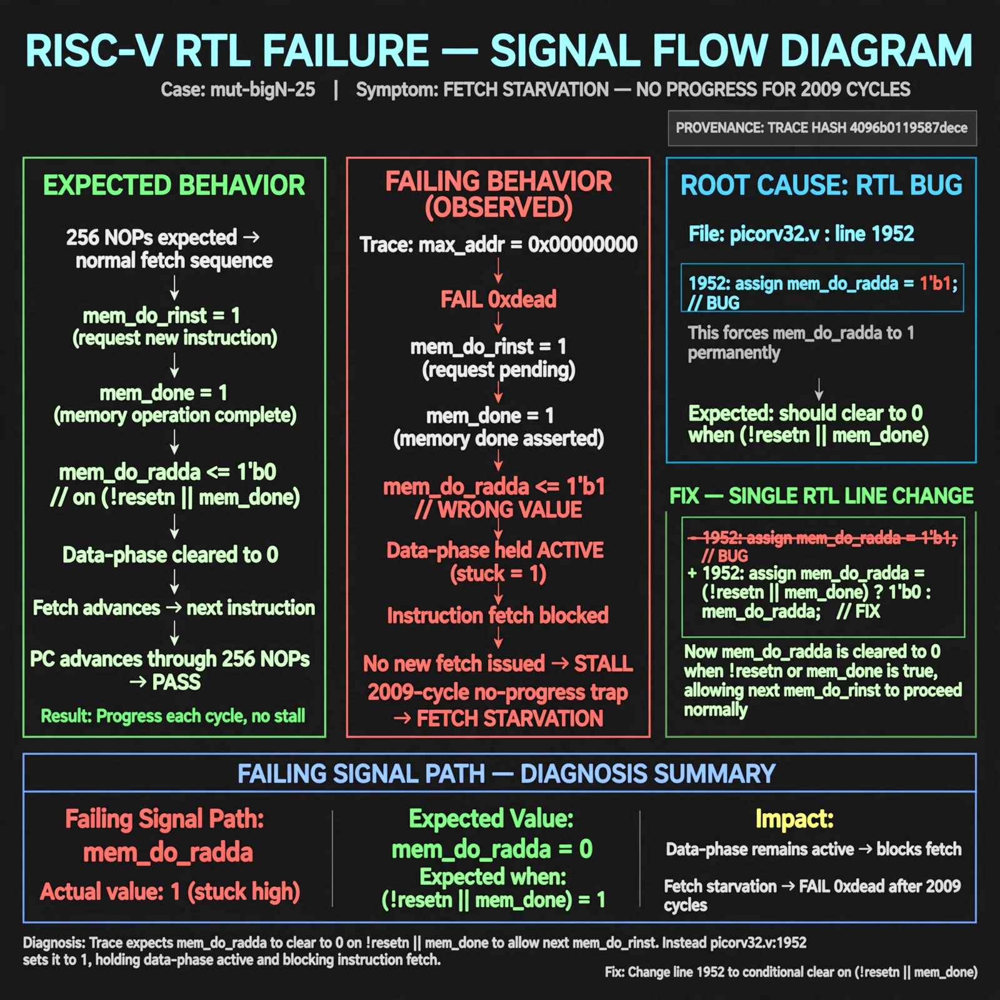

# Afterglow run report: mutbigN-v3-25

case `mut-bigN-25` | status **GREEN** | mode `live` | seed `42`

wall start `2026-10-27T11:47:40Z` | wall end `2026-10-27T11:48:54Z` | time-to-green `74.6s`

retries `0` | human_touches `0` | diagnosed `True` | fixed_unaided `True` | patch_source `model-verbatim`

## Verdicts (from sim, not typed)

- BEFORE: tohost=FAIL 0xdead checksum=563b7c10626ff25de2b3c430956c7c113e448c4efaea068f9b83a198d4322b15 cycles=2009 seed=42 pass=False
- AFTER: tohost=PASS checksum=5c28238265cb94168311e9914f0df355642c557d04dba11845d557ac8a64aa4a cycles=2009 seed=42 pass=True

## Diagnosis (verbatim from api/text_response.json)

```
Trace shows fetch starvation with max_addr=0x00000000 and FAIL 0xdead instead of advancing through 256 NOPs. Expected mem_do_rdata to clear to 0 on !resetn||mem_done to allow next mem_do_rinst, but picorv32.v:1952 sets it to 1. This holds data-phase active and blocks instruction fetch, causing the 2009-cycle no-progress trap.
```

expected re-sim signal: tohost PASS with max_addr != 0x00000000 and no TRAP: no progress

## Patch (2 lines, guard-checked)

```diff
diff --git a/picorv32.v b/picorv32.v
--- a/picorv32.v
+++ b/picorv32.v
@@ -1949,6 +1949,6 @@
 		if (!resetn || mem_done) begin
 			mem_do_prefetch <= 0;
 			mem_do_rinst <= 0;
-			mem_do_rdata <= 1;
+			mem_do_rdata <= 0;
 			mem_do_wdata <= 0;
 		end

```

## Provenance (judge checks)

- prompt file `v3` sha256 `ad529368accaf171e6121a54b2d27547230920a900c7c4e5094d3fff13ca4233`
- input_trace.txt sha256 `4096b0119587decebb02605cbea838c382ef516eecf346055af3d403112faa8f` (9 lines, 69 tokens)
- prompt tokens `711` (cap 2500)
- text model `muse-spark-1.3-contributor` latency `29178ms` request `chatcmpl-01a17d30-7231-7321-be01-64b7f5a91bb6`
- image model `muse-image-1.0` latency `44792ms` request `3ca632dc-e270-4a5b-bfed-f8cad5a1b7f2` status `ok`
- image prompt sha256 `dd38a21a9a3c2621f4dd4d2266ca2250fd82c4165f8c626fa585b41869ecfbda`, trace sha `4096b0119587decebb02605cbea838c382ef516eecf346055af3d403112faa8f` (see api/image_request.json)

## Explanation diagram



## Bundle completeness

- present (12): artifacts/input_trace.txt, artifacts/boot.log, artifacts/boot_after.log, artifacts/verdict_before.json, artifacts/verdict_after.json, api/text_request.json, api/text_response.json, api/image_request.json, api/image_response.json, explain.png, patch.diff, meta.json
- missing (0): none

