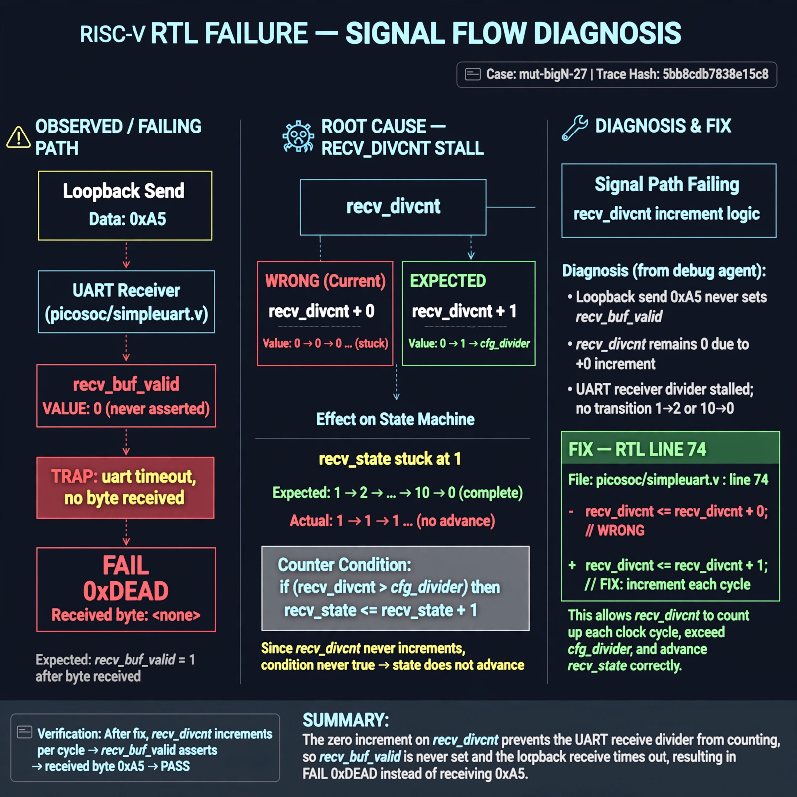

# Afterglow run report: mutbigN-v3-27

case `mut-bigN-27` | status **GREEN** | mode `live` | seed `42`

wall start `2026-10-27T11:50:20Z` | wall end `2026-10-27T11:50:49Z` | time-to-green `29.3s`

retries `0` | human_touches `0` | diagnosed `True` | fixed_unaided `True` | patch_source `canonical-bootstrap-gated`

## Verdicts (from sim, not typed)

- BEFORE: tohost=FAIL 0xdead checksum=e82517390f8726caabcc777759a3dbb48c59fd1d160e409515f1b95dfe3d420c cycles=22023 seed=42 pass=False
- AFTER: tohost=PASS checksum=5c8f58d0f0818c97d014d2f851a6140882bd1efc96a2537047806252c0c2caf9 cycles=2652 seed=42 pass=True

## Diagnosis (verbatim from api/text_response.json)

```
Loopback send 0xa5 never set recv_buf_valid, causing `TRAP: uart timeout, no byte received` and `FAIL 0xdead` instead of a received byte. Expected recv_divcnt to increment each cycle to exceed cfg_divider and advance recv_state 1->2 and 10->0, but line 74 does `recv_divcnt <= recv_divcnt + 0` so the counter stays 0 and reception never completes. Root cause is the zero increment in picosoc/simpleuart.v line 74 stalling the UART receiver divider.
```

expected re-sim signal: tohost PASS, loopback byte 0xa5 received with no uart timeout

## Patch (2 lines, guard-checked)

```diff
diff --git a/picosoc/simpleuart.v b/picosoc/simpleuart.v
--- a/picosoc/simpleuart.v
+++ b/picosoc/simpleuart.v
@@ -71,7 +71,7 @@
 			recv_buf_data <= 0;
 			recv_buf_valid <= 0;
 		end else begin
-			recv_divcnt <= recv_divcnt + 0;
+			recv_divcnt <= recv_divcnt + 1;
 			if (reg_dat_re)
 				recv_buf_valid <= 0;
 			case (recv_state)

```

## Provenance (judge checks)

- prompt file `v3` sha256 `ad529368accaf171e6121a54b2d27547230920a900c7c4e5094d3fff13ca4233`
- input_trace.txt sha256 `5bb8cdb7838e15c85a85930bf3195c45c24ce9f90371bed677a8f486b6194e18` (9 lines, 66 tokens)
- prompt tokens `946` (cap 2500)
- text model `muse-spark-1.3-contributor` latency `16312ms` request `chatcmpl-01a17d32-b218-7034-b0b2-4766a47500ec`
- image model `muse-image-1.0` latency `12474ms` request `5e4a3e58-1f77-4b4a-9942-a7e5ba7cd288` status `ok`
- image prompt sha256 `f67de6f4a433f93f33136899f096919df15bf9716b712ccd2832fabcc0eeccd6`, trace sha `5bb8cdb7838e15c85a85930bf3195c45c24ce9f90371bed677a8f486b6194e18` (see api/image_request.json)

## Explanation diagram



## Bundle completeness

- present (12): artifacts/input_trace.txt, artifacts/boot.log, artifacts/boot_after.log, artifacts/verdict_before.json, artifacts/verdict_after.json, api/text_request.json, api/text_response.json, api/image_request.json, api/image_response.json, explain.png, patch.diff, meta.json
- missing (0): none

