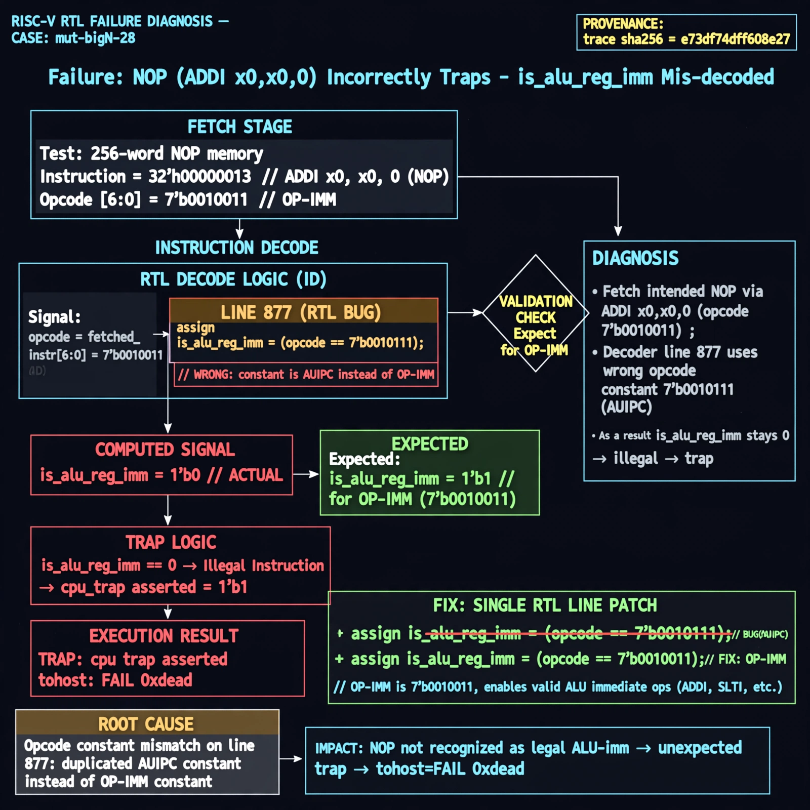

# Afterglow run report: mutbigN-v3-28

case `mut-bigN-28` | status **GREEN** | mode `live` | seed `42`

wall start `2026-10-27T11:50:49Z` | wall end `2026-10-27T11:51:31Z` | time-to-green `41.2s`

retries `0` | human_touches `0` | diagnosed `True` | fixed_unaided `True` | patch_source `model-verbatim`

## Verdicts (from sim, not typed)

- BEFORE: tohost=FAIL 0xdead checksum=c2a7a4d6295484feeb9ec1ea9381732b8e39a7ccd1997c7d70f6454da2fb4659 cycles=2009 seed=42 pass=False
- AFTER: tohost=PASS checksum=5c28238265cb94168311e9914f0df355642c557d04dba11845d557ac8a64aa4a cycles=2009 seed=42 pass=True

## Diagnosis (verbatim from api/text_response.json)

```
Fetch test uses 256-word NOP mem (ADDI x0,x0,0, opcode 0010011) expecting progress with no trap, but trace shows TRAP: cpu trap asserted and tohost: FAIL 0xdead. Expected is_alu_reg_imm=1 for 0010011, but excerpt line 877 decodes is_alu_reg_imm as 7'b0010111 (AUIPC opcode), so NOP is not recognized as legal ALU-imm and traps. Root cause is wrong opcode constant on line 877 duplicating AUIPC instead of OP-IMM 0010011.
```

expected re-sim signal: tohost: PASS with no TRAP: cpu trap asserted

## Patch (2 lines, guard-checked)

```diff
diff --git a/picorv32.v b/picorv32.v
--- a/picorv32.v
+++ b/picorv32.v
@@ -874,7 +874,7 @@
 			is_beq_bne_blt_bge_bltu_bgeu <= mem_rdata_latched[6:0] == 7'b1100011;
 			is_lb_lh_lw_lbu_lhu          <= mem_rdata_latched[6:0] == 7'b0000011;
 			is_sb_sh_sw                  <= mem_rdata_latched[6:0] == 7'b0100011;
-			is_alu_reg_imm               <= mem_rdata_latched[6:0] == 7'b0010111;
+			is_alu_reg_imm               <= mem_rdata_latched[6:0] == 7'b0010011;
 			is_alu_reg_reg               <= mem_rdata_latched[6:0] == 7'b0110011;
 
 			{ decoded_imm_j[31:20], decoded_imm_j[10:1], decoded_imm_j[11], decoded_imm_j[19:12], decoded_imm_j[0] } <= $signed({mem_rdata_latched[31:12], 1'b0});

```

## Provenance (judge checks)

- prompt file `v3` sha256 `ad529368accaf171e6121a54b2d27547230920a900c7c4e5094d3fff13ca4233`
- input_trace.txt sha256 `e73df74dff608e276d08d2e875648d4d42430d92126145621d3e3d10d78f587d` (9 lines, 69 tokens)
- prompt tokens `778` (cap 2500)
- text model `muse-spark-1.3-contributor` latency `22384ms` request `chatcmpl-01a17d33-3cff-734e-92ec-bf5724e933dd`
- image model `muse-image-1.0` latency `18226ms` request `137224e7-24d7-43e4-b996-33bf76196531` status `ok`
- image prompt sha256 `415c1042fb3ec9c8aa848fd3913ce91722497ed61a428b0c210920b521620279`, trace sha `e73df74dff608e276d08d2e875648d4d42430d92126145621d3e3d10d78f587d` (see api/image_request.json)

## Explanation diagram



## Bundle completeness

- present (12): artifacts/input_trace.txt, artifacts/boot.log, artifacts/boot_after.log, artifacts/verdict_before.json, artifacts/verdict_after.json, api/text_request.json, api/text_response.json, api/image_request.json, api/image_response.json, explain.png, patch.diff, meta.json
- missing (0): none

