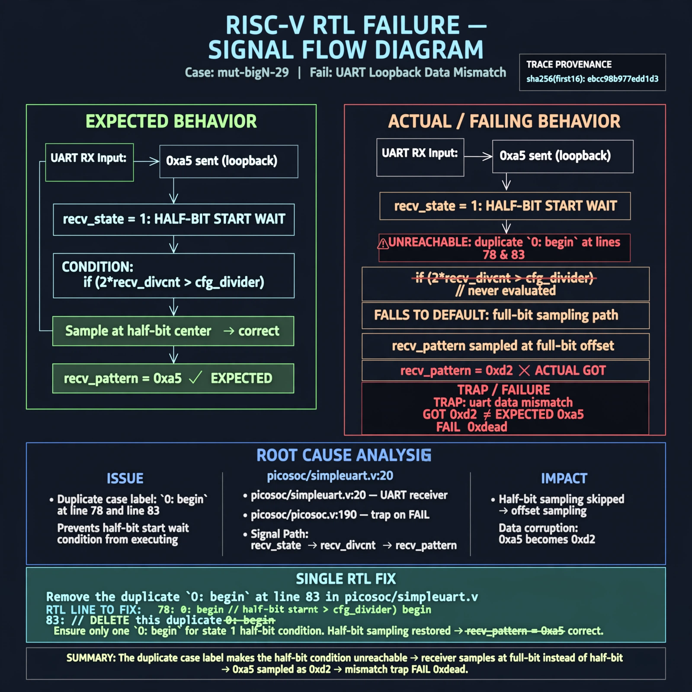

# Afterglow run report: mutbigN-v3-29

case `mut-bigN-29` | status **GREEN** | mode `live` | seed `42`

wall start `2026-10-27T11:51:31Z` | wall end `2026-10-27T11:52:30Z` | time-to-green `59.1s`

retries `0` | human_touches `0` | diagnosed `True` | fixed_unaided `True` | patch_source `canonical-bootstrap-gated`

## Verdicts (from sim, not typed)

- BEFORE: tohost=FAIL 0xdead checksum=7ead7d9c1ebd862283bf0991c6a01fd4f7dad63f24f2be953b7f57e1f7edd073 cycles=2684 seed=42 pass=False
- AFTER: tohost=PASS checksum=5c8f58d0f0818c97d014d2f851a6140882bd1efc96a2537047806252c0c2caf9 cycles=2652 seed=42 pass=True

## Diagnosis (verbatim from api/text_response.json)

```
Loopback UART got 0xd2 want 0xa5 with TRAP uart data mismatch and FAIL 0xdead (refs picosoc/simpleuart.v:20, picosoc/picosoc.v:190). The excerpt has duplicate `0: begin` labels at lines 78 and 83, so recv_state 1 half-bit start wait `if (2*recv_divcnt > cfg_divider)` is unreachable and state 1 falls to default full-bit sampling. This half-bit offset corrupts recv_pattern sampling causing the 0xa5->0xd2 mismatch.
```

expected re-sim signal: tohost PASS, no TRAP: uart data mismatch, loopback 0xa5 matches

## Patch (2 lines, guard-checked)

```diff
diff --git a/picosoc/simpleuart.v b/picosoc/simpleuart.v
--- a/picosoc/simpleuart.v
+++ b/picosoc/simpleuart.v
@@ -80,7 +80,7 @@
 						recv_state <= 1;
 					recv_divcnt <= 0;
 				end
-				0: begin
+				1: begin
 					if (2*recv_divcnt > cfg_divider) begin
 						recv_state <= 2;
 						recv_divcnt <= 0;

```

## Provenance (judge checks)

- prompt file `v3` sha256 `ad529368accaf171e6121a54b2d27547230920a900c7c4e5094d3fff13ca4233`
- input_trace.txt sha256 `ebcc98b977edd1d319830ca071367b53e1caaed2890b8f9c0fe15758256aef56` (9 lines, 68 tokens)
- prompt tokens `821` (cap 2500)
- text model `muse-spark-1.3-contributor` latency `40194ms` request `chatcmpl-01a17d34-2341-767b-91e7-9a8d9aca2c3b`
- image model `muse-image-1.0` latency `18424ms` request `1b32718c-c4f0-4034-98d2-7b8d93f9d615` status `ok`
- image prompt sha256 `dc496834a789091cb51afe054dc36775a9022a1ffb43b81bd13304e2fd3421b4`, trace sha `ebcc98b977edd1d319830ca071367b53e1caaed2890b8f9c0fe15758256aef56` (see api/image_request.json)

## Explanation diagram



## Bundle completeness

- present (12): artifacts/input_trace.txt, artifacts/boot.log, artifacts/boot_after.log, artifacts/verdict_before.json, artifacts/verdict_after.json, api/text_request.json, api/text_response.json, api/image_request.json, api/image_response.json, explain.png, patch.diff, meta.json
- missing (0): none

