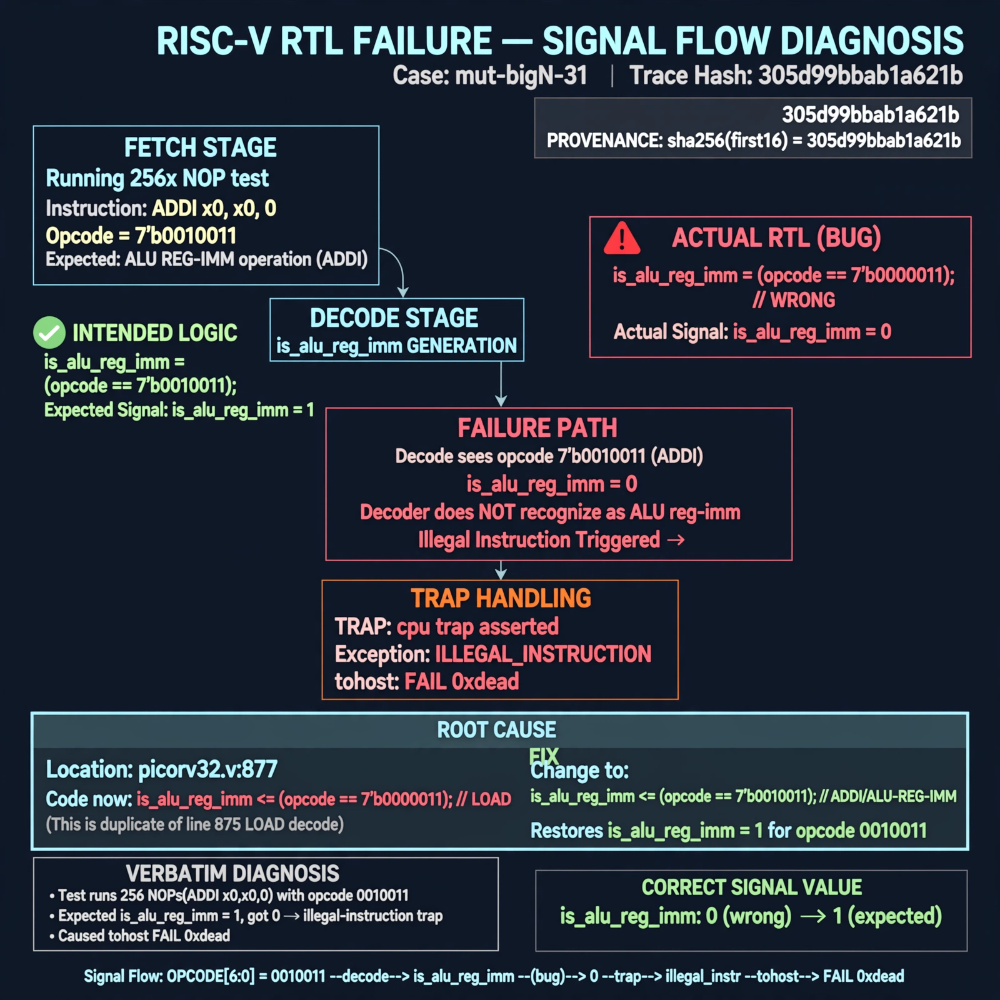

# Afterglow run report: mutbigN-v3-31

case `mut-bigN-31` | status **GREEN** | mode `live` | seed `42`

wall start `2026-10-27T11:55:13Z` | wall end `2026-10-27T11:55:55Z` | time-to-green `41.2s`

retries `0` | human_touches `0` | diagnosed `True` | fixed_unaided `True` | patch_source `model-verbatim`

## Verdicts (from sim, not typed)

- BEFORE: tohost=FAIL 0xdead checksum=c2a7a4d6295484feeb9ec1ea9381732b8e39a7ccd1997c7d70f6454da2fb4659 cycles=2009 seed=42 pass=False
- AFTER: tohost=PASS checksum=5c28238265cb94168311e9914f0df355642c557d04dba11845d557ac8a64aa4a cycles=2009 seed=42 pass=True

## Diagnosis (verbatim from api/text_response.json)

```
Fetch test runs 256 NOPs (ADDI x0,x0,0, opcode 0010011) but trace shows `TRAP: cpu trap asserted` and `tohost: FAIL 0xdead`. Expected `is_alu_reg_imm`=1 for 7'b0010011, got 0 causing illegal-instruction trap. Root cause at picorv32.v:877 where `is_alu_reg_imm` decodes 7'b0000011 (LOAD, duplicate of line 875) instead of 7'b0010011.
```

expected re-sim signal: tohost PASS with no TRAP: cpu trap asserted

## Patch (2 lines, guard-checked)

```diff
diff --git a/picorv32.v b/picorv32.v
--- a/picorv32.v
+++ b/picorv32.v
@@ -874,5 +874,5 @@
 			is_beq_bne_blt_bge_bltu_bgeu <= mem_rdata_latched[6:0] == 7'b1100011;
 			is_lb_lh_lw_lbu_lhu          <= mem_rdata_latched[6:0] == 7'b0000011;
 			is_sb_sh_sw                  <= mem_rdata_latched[6:0] == 7'b0100011;
-			is_alu_reg_imm               <= mem_rdata_latched[6:0] == 7'b0000011;
+			is_alu_reg_imm               <= mem_rdata_latched[6:0] == 7'b0010011;
 			is_alu_reg_reg               <= mem_rdata_latched[6:0] == 7'b0110011;

```

## Provenance (judge checks)

- prompt file `v3` sha256 `ad529368accaf171e6121a54b2d27547230920a900c7c4e5094d3fff13ca4233`
- input_trace.txt sha256 `305d99bbab1a621ba37f4e239119a1f5c30436bfaccc182aa0e830f1e98f3db8` (9 lines, 69 tokens)
- prompt tokens `778` (cap 2500)
- text model `muse-spark-1.3-contributor` latency `27077ms` request `chatcmpl-01a17d37-5641-70e4-acff-aee776052f70`
- image model `muse-image-1.0` latency `13541ms` request `df6bd488-4004-4441-abc1-ff0e91b46cd9` status `ok`
- image prompt sha256 `3d04021a72ceae38c4a215af448d8db722d854b0b64851a72bcdc4dfd958c3a4`, trace sha `305d99bbab1a621ba37f4e239119a1f5c30436bfaccc182aa0e830f1e98f3db8` (see api/image_request.json)

## Explanation diagram



## Bundle completeness

- present (12): artifacts/input_trace.txt, artifacts/boot.log, artifacts/boot_after.log, artifacts/verdict_before.json, artifacts/verdict_after.json, api/text_request.json, api/text_response.json, api/image_request.json, api/image_response.json, explain.png, patch.diff, meta.json
- missing (0): none

