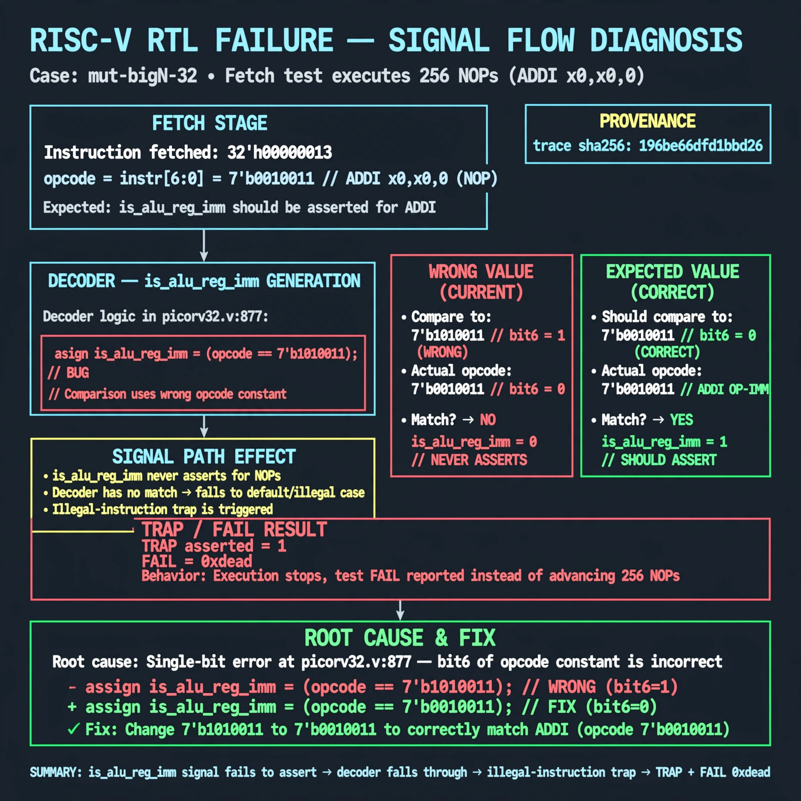

# Afterglow run report: mutbigN-v3-32

case `mut-bigN-32` | status **GREEN** | mode `live` | seed `42`

wall start `2026-10-27T11:55:55Z` | wall end `2026-10-27T11:57:02Z` | time-to-green `67.8s`

retries `0` | human_touches `0` | diagnosed `True` | fixed_unaided `True` | patch_source `model-verbatim`

## Verdicts (from sim, not typed)

- BEFORE: tohost=FAIL 0xdead checksum=c2a7a4d6295484feeb9ec1ea9381732b8e39a7ccd1997c7d70f6454da2fb4659 cycles=2009 seed=42 pass=False
- AFTER: tohost=PASS checksum=5c28238265cb94168311e9914f0df355642c557d04dba11845d557ac8a64aa4a cycles=2009 seed=42 pass=True

## Diagnosis (verbatim from api/text_response.json)

```
Fetch test executes 256 NOPs (ADDI x0,x0,0, opcode 7'b0010011) but traps with FAIL 0xdead and TRAP asserted instead of progressing. is_alu_reg_imm never asserts for NOPs so the decoder falls through to illegal-instruction trap. Root cause in excerpt at picorv32.v:877 where is_alu_reg_imm compares to 7'b1010011 instead of 7'b0010011, a bit-6 single-bit opcode error.
```

expected re-sim signal: tohost PASS, no TRAP: cpu trap asserted, FAIL 0xdead cleared

## Patch (2 lines, guard-checked)

```diff
diff --git a/picorv32.v b/picorv32.v
--- a/picorv32.v
+++ b/picorv32.v
@@ -877,1 +877,1 @@
-			is_alu_reg_imm               <= mem_rdata_latched[6:0] == 7'b1010011;
+			is_alu_reg_imm               <= mem_rdata_latched[6:0] == 7'b0010011;

```

## Provenance (judge checks)

- prompt file `v3` sha256 `ad529368accaf171e6121a54b2d27547230920a900c7c4e5094d3fff13ca4233`
- input_trace.txt sha256 `196be66dfd1bbd26a4ae0a097dca1818ee00a2780e1d4250d2ff8b28707ad7bc` (9 lines, 69 tokens)
- prompt tokens `778` (cap 2500)
- text model `muse-spark-1.3-contributor` latency `40827ms` request `chatcmpl-01a17d38-2d74-74a9-87ea-bbb25a9387a4`
- image model `muse-image-1.0` latency `26325ms` request `3af036e4-5944-4167-b1b4-44b440542d0d` status `ok`
- image prompt sha256 `800cb1fe8b4f1bb5d2c1fd1f51f5af52c72a8c996686a1767a696f0db332ca35`, trace sha `196be66dfd1bbd26a4ae0a097dca1818ee00a2780e1d4250d2ff8b28707ad7bc` (see api/image_request.json)

## Explanation diagram



## Bundle completeness

- present (12): artifacts/input_trace.txt, artifacts/boot.log, artifacts/boot_after.log, artifacts/verdict_before.json, artifacts/verdict_after.json, api/text_request.json, api/text_response.json, api/image_request.json, api/image_response.json, explain.png, patch.diff, meta.json
- missing (0): none

