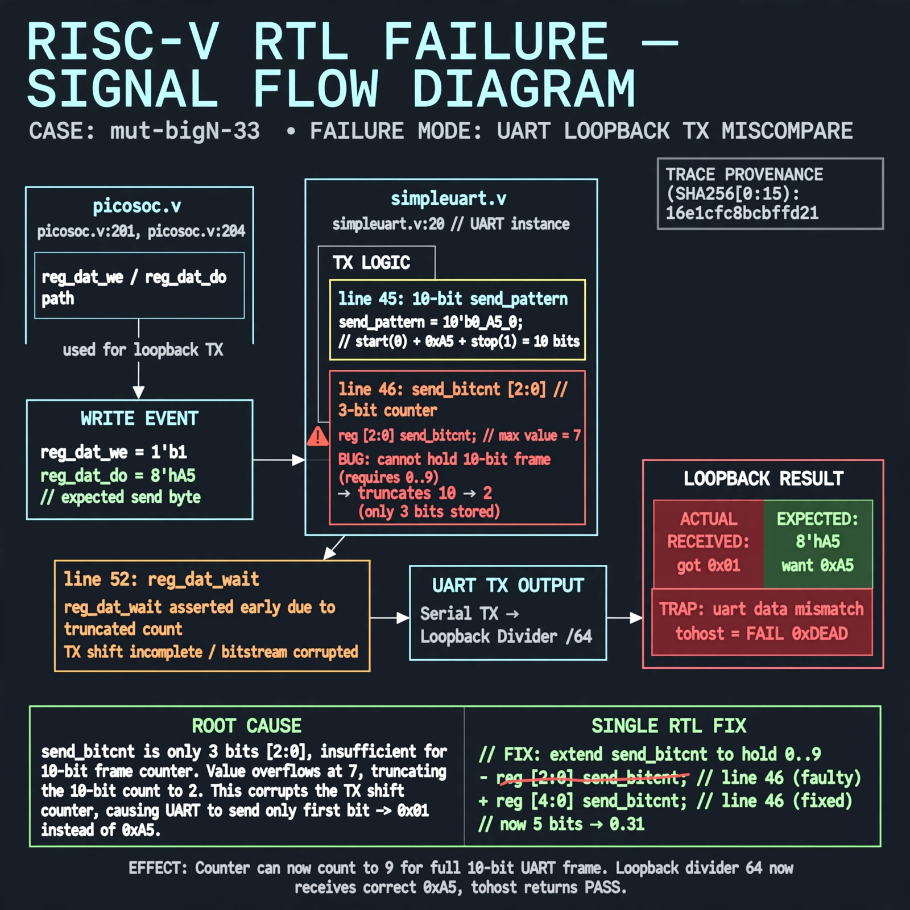

# Afterglow run report: mutbigN-v3-33

case `mut-bigN-33` | status **GREEN** | mode `live` | seed `42`

wall start `2026-10-27T11:57:02Z` | wall end `2026-10-27T11:58:06Z` | time-to-green `64.0s`

retries `0` | human_touches `0` | diagnosed `True` | fixed_unaided `True` | patch_source `model-verbatim`

## Verdicts (from sim, not typed)

- BEFORE: tohost=FAIL 0xdead checksum=b6e0169fb7c409f1a6e23cdf77f846d41e48405df0444f0d3c56f6ec28770cef cycles=2652 seed=42 pass=False
- AFTER: tohost=PASS checksum=5c8f58d0f0818c97d014d2f851a6140882bd1efc96a2537047806252c0c2caf9 cycles=2652 seed=42 pass=True

## Diagnosis (verbatim from api/text_response.json)

```
Loopback divider 64 send 0xa5 failed as TRAP: uart data mismatch got 0x01 want 0xa5 with tohost FAIL 0xdead. Root cause in excerpt is line 46 reg [2:0] send_bitcnt which cannot hold the 10-bit send_pattern frame (line 45), truncating 10 to 2 and corrupting TX plus reg_dat_wait at line 52. Wiring per picosoc/simpleuart.v:20 and picosoc/picosoc.v:201, picosoc/picosoc.v:204 shows reg_dat_we/do path used for this loopback.
```

expected re-sim signal: tohost PASS, no TRAP: uart data mismatch, loopback got 0xa5 want 0xa5

## Patch (2 lines, guard-checked)

```diff
diff --git a/picosoc/simpleuart.v b/picosoc/simpleuart.v
--- a/picosoc/simpleuart.v
+++ b/picosoc/simpleuart.v
@@ -45,7 +45,7 @@
 	reg [9:0] send_pattern;
-	reg [2:0] send_bitcnt;
+	reg [3:0] send_bitcnt;
 	reg [31:0] send_divcnt;
 	reg send_dummy;

```

## Provenance (judge checks)

- prompt file `v3` sha256 `ad529368accaf171e6121a54b2d27547230920a900c7c4e5094d3fff13ca4233`
- input_trace.txt sha256 `16e1cfc8bcbffd212e1b66a73a256368012743ecf74f7bcb2bcd404b5476bb6f` (9 lines, 68 tokens)
- prompt tokens `813` (cap 2500)
- text model `muse-spark-1.3-contributor` latency `45695ms` request `chatcmpl-01a17d39-4919-7594-9a8a-e2db83047acf`
- image model `muse-image-1.0` latency `17848ms` request `ed3e4784-708a-4120-9c36-bf2695a98ca6` status `ok`
- image prompt sha256 `21481435885610464e0b054e2bfe5495b0be64c306073cfe1fc223272517da85`, trace sha `16e1cfc8bcbffd212e1b66a73a256368012743ecf74f7bcb2bcd404b5476bb6f` (see api/image_request.json)

## Explanation diagram



## Bundle completeness

- present (12): artifacts/input_trace.txt, artifacts/boot.log, artifacts/boot_after.log, artifacts/verdict_before.json, artifacts/verdict_after.json, api/text_request.json, api/text_response.json, api/image_request.json, api/image_response.json, explain.png, patch.diff, meta.json
- missing (0): none

