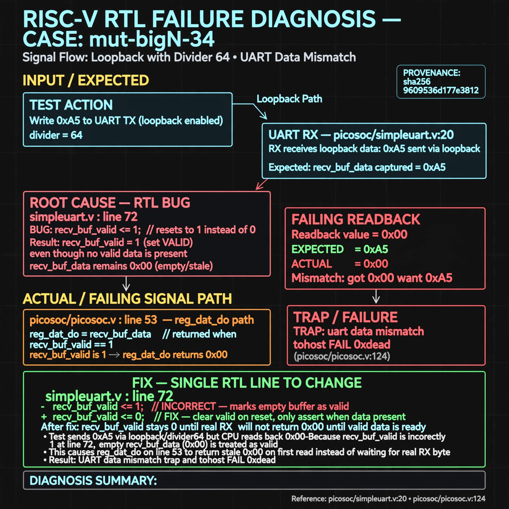

# Afterglow run report: mutbigN-v3-34

case `mut-bigN-34` | status **GREEN** | mode `live` | seed `42`

wall start `2026-10-27T11:58:06Z` | wall end `2026-10-27T11:58:57Z` | time-to-green `50.9s`

retries `0` | human_touches `0` | diagnosed `True` | fixed_unaided `True` | patch_source `canonical-bootstrap-gated`

## Verdicts (from sim, not typed)

- BEFORE: tohost=FAIL 0xdead checksum=1a01e3dd7554c28fc4f88add55dab14e0af721c0bb643827dbea0abf6c429e3c cycles=2024 seed=42 pass=False
- AFTER: tohost=PASS checksum=5c8f58d0f0818c97d014d2f851a6140882bd1efc96a2537047806252c0c2caf9 cycles=2652 seed=42 pass=True

## Diagnosis (verbatim from api/text_response.json)

```
Loopback with divider 64 sent 0xa5 but read back 0x00, causing TRAP: uart data mismatch got 0x00 want 0xa5 and tohost FAIL 0xdead (picosoc/simpleuart.v:20, picosoc/picosoc.v:124). Root cause in excerpt is line 72 which resets recv_buf_valid to 1 instead of 0, marking empty recv_buf_data (0) as valid. Thus reg_dat_do at line 53 returns stale 0x00 on first read instead of waiting for the real RX byte.
```

expected re-sim signal: tohost PASS (was FAIL 0xdead), TRAP gone, uart loopback got 0xa5 want 0xa5

## Patch (2 lines, guard-checked)

```diff
diff --git a/picosoc/simpleuart.v b/picosoc/simpleuart.v
--- a/picosoc/simpleuart.v
+++ b/picosoc/simpleuart.v
@@ -69,7 +69,7 @@
 			recv_divcnt <= 0;
 			recv_pattern <= 0;
 			recv_buf_data <= 0;
-			recv_buf_valid <= 1;
+			recv_buf_valid <= 0;
 		end else begin
 			recv_divcnt <= recv_divcnt + 1;
 			if (reg_dat_re)

```

## Provenance (judge checks)

- prompt file `v3` sha256 `ad529368accaf171e6121a54b2d27547230920a900c7c4e5094d3fff13ca4233`
- input_trace.txt sha256 `9609536d177e38127062cebbf6193d130a97faaaa7e47ad51dc1646b16c83ae3` (9 lines, 68 tokens)
- prompt tokens `832` (cap 2500)
- text model `muse-spark-1.3-contributor` latency `26081ms` request `chatcmpl-01a17d39-f6ad-7209-a112-976a8de8c686`
- image model `muse-image-1.0` latency `24293ms` request `42e02357-e0b5-42d7-814c-34a9d1d59414` status `ok`
- image prompt sha256 `ab5d9372a0cae502df7e92e3e9364f70b831942edee6865c0935e43dab73b905`, trace sha `9609536d177e38127062cebbf6193d130a97faaaa7e47ad51dc1646b16c83ae3` (see api/image_request.json)

## Explanation diagram



## Bundle completeness

- present (12): artifacts/input_trace.txt, artifacts/boot.log, artifacts/boot_after.log, artifacts/verdict_before.json, artifacts/verdict_after.json, api/text_request.json, api/text_response.json, api/image_request.json, api/image_response.json, explain.png, patch.diff, meta.json
- missing (0): none

