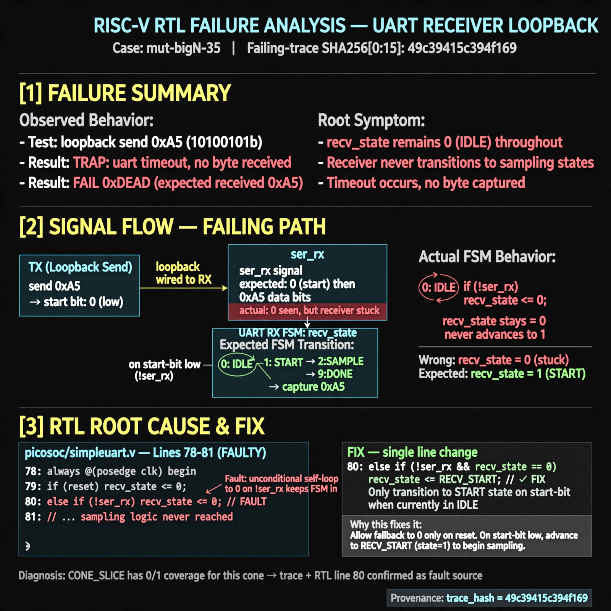

# Afterglow run report: mutbigN-v3-35

case `mut-bigN-35` | status **GREEN** | mode `live` | seed `42`

wall start `2026-10-27T11:58:57Z` | wall end `2026-10-27T11:59:28Z` | time-to-green `30.9s`

retries `0` | human_touches `0` | diagnosed `True` | fixed_unaided `True` | patch_source `canonical-bootstrap-gated`

## Verdicts (from sim, not typed)

- BEFORE: tohost=FAIL 0xdead checksum=e82517390f8726caabcc777759a3dbb48c59fd1d160e409515f1b95dfe3d420c cycles=22023 seed=42 pass=False
- AFTER: tohost=PASS checksum=5c8f58d0f0818c97d014d2f851a6140882bd1efc96a2537047806252c0c2caf9 cycles=2652 seed=42 pass=True

## Diagnosis (verbatim from api/text_response.json)

```
Loopback send 0xa5 was never received, giving `TRAP: uart timeout, no byte received` and `FAIL 0xdead` instead of a received byte. recv_state stays at 0 instead of advancing to 1 on start-bit low, so receiver never enters sampling states. Root cause in picosoc/simpleuart.v:78-81: `if (!ser_rx) recv_state <= 0;` self-loops in idle; CONE_SLICE has 0/1 coverage for this cone so trace+excerpt win.
```

expected re-sim signal: tohost PASS with loopback byte 0xa5 received, no `TRAP: uart timeout`

## Patch (2 lines, guard-checked)

```diff
diff --git a/picosoc/simpleuart.v b/picosoc/simpleuart.v
--- a/picosoc/simpleuart.v
+++ b/picosoc/simpleuart.v
@@ -77,7 +77,7 @@
 			case (recv_state)
 				0: begin
 					if (!ser_rx)
-						recv_state <= 0;
+						recv_state <= 1;
 					recv_divcnt <= 0;
 				end
 				1: begin

```

## Provenance (judge checks)

- prompt file `v3` sha256 `ad529368accaf171e6121a54b2d27547230920a900c7c4e5094d3fff13ca4233`
- input_trace.txt sha256 `49c39415c394f169a1e3ba18ed23222289217c71dedee6e187f6376044414b57` (9 lines, 66 tokens)
- prompt tokens `951` (cap 2500)
- text model `muse-spark-1.3-contributor` latency `14316ms` request `chatcmpl-01a17d3a-8fab-74c4-9897-0b4b08ed571d`
- image model `muse-image-1.0` latency `16079ms` request `a99fc7d0-e44b-4a10-b0b3-7a81caebb351` status `ok`
- image prompt sha256 `5751aeb8e08e8b535dc39a6998edcc9b7ab2acb548e1376fbece910f5c118b5b`, trace sha `49c39415c394f169a1e3ba18ed23222289217c71dedee6e187f6376044414b57` (see api/image_request.json)

## Explanation diagram



## Bundle completeness

- present (12): artifacts/input_trace.txt, artifacts/boot.log, artifacts/boot_after.log, artifacts/verdict_before.json, artifacts/verdict_after.json, api/text_request.json, api/text_response.json, api/image_request.json, api/image_response.json, explain.png, patch.diff, meta.json
- missing (0): none

