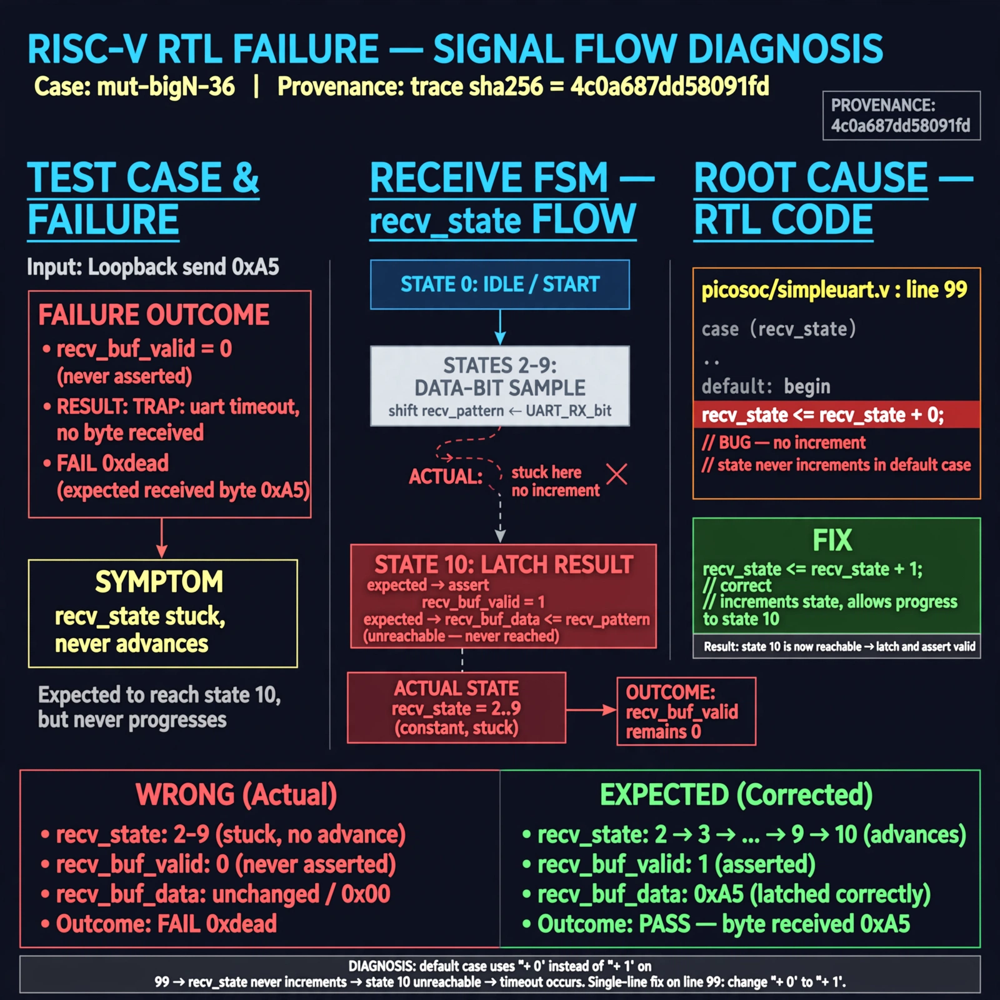

# Afterglow run report: mutbigN-v3-36

case `mut-bigN-36` | status **GREEN** | mode `live` | seed `42`

wall start `2026-10-27T11:59:28Z` | wall end `2026-10-27T12:00:18Z` | time-to-green `49.6s`

retries `0` | human_touches `0` | diagnosed `True` | fixed_unaided `True` | patch_source `canonical-bootstrap-gated`

## Verdicts (from sim, not typed)

- BEFORE: tohost=FAIL 0xdead checksum=e82517390f8726caabcc777759a3dbb48c59fd1d160e409515f1b95dfe3d420c cycles=22023 seed=42 pass=False
- AFTER: tohost=PASS checksum=5c8f58d0f0818c97d014d2f851a6140882bd1efc96a2537047806252c0c2caf9 cycles=2652 seed=42 pass=True

## Diagnosis (verbatim from api/text_response.json)

```
Loopback send 0xa5 never asserts recv_buf_valid so trace ends with TRAP: uart timeout, no byte received and FAIL 0xdead instead of a received byte. Expected recv_state to advance through data-bit states 2-9 to state 10 to latch recv_pattern into recv_buf_data, but it remains stuck. Root cause is line 99 in picosoc/simpleuart.v `recv_state <= recv_state + 0;` in the default case which never increments, making state 10 unreachable.
```

expected re-sim signal: tohost PASS, no TRAP: uart timeout — loopback byte 0xa5 received with recv_buf_valid asserted

## Patch (2 lines, guard-checked)

```diff
diff --git a/picosoc/simpleuart.v b/picosoc/simpleuart.v
--- a/picosoc/simpleuart.v
+++ b/picosoc/simpleuart.v
@@ -96,7 +96,7 @@
 				default: begin
 					if (recv_divcnt > cfg_divider) begin
 						recv_pattern <= {ser_rx, recv_pattern[7:1]};
-						recv_state <= recv_state + 0;
+						recv_state <= recv_state + 1;
 						recv_divcnt <= 0;
 					end
 				end

```

## Provenance (judge checks)

- prompt file `v3` sha256 `ad529368accaf171e6121a54b2d27547230920a900c7c4e5094d3fff13ca4233`
- input_trace.txt sha256 `4c0a687dd58091fdb94ce1137c2d9eeb0de8eacaa69bf768c30ede663cfd2fe7` (9 lines, 66 tokens)
- prompt tokens `928` (cap 2500)
- text model `muse-spark-1.3-contributor` latency `24697ms` request `chatcmpl-01a17d3b-3133-7211-a68b-c8b1554cf10b`
- image model `muse-image-1.0` latency `24398ms` request `74bad896-0911-4089-9026-2ce11c825ce5` status `ok`
- image prompt sha256 `7fe8c737ab255b9f287883b0fd65083d25bfda63d0ff3e4a4e8cb87c8ead2105`, trace sha `4c0a687dd58091fdb94ce1137c2d9eeb0de8eacaa69bf768c30ede663cfd2fe7` (see api/image_request.json)

## Explanation diagram



## Bundle completeness

- present (12): artifacts/input_trace.txt, artifacts/boot.log, artifacts/boot_after.log, artifacts/verdict_before.json, artifacts/verdict_after.json, api/text_request.json, api/text_response.json, api/image_request.json, api/image_response.json, explain.png, patch.diff, meta.json
- missing (0): none

