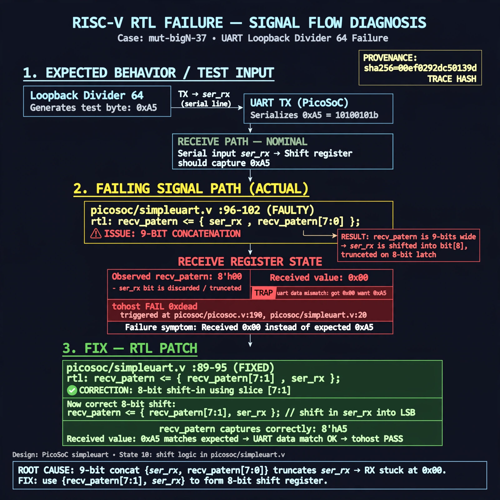

# Afterglow run report: mutbigN-v3-37

case `mut-bigN-37` | status **GREEN** | mode `live` | seed `42`

wall start `2026-10-27T12:00:18Z` | wall end `2026-10-27T12:01:28Z` | time-to-green `70.1s`

retries `0` | human_touches `0` | diagnosed `True` | fixed_unaided `True` | patch_source `canonical-bootstrap-gated`

## Verdicts (from sim, not typed)

- BEFORE: tohost=FAIL 0xdead checksum=dbb50cbb61b3704d4ab04bba47dd54874597339897bb0d0354152efa03feeb20 cycles=2652 seed=42 pass=False
- AFTER: tohost=PASS checksum=5c8f58d0f0818c97d014d2f851a6140882bd1efc96a2537047806252c0c2caf9 cycles=2652 seed=42 pass=True

## Diagnosis (verbatim from api/text_response.json)

```
Loopback divider 64 send 0xa5 was received as 0x00 causing TRAP: uart data mismatch got 0x00 want 0xa5 and tohost FAIL 0xdead (picosoc/picosoc.v:190, picosoc/simpleuart.v:20). Receiver default state picosoc/simpleuart.v:96-102 shifts recv_pattern <= {ser_rx, recv_pattern[7:0]} which is 9-bits and truncates away ser_rx so recv_pattern stays 0. Changing slice to [7:1] restores 8-bit shift-in so state 10 picosoc/simpleuart.v:89-95 latches correct 0xa5.
```

expected re-sim signal: tohost PASS, no TRAP, uart loopback got 0xa5 want 0xa5

## Patch (2 lines, guard-checked)

```diff
diff --git a/picosoc/simpleuart.v b/picosoc/simpleuart.v
--- a/picosoc/simpleuart.v
+++ b/picosoc/simpleuart.v
@@ -95,7 +95,7 @@
 				end
 				default: begin
 					if (recv_divcnt > cfg_divider) begin
-						recv_pattern <= {ser_rx, recv_pattern[7:0]};
+						recv_pattern <= {ser_rx, recv_pattern[7:1]};
 						recv_state <= recv_state + 1;
 						recv_divcnt <= 0;
 					end

```

## Provenance (judge checks)

- prompt file `v3` sha256 `ad529368accaf171e6121a54b2d27547230920a900c7c4e5094d3fff13ca4233`
- input_trace.txt sha256 `00ef0292dc50139dbde4291d02442c54443f58f08c24cce87c4272e4957b0b86` (9 lines, 68 tokens)
- prompt tokens `803` (cap 2500)
- text model `muse-spark-1.3-contributor` latency `39458ms` request `chatcmpl-01a17d3c-2ce5-76cf-bb7d-918f7eab8c29`
- image model `muse-image-1.0` latency `30192ms` request `9fd65428-1078-4dc3-badc-32ac5cf65ac0` status `ok`
- image prompt sha256 `05282c4ef57e39e533bf2b271d393b8c593c5714cb4d9667c2c1050f01e4b007`, trace sha `00ef0292dc50139dbde4291d02442c54443f58f08c24cce87c4272e4957b0b86` (see api/image_request.json)

## Explanation diagram



## Bundle completeness

- present (12): artifacts/input_trace.txt, artifacts/boot.log, artifacts/boot_after.log, artifacts/verdict_before.json, artifacts/verdict_after.json, api/text_request.json, api/text_response.json, api/image_request.json, api/image_response.json, explain.png, patch.diff, meta.json
- missing (0): none

