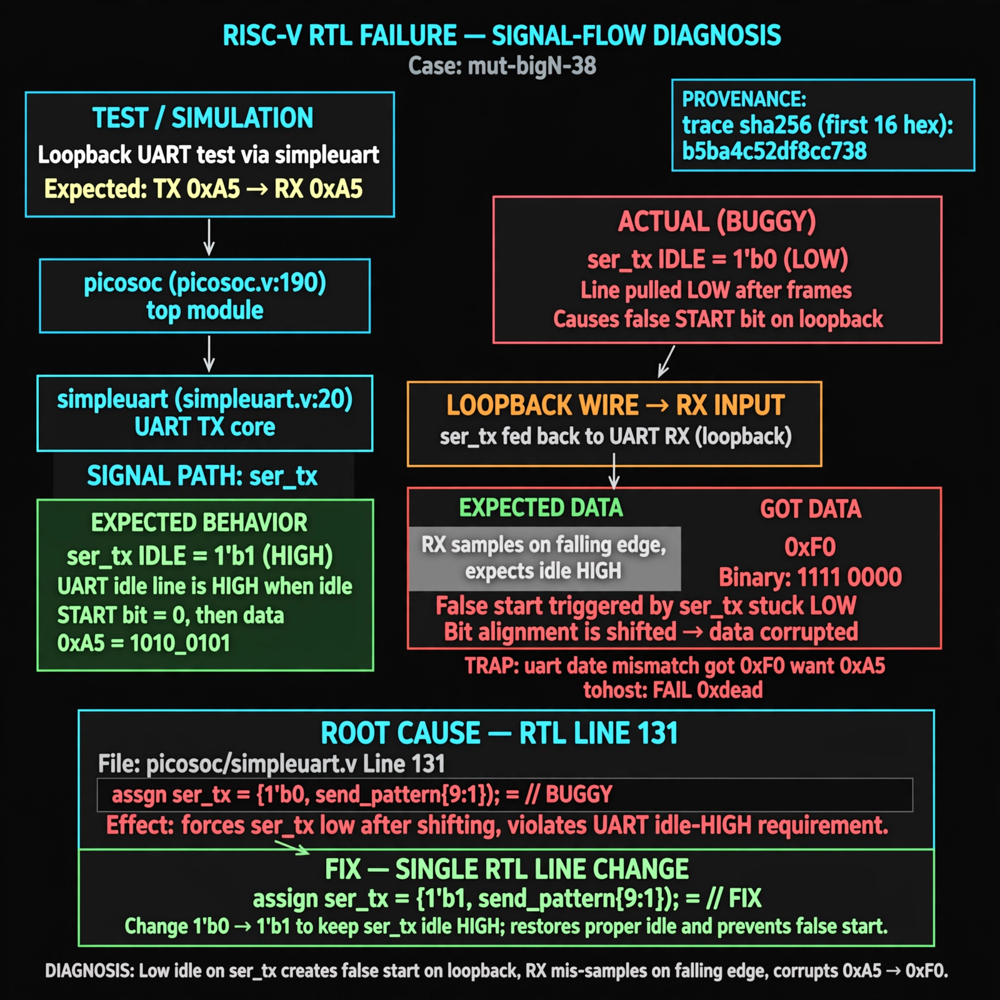

# Afterglow run report: mutbigN-v3-38

case `mut-bigN-38` | status **GREEN** | mode `live` | seed `42`

wall start `2026-10-27T12:01:28Z` | wall end `2026-10-27T12:03:20Z` | time-to-green `111.6s`

retries `0` | human_touches `0` | diagnosed `True` | fixed_unaided `True` | patch_source `model-verbatim`

## Verdicts (from sim, not typed)

- BEFORE: tohost=FAIL 0xdead checksum=7f1f8653d81beffbf56c64348d4b664a9ffa3b217fbca29ca6a0e86da0c3cbf9 cycles=2024 seed=42 pass=False
- AFTER: tohost=PASS checksum=5c8f58d0f0818c97d014d2f851a6140882bd1efc96a2537047806252c0c2caf9 cycles=2652 seed=42 pass=True

## Diagnosis (verbatim from api/text_response.json)

```
Loopback UART via simpleuart at picosoc/picosoc.v:190 (module at picosoc/simpleuart.v:20) trapped `TRAP: uart data mismatch got 0xf0 want 0xa5` with tohost `FAIL 0xdead`. TX `ser_tx` should idle high but excerpt line 131 shifts `{1'b0, send_pattern[9:1]}` pulling the line low after dummy/data frames. The low idle creates a false start and misaligned sampling in loopback, corrupting 0xa5 to 0xf0.
```

expected re-sim signal: tohost PASS (no TRAP), uart loopback got 0xa5 want 0xa5, checksum != 7f1f8653d81beffbf56c64348d4b664a9ffa3b217fbca29ca6a0e86da0c3cbf9

## Patch (2 lines, guard-checked)

```diff
diff --git a/picosoc/simpleuart.v b/picosoc/simpleuart.v
--- a/picosoc/simpleuart.v
+++ b/picosoc/simpleuart.v
@@ -128,7 +128,7 @@
 				send_divcnt <= 0;
 			end else
 			if (send_divcnt > cfg_divider && send_bitcnt) begin
-				send_pattern <= {1'b0, send_pattern[9:1]};
+				send_pattern <= {1'b1, send_pattern[9:1]};
 				send_bitcnt <= send_bitcnt - 1;
 				send_divcnt <= 0;
 			end

```

## Provenance (judge checks)

- prompt file `v3` sha256 `ad529368accaf171e6121a54b2d27547230920a900c7c4e5094d3fff13ca4233`
- input_trace.txt sha256 `b5ba4c52df8cc7388aee971755c5f21d375751cda041dfecc4a2b73d66ce3f34` (9 lines, 68 tokens)
- prompt tokens `815` (cap 2500)
- text model `muse-spark-1.3-contributor` latency `70719ms` request `chatcmpl-01a17d3d-b947-7457-b5cc-697d96d37f56`
- image model `muse-image-1.0` latency `40375ms` request `19dfe9ec-71c0-4544-917d-e3122811669e` status `ok`
- image prompt sha256 `2e0331af13b6e6ec4acc5ea7fa396eab97d5ea7dd6995894e2d6adc37eb52788`, trace sha `b5ba4c52df8cc7388aee971755c5f21d375751cda041dfecc4a2b73d66ce3f34` (see api/image_request.json)

## Explanation diagram



## Bundle completeness

- present (12): artifacts/input_trace.txt, artifacts/boot.log, artifacts/boot_after.log, artifacts/verdict_before.json, artifacts/verdict_after.json, api/text_request.json, api/text_response.json, api/image_request.json, api/image_response.json, explain.png, patch.diff, meta.json
- missing (0): none

