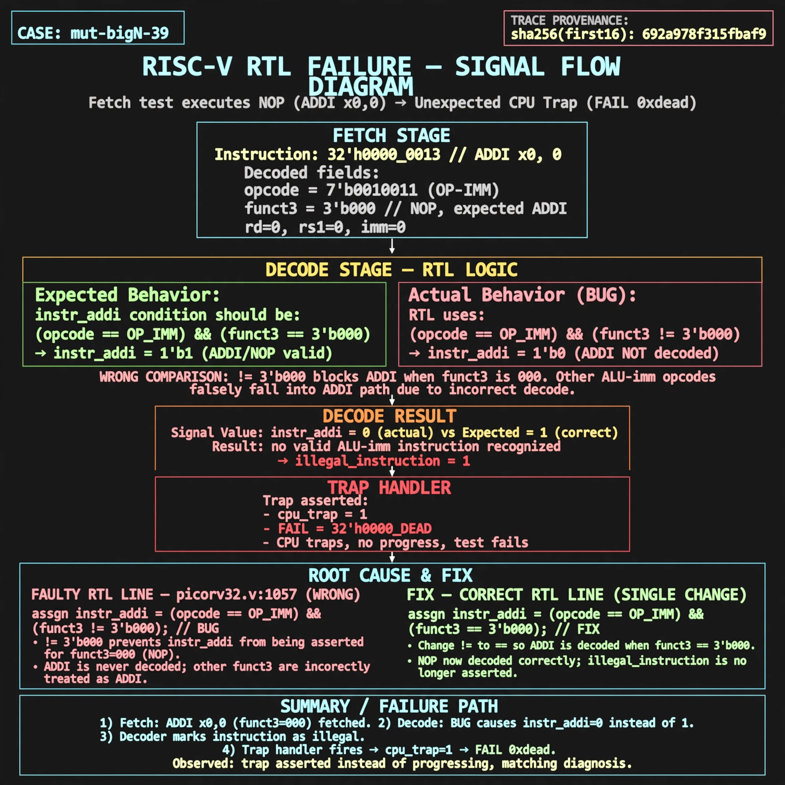

# Afterglow run report: mutbigN-v3-39

case `mut-bigN-39` | status **GREEN** | mode `live` | seed `42`

wall start `2026-10-27T12:03:20Z` | wall end `2026-10-27T12:04:11Z` | time-to-green `50.6s`

retries `0` | human_touches `0` | diagnosed `True` | fixed_unaided `True` | patch_source `model-verbatim`

## Verdicts (from sim, not typed)

- BEFORE: tohost=FAIL 0xdead checksum=c2a7a4d6295484feeb9ec1ea9381732b8e39a7ccd1997c7d70f6454da2fb4659 cycles=2009 seed=42 pass=False
- AFTER: tohost=PASS checksum=5c28238265cb94168311e9914f0df355642c557d04dba11845d557ac8a64aa4a cycles=2009 seed=42 pass=True

## Diagnosis (verbatim from api/text_response.json)

```
Fetch test executes NOP (ADDI x0,0, funct3 000) but traps with FAIL 0xdead and TRAP: cpu trap asserted instead of progressing. instr_addi at picorv32.v:1057 uses != 3'b000 so ADDI never decodes while other ALU-imm opcodes falsely assert ADDI. The resulting illegal-instruction decode causes the observed trap.
```

expected re-sim signal: tohost PASS with no TRAP: cpu trap asserted

## Patch (2 lines, guard-checked)

```diff
diff --git a/picorv32.v b/picorv32.v
--- a/picorv32.v
+++ b/picorv32.v
@@ -1057,1 +1057,1 @@
-			instr_addi  <= is_alu_reg_imm && mem_rdata_q[14:12] != 3'b000;
+			instr_addi  <= is_alu_reg_imm && mem_rdata_q[14:12] == 3'b000;

```

## Provenance (judge checks)

- prompt file `v3` sha256 `ad529368accaf171e6121a54b2d27547230920a900c7c4e5094d3fff13ca4233`
- input_trace.txt sha256 `692a978f315fbaf96bb9c41f4ebf11ff5ea80aeaac063246ed987709b811f271` (9 lines, 69 tokens)
- prompt tokens `872` (cap 2500)
- text model `muse-spark-1.3-contributor` latency `23708ms` request `chatcmpl-01a17d3e-b650-7332-ba45-bd7dadac021e`
- image model `muse-image-1.0` latency `26228ms` request `1621a5e3-0afe-45d4-bdf3-649de11b548f` status `ok`
- image prompt sha256 `740e67944218386b9cf7149d0dd687863293fae87133778894f35bcb138aa3dc`, trace sha `692a978f315fbaf96bb9c41f4ebf11ff5ea80aeaac063246ed987709b811f271` (see api/image_request.json)

## Explanation diagram



## Bundle completeness

- present (12): artifacts/input_trace.txt, artifacts/boot.log, artifacts/boot_after.log, artifacts/verdict_before.json, artifacts/verdict_after.json, api/text_request.json, api/text_response.json, api/image_request.json, api/image_response.json, explain.png, patch.diff, meta.json
- missing (0): none

