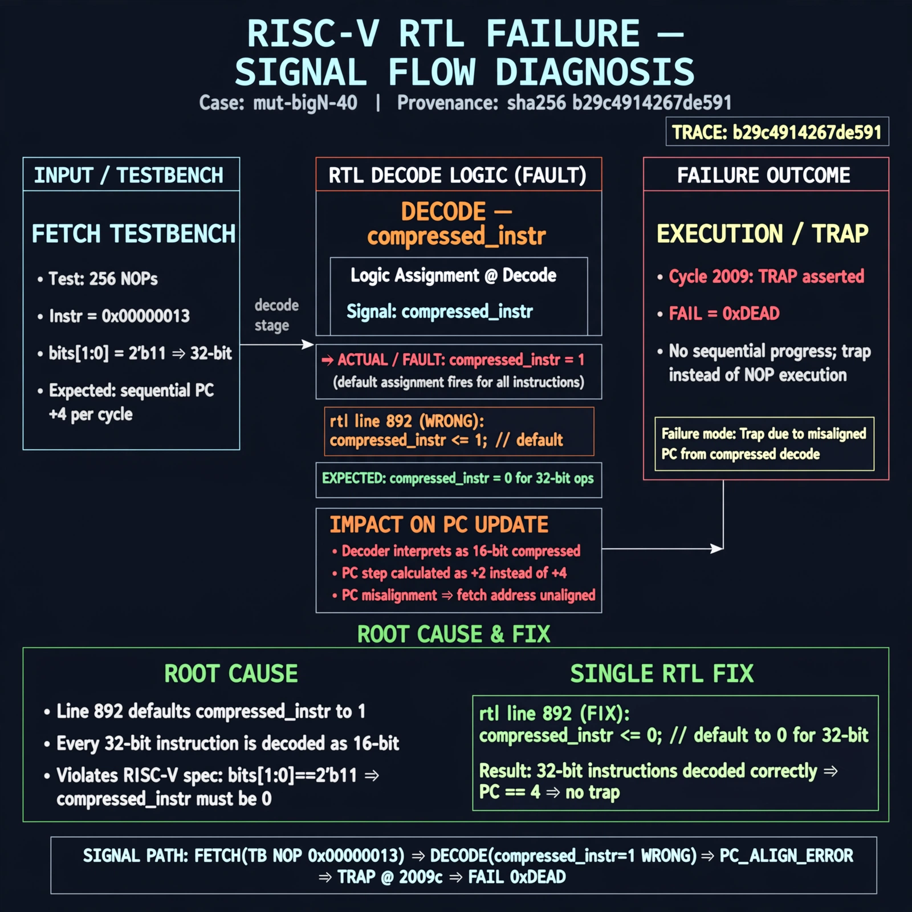

# Afterglow run report: mutbigN-v3-40

case `mut-bigN-40` | status **GREEN** | mode `live` | seed `42`

wall start `2026-10-27T12:04:11Z` | wall end `2026-10-27T12:05:10Z` | time-to-green `59.7s`

retries `0` | human_touches `0` | diagnosed `True` | fixed_unaided `True` | patch_source `model-verbatim`

## Verdicts (from sim, not typed)

- BEFORE: tohost=FAIL 0xdead checksum=c2a7a4d6295484feeb9ec1ea9381732b8e39a7ccd1997c7d70f6454da2fb4659 cycles=2009 seed=42 pass=False
- AFTER: tohost=PASS checksum=5c28238265cb94168311e9914f0df355642c557d04dba11845d557ac8a64aa4a cycles=2009 seed=42 pass=True

## Diagnosis (verbatim from api/text_response.json)

```
Fetch TB with 256 NOPs (0x00000013 with bits[1:0]=2'b11) traps with TRAP asserted and FAIL 0xdead at 2009 cycles instead of sequential progress. Expected compressed_instr==0 for 32-bit ops but excerpt holds it at 1. Root cause at line 892: `compressed_instr <= 1` as default makes every 32-bit instruction decode as 16-bit compressed, corrupting PC step/alignment and causing trap.
```

expected re-sim signal: tohost PASS (no 0xdead), TRAP not asserted, fetch alignment/progress OK through NOP sled

## Patch (2 lines, guard-checked)

```diff
diff --git a/picorv32.v b/picorv32.v
--- a/picorv32.v
+++ b/picorv32.v
@@ -892,3 +892,3 @@
-			compressed_instr <= 1;
+			compressed_instr <= 0;
 			if (COMPRESSED_ISA && mem_rdata_latched[1:0] != 2'b11) begin
 				compressed_instr <= 1;

```

## Provenance (judge checks)

- prompt file `v3` sha256 `ad529368accaf171e6121a54b2d27547230920a900c7c4e5094d3fff13ca4233`
- input_trace.txt sha256 `b29c4914267de5911740cd7bd66969ff34e0beebeda53de5872c4445c49fc0f6` (9 lines, 69 tokens)
- prompt tokens `747` (cap 2500)
- text model `muse-spark-1.3-contributor` latency `42477ms` request `chatcmpl-01a17d3f-c569-72fa-9089-066011f64c42`
- image model `muse-image-1.0` latency `16608ms` request `63d5d734-4849-4570-bd87-3f85f42a924c` status `ok`
- image prompt sha256 `2bf49cb9caa0618bbfa5d8491de76d9649fbb3a032c07b9d076d7200bb5ca0d2`, trace sha `b29c4914267de5911740cd7bd66969ff34e0beebeda53de5872c4445c49fc0f6` (see api/image_request.json)

## Explanation diagram



## Bundle completeness

- present (12): artifacts/input_trace.txt, artifacts/boot.log, artifacts/boot_after.log, artifacts/verdict_before.json, artifacts/verdict_after.json, api/text_request.json, api/text_response.json, api/image_request.json, api/image_response.json, explain.png, patch.diff, meta.json
- missing (0): none

