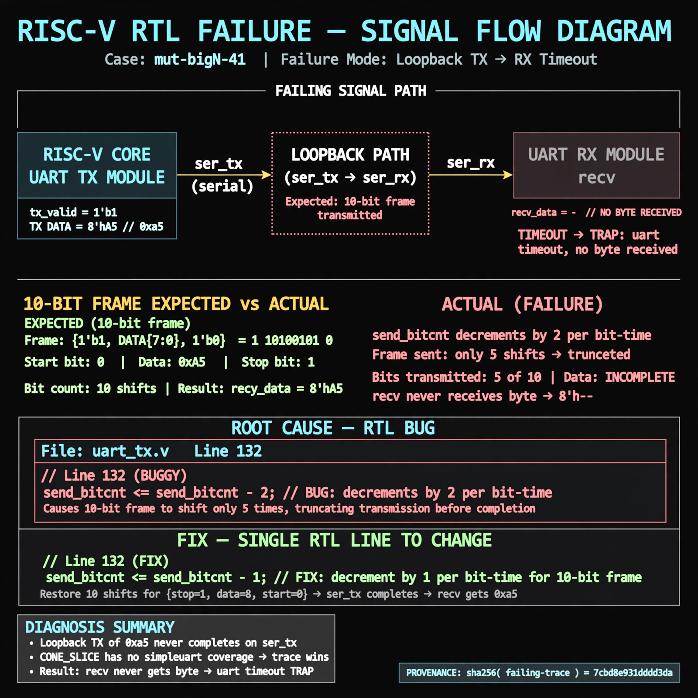

# Afterglow run report: mutbigN-v3-41

case `mut-bigN-41` | status **GREEN** | mode `live` | seed `42`

wall start `2026-10-27T12:05:10Z` | wall end `2026-10-27T12:06:10Z` | time-to-green `59.6s`

retries `0` | human_touches `0` | diagnosed `True` | fixed_unaided `True` | patch_source `model-verbatim`

## Verdicts (from sim, not typed)

- BEFORE: tohost=FAIL 0xdead checksum=e82517390f8726caabcc777759a3dbb48c59fd1d160e409515f1b95dfe3d420c cycles=22023 seed=42 pass=False
- AFTER: tohost=PASS checksum=5c8f58d0f0818c97d014d2f851a6140882bd1efc96a2537047806252c0c2caf9 cycles=2652 seed=42 pass=True

## Diagnosis (verbatim from api/text_response.json)

```
Loopback TX of 0xa5 never completes on ser_tx so recv never gets a byte vs expected 0xa5, ending in TRAP: uart timeout, no byte received. send_bitcnt at line 132 decrements by 2 per bit-time so the 10-bit frame {1'b1,data,1'b0} shifts only 5 times and truncates. CONE_SLICE has no simpleuart coverage so trace wins and line 132 is the root cause.
```

expected re-sim signal: tohost PASS, loopback byte 0xa5 received with no uart timeout

## Patch (2 lines, guard-checked)

```diff
diff --git a/picosoc/simpleuart.v b/picosoc/simpleuart.v
--- a/picosoc/simpleuart.v
+++ b/picosoc/simpleuart.v
@@ -130,5 +130,5 @@
 			if (send_divcnt > cfg_divider && send_bitcnt) begin
 				send_pattern <= {1'b1, send_pattern[9:1]};
-				send_bitcnt <= send_bitcnt - 2;
+				send_bitcnt <= send_bitcnt - 1;
 				send_divcnt <= 0;
 			end

```

## Provenance (judge checks)

- prompt file `v3` sha256 `ad529368accaf171e6121a54b2d27547230920a900c7c4e5094d3fff13ca4233`
- input_trace.txt sha256 `7cbd8e931dddd3da65228904c2d54eba98cfa8d394feb671c262f7c497370975` (9 lines, 66 tokens)
- prompt tokens `939` (cap 2500)
- text model `muse-spark-1.3-contributor` latency `41316ms` request `chatcmpl-01a17d40-aa09-7032-9587-0ecd6bfc791c`
- image model `muse-image-1.0` latency `17753ms` request `b9aee09e-4ff0-423a-bdab-7f66ae01b5be` status `ok`
- image prompt sha256 `793a3f77f559ea698c25367b3a34501daea58e196b63d5b80f0db4145f88d4b9`, trace sha `7cbd8e931dddd3da65228904c2d54eba98cfa8d394feb671c262f7c497370975` (see api/image_request.json)

## Explanation diagram



## Bundle completeness

- present (12): artifacts/input_trace.txt, artifacts/boot.log, artifacts/boot_after.log, artifacts/verdict_before.json, artifacts/verdict_after.json, api/text_request.json, api/text_response.json, api/image_request.json, api/image_response.json, explain.png, patch.diff, meta.json
- missing (0): none

