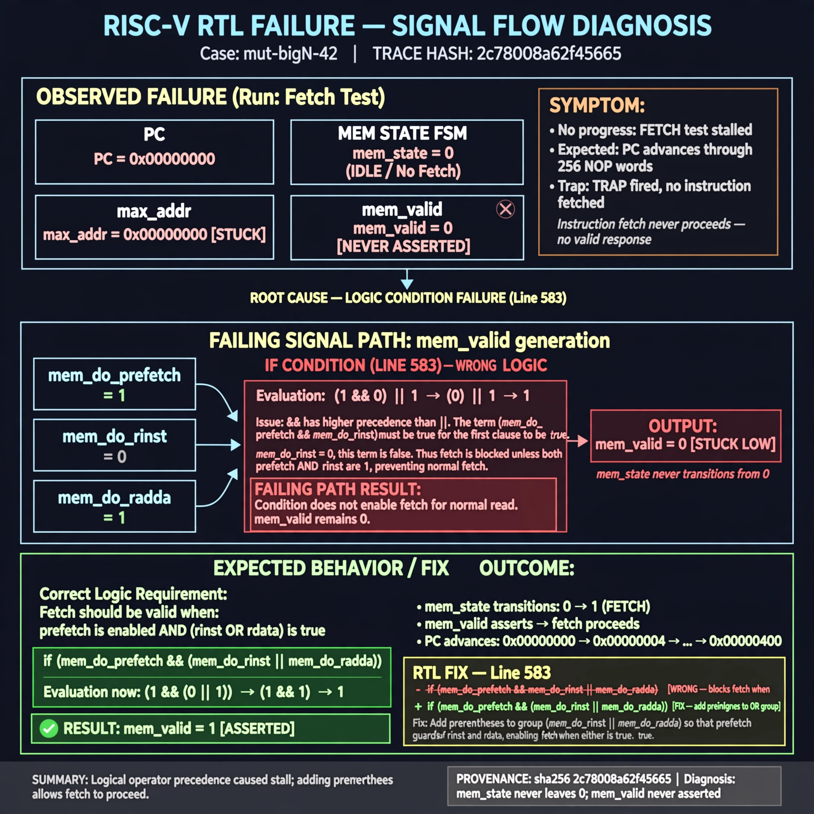

# Afterglow run report: mutbigN-v3-42

case `mut-bigN-42` | status **GREEN** | mode `live` | seed `42`

wall start `2026-10-27T12:06:10Z` | wall end `2026-10-27T12:07:52Z` | time-to-green `102.1s`

retries `0` | human_touches `0` | diagnosed `True` | fixed_unaided `True` | patch_source `model-verbatim`

## Verdicts (from sim, not typed)

- BEFORE: tohost=FAIL 0xdead checksum=563b7c10626ff25de2b3c430956c7c113e448c4efaea068f9b83a198d4322b15 cycles=2009 seed=42 pass=False
- AFTER: tohost=PASS checksum=5c28238265cb94168311e9914f0df355642c557d04dba11845d557ac8a64aa4a cycles=2009 seed=42 pass=True

## Diagnosis (verbatim from api/text_response.json)

```
Fetch test shows max_addr stuck at 0x00000000 with TRAP: no progress, expected PC to advance through 256 NOP words. mem_state never leaves 0 for instruction fetch so mem_valid never asserts. Root cause in excerpt line 583 is `if (mem_do_prefetch && mem_do_rinst || mem_do_rdata)` using && instead of ||, requiring prefetch and rinst together and blocking normal fetch.
```

expected re-sim signal: tohost PASS, no TRAP: no progress, max_addr advances beyond 0x00000000

## Patch (2 lines, guard-checked)

```diff
diff --git a/picorv32.v b/picorv32.v
--- a/picorv32.v
+++ b/picorv32.v
@@ -582,4 +582,4 @@
 				0: begin
-					if (mem_do_prefetch && mem_do_rinst || mem_do_rdata) begin
+					if (mem_do_prefetch || mem_do_rinst || mem_do_rdata) begin
 						mem_valid <= !mem_la_use_prefetched_high_word;
 						mem_instr <= mem_do_prefetch || mem_do_rinst;

```

## Provenance (judge checks)

- prompt file `v3` sha256 `ad529368accaf171e6121a54b2d27547230920a900c7c4e5094d3fff13ca4233`
- input_trace.txt sha256 `2c78008a62f45665b4463c846dc73f00ee9fecc60bedfa4cdb6948c601b1ad84` (9 lines, 69 tokens)
- prompt tokens `710` (cap 2500)
- text model `muse-spark-1.3-contributor` latency `50289ms` request `chatcmpl-01a17d41-b64b-748d-b635-0216596569e2`
- image model `muse-image-1.0` latency `51142ms` request `1ca6e59c-0b8f-4551-be7e-9b24767f2df8` status `ok`
- image prompt sha256 `f7b1ed59415263860e5c60148be996d0e650eea5daf3d7db4ffd5d2b4d05351d`, trace sha `2c78008a62f45665b4463c846dc73f00ee9fecc60bedfa4cdb6948c601b1ad84` (see api/image_request.json)

## Explanation diagram



## Bundle completeness

- present (12): artifacts/input_trace.txt, artifacts/boot.log, artifacts/boot_after.log, artifacts/verdict_before.json, artifacts/verdict_after.json, api/text_request.json, api/text_response.json, api/image_request.json, api/image_response.json, explain.png, patch.diff, meta.json
- missing (0): none

