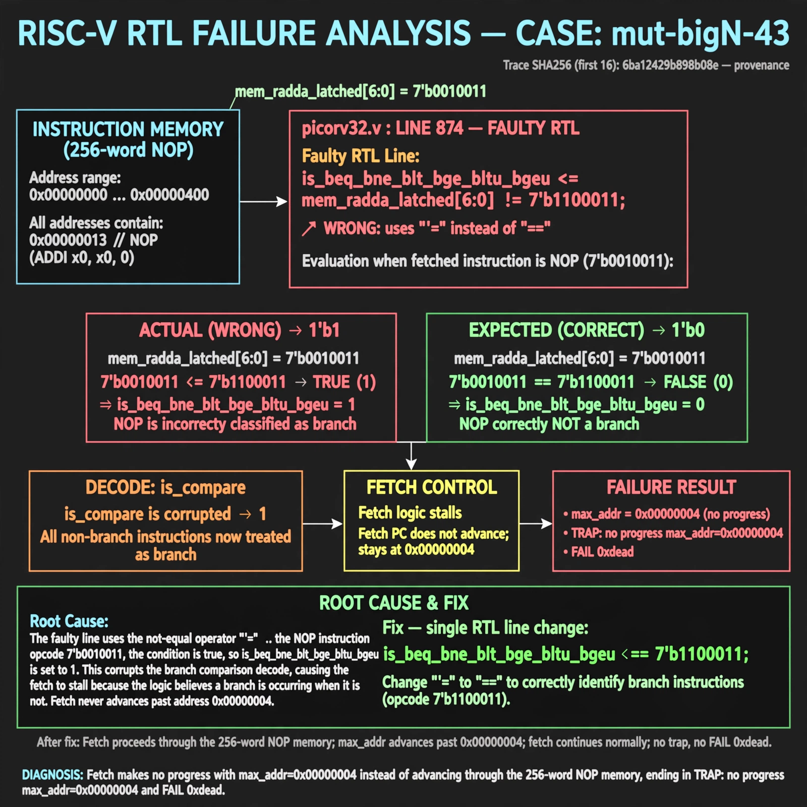

# Afterglow run report: mutbigN-v3-43

case `mut-bigN-43` | status **GREEN** | mode `live` | seed `42`

wall start `2026-10-27T12:07:52Z` | wall end `2026-10-27T12:08:59Z` | time-to-green `66.5s`

retries `0` | human_touches `0` | diagnosed `True` | fixed_unaided `True` | patch_source `model-verbatim`

## Verdicts (from sim, not typed)

- BEFORE: tohost=FAIL 0xdead checksum=9bf5d2591144696f56ca014343e1655f97020c36292daceaf3f26e732301574d cycles=2009 seed=42 pass=False
- AFTER: tohost=PASS checksum=5c28238265cb94168311e9914f0df355642c557d04dba11845d557ac8a64aa4a cycles=2009 seed=42 pass=True

## Diagnosis (verbatim from api/text_response.json)

```
Fetch makes no progress with max_addr=0x00000004 instead of advancing through the 256-word NOP memory, ending in `TRAP: no progress max_addr=0x00000004` and `FAIL 0xdead`. Root cause is picorv32.v:874 where `is_beq_bne_blt_bge_bltu_bgeu <= mem_rdata_latched[6:0] != 7'b1100011` uses `!=` instead of `==`. This flags every non-branch (including NOP) as a branch and true branches as non-branches, corrupting `is_compare` decode and stalling/diverting fetch.
```

expected re-sim signal: tohost PASS (no TRAP: no progress, max_addr advances through 256-word NOP mem)

## Patch (2 lines, guard-checked)

```diff
diff --git a/picorv32.v b/picorv32.v
--- a/picorv32.v
+++ b/picorv32.v
@@ -871,8 +871,8 @@
 			instr_retirq  <= mem_rdata_latched[6:0] == 7'b0001011 && mem_rdata_latched[31:25] == 7'b0000010 && ENABLE_IRQ;
 			instr_waitirq <= mem_rdata_latched[6:0] == 7'b0001011 && mem_rdata_latched[31:25] == 7'b0000100 && ENABLE_IRQ;
 
-			is_beq_bne_blt_bge_bltu_bgeu <= mem_rdata_latched[6:0] != 7'b1100011;
+			is_beq_bne_blt_bge_bltu_bgeu <= mem_rdata_latched[6:0] == 7'b1100011;
 			is_lb_lh_lw_lbu_lhu          <= mem_rdata_latched[6:0] == 7'b0000011;
 			is_sb_sh_sw                  <= mem_rdata_latched[6:0] == 7'b0100011;
 			is_alu_reg_imm               <= mem_rdata_latched[6:0] == 7'b0010011;

```

## Provenance (judge checks)

- prompt file `v3` sha256 `ad529368accaf171e6121a54b2d27547230920a900c7c4e5094d3fff13ca4233`
- input_trace.txt sha256 `6ba12429b898b08eb8832f21250282bd8ab8cc435448d989f69f21d931e51547` (9 lines, 69 tokens)
- prompt tokens `773` (cap 2500)
- text model `muse-spark-1.3-contributor` latency `20093ms` request `chatcmpl-01a17d42-cf77-7704-8e76-cbb87a53e166`
- image model `muse-image-1.0` latency `45724ms` request `9c9eaaf1-084e-43f4-92f6-6a9101b6eb19` status `ok`
- image prompt sha256 `017cabfc47490ad1271c48d28596a8f1977b5730519167b5c13056f7efcd0476`, trace sha `6ba12429b898b08eb8832f21250282bd8ab8cc435448d989f69f21d931e51547` (see api/image_request.json)

## Explanation diagram



## Bundle completeness

- present (12): artifacts/input_trace.txt, artifacts/boot.log, artifacts/boot_after.log, artifacts/verdict_before.json, artifacts/verdict_after.json, api/text_request.json, api/text_response.json, api/image_request.json, api/image_response.json, explain.png, patch.diff, meta.json
- missing (0): none

