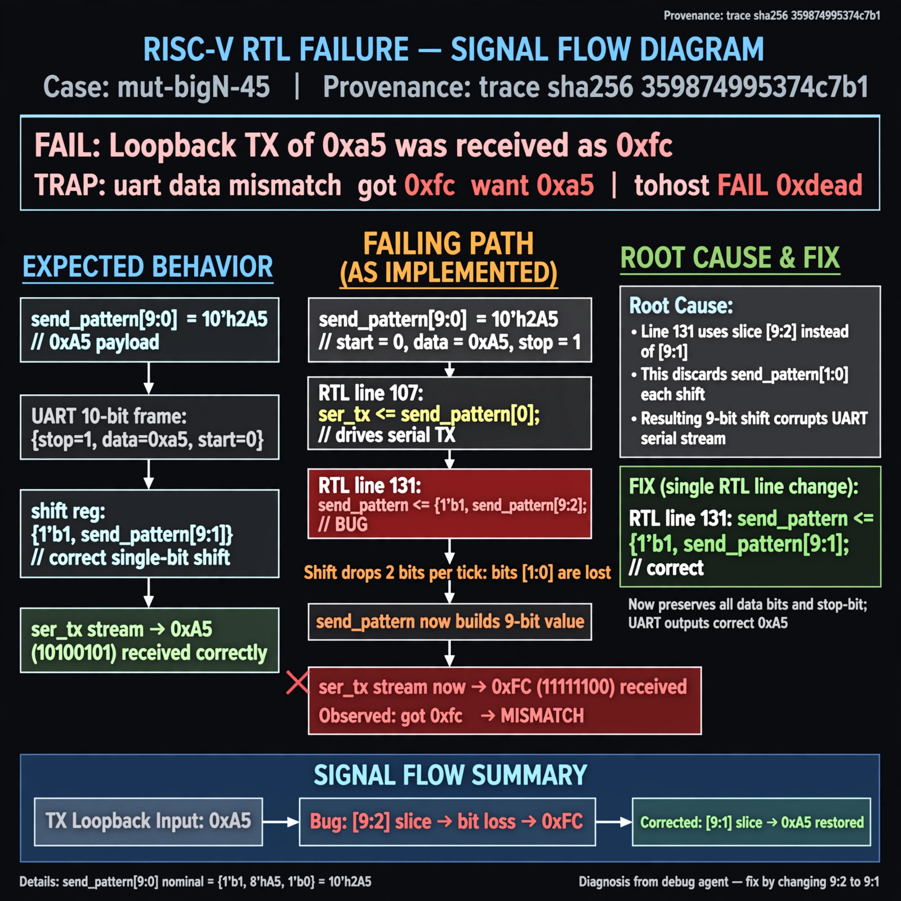

# Afterglow run report: mutbigN-v3-45

case `mut-bigN-45` | status **GREEN** | mode `live` | seed `42`

wall start `2026-10-27T12:10:05Z` | wall end `2026-10-27T12:10:48Z` | time-to-green `42.8s`

retries `0` | human_touches `0` | diagnosed `True` | fixed_unaided `True` | patch_source `model-verbatim`

## Verdicts (from sim, not typed)

- BEFORE: tohost=FAIL 0xdead checksum=81da732e94fc072e4bfde6dbde0f87fc64d6bd1ce2626374b0f08525d89d43af cycles=2652 seed=42 pass=False
- AFTER: tohost=PASS checksum=5c8f58d0f0818c97d014d2f851a6140882bd1efc96a2537047806252c0c2caf9 cycles=2652 seed=42 pass=True

## Diagnosis (verbatim from api/text_response.json)

```
Loopback TX of 0xa5 was received as 0xfc (TRAP: uart data mismatch got 0xfc want 0xa5, tohost FAIL 0xdead). ser_tx is driven as send_pattern[0] per line 107, but line 131 shifts as {1'b1, send_pattern[9:2]} which drops two bits per tick and builds a 9-bit value, corrupting the serial stream. Root cause is the [9:2] slice; correct single-bit shift is [9:1] to preserve data and stop-bit 1s.
```

expected re-sim signal: tohost PASS (FAIL 0xdead cleared), uart loopback got 0xa5 want 0xa5

## Patch (2 lines, guard-checked)

```diff
diff --git a/picosoc/simpleuart.v b/picosoc/simpleuart.v
--- a/picosoc/simpleuart.v
+++ b/picosoc/simpleuart.v
@@ -128,7 +128,7 @@
 				send_divcnt <= 0;
 			end else
 			if (send_divcnt > cfg_divider && send_bitcnt) begin
-				send_pattern <= {1'b1, send_pattern[9:2]};
+				send_pattern <= {1'b1, send_pattern[9:1]};
 				send_bitcnt <= send_bitcnt - 1;
 				send_divcnt <= 0;
 			end

```

## Provenance (judge checks)

- prompt file `v3` sha256 `ad529368accaf171e6121a54b2d27547230920a900c7c4e5094d3fff13ca4233`
- input_trace.txt sha256 `359874995374c7b17bf4eb30626e2d6cf01f07e91fddd8da6756d154c2ec101c` (9 lines, 68 tokens)
- prompt tokens `815` (cap 2500)
- text model `muse-spark-1.3-contributor` latency `23658ms` request `chatcmpl-01a17d44-e317-7094-b3be-be49f252550c`
- image model `muse-image-1.0` latency `18617ms` request `dc5dc6af-a5c8-4349-8ebf-5358090b84ae` status `ok`
- image prompt sha256 `5ac0c96259bd8b269faa0a0c55d2b8e11fc6d67a698a37745e79ca3a2d1b8958`, trace sha `359874995374c7b17bf4eb30626e2d6cf01f07e91fddd8da6756d154c2ec101c` (see api/image_request.json)

## Explanation diagram



## Bundle completeness

- present (12): artifacts/input_trace.txt, artifacts/boot.log, artifacts/boot_after.log, artifacts/verdict_before.json, artifacts/verdict_after.json, api/text_request.json, api/text_response.json, api/image_request.json, api/image_response.json, explain.png, patch.diff, meta.json
- missing (0): none

