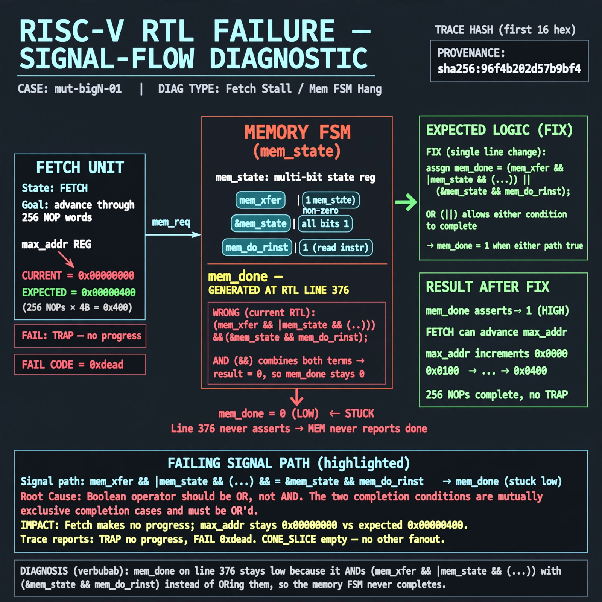

# Afterglow run report: mutbigN-v4-01

case `mut-bigN-01` | status **GREEN** | mode `live` | seed `42`

wall start `2026-10-27T14:24:37Z` | wall end `2026-10-27T14:25:28Z` | time-to-green `51.1s`

retries `0` | human_touches `0` | diagnosed `True` | fixed_unaided `True` | patch_source `model-verbatim`

## Verdicts (from sim, not typed)

- BEFORE: tohost=FAIL 0xdead checksum=563b7c10626ff25de2b3c430956c7c113e448c4efaea068f9b83a198d4322b15 cycles=2009 seed=42 pass=False
- AFTER: tohost=PASS checksum=5c28238265cb94168311e9914f0df355642c557d04dba11845d557ac8a64aa4a cycles=2009 seed=42 pass=True

## Diagnosis (verbatim from api/text_response.json)

```
Fetch makes no progress: max_addr stays 0x00000000 vs expected advance through 256 NOP words, with TRAP: no progress and FAIL 0xdead. mem_done on line 376 stays low because it ANDs (mem_xfer && |mem_state && (...)) with (&mem_state && mem_do_rinst) instead of ORing them, so the memory FSM never completes. Trace wins; CONE_SLICE was empty so no cone refs apply.
```

expected re-sim signal: tohost PASS (not FAIL 0xdead), no TRAP: no progress, max_addr advances beyond 0x00000000

## Patch (2 lines, guard-checked)

```diff
diff --git a/picorv32.v b/picorv32.v
--- a/picorv32.v
+++ b/picorv32.v
@@ -376,2 +376,2 @@
-	wire mem_done = resetn && ((mem_xfer && |mem_state && (mem_do_rinst || mem_do_rdata || mem_do_wdata)) && (&mem_state && mem_do_rinst)) &&
+	wire mem_done = resetn && ((mem_xfer && |mem_state && (mem_do_rinst || mem_do_rdata || mem_do_wdata)) || (&mem_state && mem_do_rinst)) &&
 			(!mem_la_firstword || (~&mem_rdata_latched[1:0] && mem_xfer));

```

## Provenance (judge checks)

- prompt file `v3` sha256 `ad529368accaf171e6121a54b2d27547230920a900c7c4e5094d3fff13ca4233`
- input_trace.txt sha256 `96f4b202d57b9bf40e2202b0d9fad9967590db733dcfa7ed372ff030bb3b9b46` (9 lines, 69 tokens)
- prompt tokens `795` (cap 2500)
- text model `muse-spark-1.3-contributor` latency `34495ms` request `chatcmpl-01a17dc0-3a74-7469-bb0d-0589ba2f000e`
- image model `muse-image-1.0` latency `15966ms` request `44718552-dff0-4c08-9aac-2dcd91ab104c` status `ok`
- image prompt sha256 `127e47a8d57d1bab8ebe0c2386a5937346aa03df29148e3741ea29da8f7b7f3f`, trace sha `96f4b202d57b9bf40e2202b0d9fad9967590db733dcfa7ed372ff030bb3b9b46` (see api/image_request.json)

## Explanation diagram



## Bundle completeness

- present (12): artifacts/input_trace.txt, artifacts/boot.log, artifacts/boot_after.log, artifacts/verdict_before.json, artifacts/verdict_after.json, api/text_request.json, api/text_response.json, api/image_request.json, api/image_response.json, explain.png, patch.diff, meta.json
- missing (0): none

