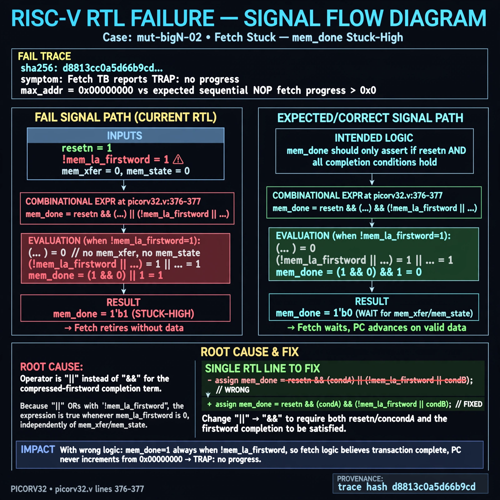

# Afterglow run report: mutbigN-v4-02

case `mut-bigN-02` | status **GREEN** | mode `live` | seed `42`

wall start `2026-10-27T14:25:28Z` | wall end `2026-10-27T14:35:00Z` | time-to-green `571.2s`

retries `0` | human_touches `0` | diagnosed `True` | fixed_unaided `True` | patch_source `model-verbatim`

## Verdicts (from sim, not typed)

- BEFORE: tohost=FAIL 0xdead checksum=563b7c10626ff25de2b3c430956c7c113e448c4efaea068f9b83a198d4322b15 cycles=2009 seed=42 pass=False
- AFTER: tohost=PASS checksum=5c28238265cb94168311e9914f0df355642c557d04dba11845d557ac8a64aa4a cycles=2009 seed=42 pass=True

## Diagnosis (verbatim from api/text_response.json)

```
Fetch TB reports TRAP: no progress max_addr=0x00000000 vs expected sequential NOP fetch progress beyond 0x0. mem_done at picorv32.v:376-377 is stuck-high because `resetn && (...) || (!mem_la_firstword || ...)` is true whenever !mem_la_firstword, so it asserts without mem_xfer/mem_state. Root cause is `||` instead of `&&` gating the compressed-firstword completion term, letting fetch retire without data and never advance PC.
```

expected re-sim signal: tohost PASS with fetch progress max_addr>0x00000000, no TRAP: no progress

## Patch (2 lines, guard-checked)

```diff
diff --git a/picorv32.v b/picorv32.v
--- a/picorv32.v
+++ b/picorv32.v
@@ -375,3 +375,3 @@
 	wire mem_busy = |{mem_do_prefetch, mem_do_rinst, mem_do_rdata, mem_do_wdata};
-	wire mem_done = resetn && ((mem_xfer && |mem_state && (mem_do_rinst || mem_do_rdata || mem_do_wdata)) || (&mem_state && mem_do_rinst)) ||
+	wire mem_done = resetn && ((mem_xfer && |mem_state && (mem_do_rinst || mem_do_rdata || mem_do_wdata)) || (&mem_state && mem_do_rinst)) &&
 			(!mem_la_firstword || (~&mem_rdata_latched[1:0] && mem_xfer));

```

## Provenance (judge checks)

- prompt file `v3` sha256 `ad529368accaf171e6121a54b2d27547230920a900c7c4e5094d3fff13ca4233`
- input_trace.txt sha256 `d8813c0a5d66b9cdfc3cad6564a521d9936aeeee4df0b21aa2bf4bef69ae80bd` (9 lines, 69 tokens)
- prompt tokens `795` (cap 2500)
- text model `muse-spark-1.3-contributor` latency `48769ms` request `chatcmpl-01a17dc8-ed1e-7439-a339-53f27a68a8cc`
- image model `muse-image-1.0` latency `17249ms` request `4214a388-b15c-4370-bbee-92d0b98f256a` status `ok`
- image prompt sha256 `d2533004dafeac1cd22563510f126476520a991b47b6623a379f7414e8b875bb`, trace sha `d8813c0a5d66b9cdfc3cad6564a521d9936aeeee4df0b21aa2bf4bef69ae80bd` (see api/image_request.json)

## Explanation diagram



## Bundle completeness

- present (12): artifacts/input_trace.txt, artifacts/boot.log, artifacts/boot_after.log, artifacts/verdict_before.json, artifacts/verdict_after.json, api/text_request.json, api/text_response.json, api/image_request.json, api/image_response.json, explain.png, patch.diff, meta.json
- missing (0): none

