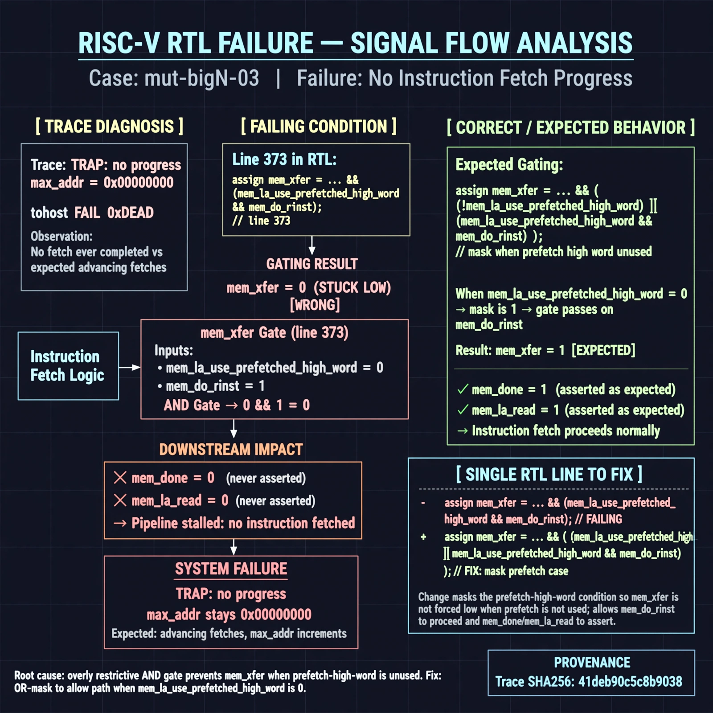

# Afterglow run report: mutbigN-v4-03

case `mut-bigN-03` | status **GREEN** | mode `live` | seed `42`

wall start `2026-10-27T14:35:00Z` | wall end `2026-10-27T14:36:03Z` | time-to-green `63.3s`

retries `0` | human_touches `0` | diagnosed `True` | fixed_unaided `True` | patch_source `model-verbatim`

## Verdicts (from sim, not typed)

- BEFORE: tohost=FAIL 0xdead checksum=563b7c10626ff25de2b3c430956c7c113e448c4efaea068f9b83a198d4322b15 cycles=2009 seed=42 pass=False
- AFTER: tohost=PASS checksum=5c28238265cb94168311e9914f0df355642c557d04dba11845d557ac8a64aa4a cycles=2009 seed=42 pass=True

## Diagnosis (verbatim from api/text_response.json)

```
Trace shows TRAP: no progress max_addr=0x00000000 with tohost FAIL 0xdead, meaning no fetch ever completed versus expected advancing fetches. Line 373 holds mem_xfer low because it is `&& (mem_la_use_prefetched_high_word && mem_do_rinst)` instead of masking that case, so mem_done/mem_la_read never assert. This single gating inversion stalls all instruction fetch, matching zero max_addr.
```

expected re-sim signal: tohost PASS (not FAIL 0xdead) with progress max_addr != 0x00000000 and no TRAP: no progress

## Patch (2 lines, guard-checked)

```diff
diff --git a/picorv32.v b/picorv32.v
--- a/picorv32.v
+++ b/picorv32.v
@@ -372,4 +372,4 @@
 	wire mem_la_use_prefetched_high_word = COMPRESSED_ISA && mem_la_firstword && prefetched_high_word && !clear_prefetched_high_word;
-	assign mem_xfer = (mem_valid && mem_ready) && (mem_la_use_prefetched_high_word && mem_do_rinst);
+	assign mem_xfer = (mem_valid && mem_ready) && !(mem_la_use_prefetched_high_word && mem_do_rinst);
 
 	wire mem_busy = |{mem_do_prefetch, mem_do_rinst, mem_do_rdata, mem_do_wdata};

```

## Provenance (judge checks)

- prompt file `v3` sha256 `ad529368accaf171e6121a54b2d27547230920a900c7c4e5094d3fff13ca4233`
- input_trace.txt sha256 `41deb90c5c8b9038978eaafd23f688526711416cea0f1d179348f73488a20eac` (9 lines, 69 tokens)
- prompt tokens `795` (cap 2500)
- text model `muse-spark-1.3-contributor` latency `43974ms` request `chatcmpl-01a17dc9-dee6-740d-b394-09edb92a87c3`
- image model `muse-image-1.0` latency `18677ms` request `9e91a854-edd6-428f-aaa9-00535467d72e` status `ok`
- image prompt sha256 `3f7e8ad8cfdb2d10b192cf92c3e8ccbb1b431e84295560f113faa0f053ba07f9`, trace sha `41deb90c5c8b9038978eaafd23f688526711416cea0f1d179348f73488a20eac` (see api/image_request.json)

## Explanation diagram



## Bundle completeness

- present (12): artifacts/input_trace.txt, artifacts/boot.log, artifacts/boot_after.log, artifacts/verdict_before.json, artifacts/verdict_after.json, api/text_request.json, api/text_response.json, api/image_request.json, api/image_response.json, explain.png, patch.diff, meta.json
- missing (0): none

