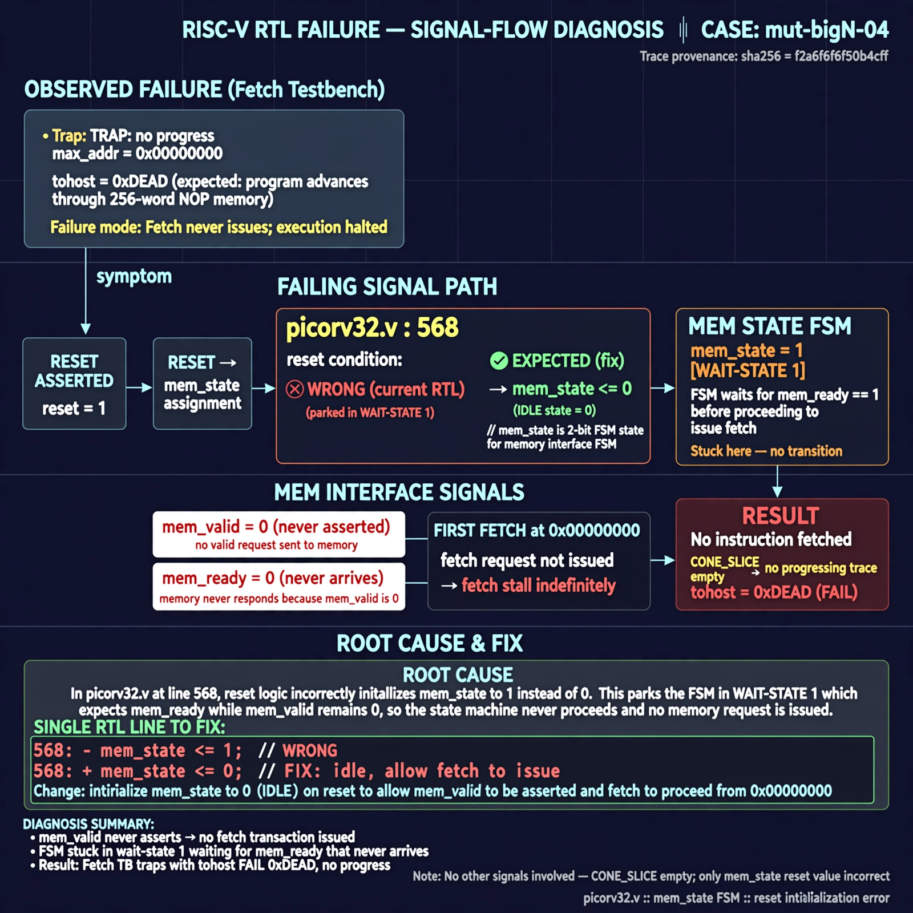

# Afterglow run report: mutbigN-v4-04

case `mut-bigN-04` | status **GREEN** | mode `live` | seed `42`

wall start `2026-10-27T14:36:03Z` | wall end `2026-10-27T14:37:02Z` | time-to-green `58.7s`

retries `0` | human_touches `0` | diagnosed `True` | fixed_unaided `True` | patch_source `model-verbatim`

## Verdicts (from sim, not typed)

- BEFORE: tohost=FAIL 0xdead checksum=563b7c10626ff25de2b3c430956c7c113e448c4efaea068f9b83a198d4322b15 cycles=2009 seed=42 pass=False
- AFTER: tohost=PASS checksum=5c28238265cb94168311e9914f0df355642c557d04dba11845d557ac8a64aa4a cycles=2009 seed=42 pass=True

## Diagnosis (verbatim from api/text_response.json)

```
Fetch tb shows TRAP: no progress max_addr=0x00000000 with tohost FAIL 0xdead instead of advancing through 256-word NOP memory. mem_valid never asserts so first fetch at 0x00000000 never issues. Root cause in excerpt at picorv32.v:568 is reset assigning mem_state <= 1 instead of idle 0, parking the FSM in wait-state 1 where it waits for mem_ready that can never come while mem_valid is 0; CONE_SLICE empty so trace wins.
```

expected re-sim signal: tohost PASS, no TRAP: no progress, max_addr > 0x00000000

## Patch (2 lines, guard-checked)

```diff
diff --git a/picorv32.v b/picorv32.v
--- a/picorv32.v
+++ b/picorv32.v
@@ -566,5 +566,5 @@
 		if (!resetn || trap) begin
 			if (!resetn)
-				mem_state <= 1;
+				mem_state <= 0;
 			if (!resetn || mem_ready)
 				mem_valid <= 0;

```

## Provenance (judge checks)

- prompt file `v3` sha256 `ad529368accaf171e6121a54b2d27547230920a900c7c4e5094d3fff13ca4233`
- input_trace.txt sha256 `f2a6f6f6f50b4cff8ffec5b83d570f6dc51e8cabac6b520f63e331cd3221fc98` (9 lines, 69 tokens)
- prompt tokens `705` (cap 2500)
- text model `muse-spark-1.3-contributor` latency `40366ms` request `chatcmpl-01a17dca-c82d-728e-9356-de2ce4ea24ec`
- image model `muse-image-1.0` latency `17767ms` request `6583d844-5f7e-40af-ae8c-735d85bab7be` status `ok`
- image prompt sha256 `ac9e3dcd38666c0e83da51155c593455a8200fe5030d26e8ca94f0f098a843b0`, trace sha `f2a6f6f6f50b4cff8ffec5b83d570f6dc51e8cabac6b520f63e331cd3221fc98` (see api/image_request.json)

## Explanation diagram



## Bundle completeness

- present (12): artifacts/input_trace.txt, artifacts/boot.log, artifacts/boot_after.log, artifacts/verdict_before.json, artifacts/verdict_after.json, api/text_request.json, api/text_response.json, api/image_request.json, api/image_response.json, explain.png, patch.diff, meta.json
- missing (0): none

