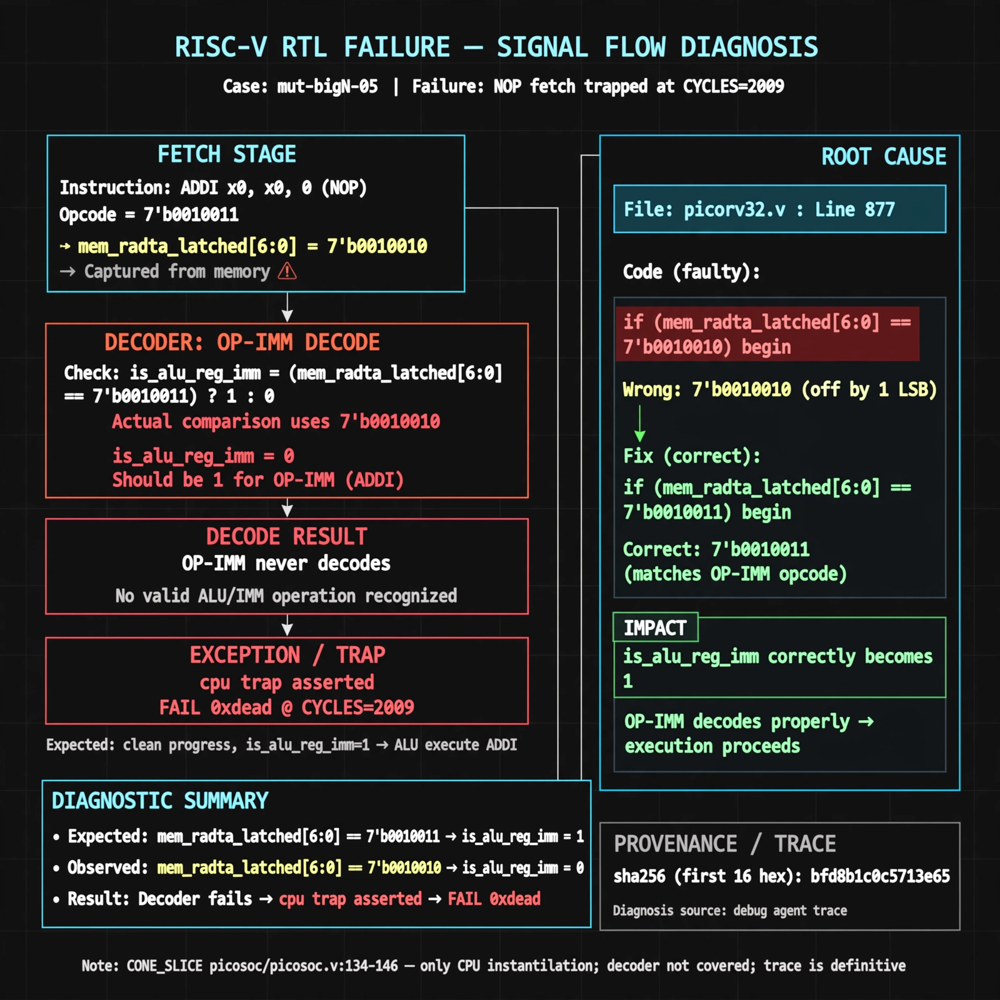

# Afterglow run report: mutbigN-v4-05

case `mut-bigN-05` | status **GREEN** | mode `live` | seed `42`

wall start `2026-10-27T14:37:02Z` | wall end `2026-10-27T14:38:06Z` | time-to-green `64.4s`

retries `0` | human_touches `0` | diagnosed `True` | fixed_unaided `True` | patch_source `model-verbatim`

## Verdicts (from sim, not typed)

- BEFORE: tohost=FAIL 0xdead checksum=c2a7a4d6295484feeb9ec1ea9381732b8e39a7ccd1997c7d70f6454da2fb4659 cycles=2009 seed=42 pass=False
- AFTER: tohost=PASS checksum=5c28238265cb94168311e9914f0df355642c557d04dba11845d557ac8a64aa4a cycles=2009 seed=42 pass=True

## Diagnosis (verbatim from api/text_response.json)

```
NOP fetch (ADDI x0,x0,0, opcode 0010011) ends in `TRAP: cpu trap asserted` and `FAIL 0xdead` at CYCLES=2009 instead of clean progress. `is_alu_reg_imm` stays 0 when it should be 1, so OP-IMM never decodes. Root cause in picorv32.v:877 compares `mem_rdata_latched[6:0]` to 7'b0010010 instead of 7'b0010011, off by one LSB. CONE_SLICE picosoc/picosoc.v:134-146 only shows cpu instantiation (fallback-window, 0/1 resolved) and does not cover the decoder, so trace wins.
```

expected re-sim signal: tohost PASS with no TRAP: cpu trap asserted, fetch progress beyond CYCLES=2009

## Patch (2 lines, guard-checked)

```diff
diff --git a/picorv32.v b/picorv32.v
--- a/picorv32.v
+++ b/picorv32.v
@@ -874,7 +874,7 @@
 			is_beq_bne_blt_bge_bltu_bgeu <= mem_rdata_latched[6:0] == 7'b1100011;
 			is_lb_lh_lw_lbu_lhu          <= mem_rdata_latched[6:0] == 7'b0000011;
 			is_sb_sh_sw                  <= mem_rdata_latched[6:0] == 7'b0100011;
-			is_alu_reg_imm               <= mem_rdata_latched[6:0] == 7'b0010010;
+			is_alu_reg_imm               <= mem_rdata_latched[6:0] == 7'b0010011;
 			is_alu_reg_reg               <= mem_rdata_latched[6:0] == 7'b0110011;

```

## Provenance (judge checks)

- prompt file `v3` sha256 `ad529368accaf171e6121a54b2d27547230920a900c7c4e5094d3fff13ca4233`
- input_trace.txt sha256 `bfd8b1c0c5713e6532737273b18214bed4a936a538e1ad7bc46279dadfd3d266` (9 lines, 69 tokens)
- prompt tokens `1016` (cap 2500)
- text model `muse-spark-1.3-contributor` latency `33203ms` request `chatcmpl-01a17dcb-91d2-7034-8e85-446b1d4b8a87`
- image model `muse-image-1.0` latency `30638ms` request `14d82f92-98d6-4d02-a0db-19762ee8b41c` status `ok`
- image prompt sha256 `558bcfdac0a5c587e6a07999f343662d5bbe324aab03991199464b76ddef9ebb`, trace sha `bfd8b1c0c5713e6532737273b18214bed4a936a538e1ad7bc46279dadfd3d266` (see api/image_request.json)

## Explanation diagram



## Bundle completeness

- present (12): artifacts/input_trace.txt, artifacts/boot.log, artifacts/boot_after.log, artifacts/verdict_before.json, artifacts/verdict_after.json, api/text_request.json, api/text_response.json, api/image_request.json, api/image_response.json, explain.png, patch.diff, meta.json
- missing (0): none

