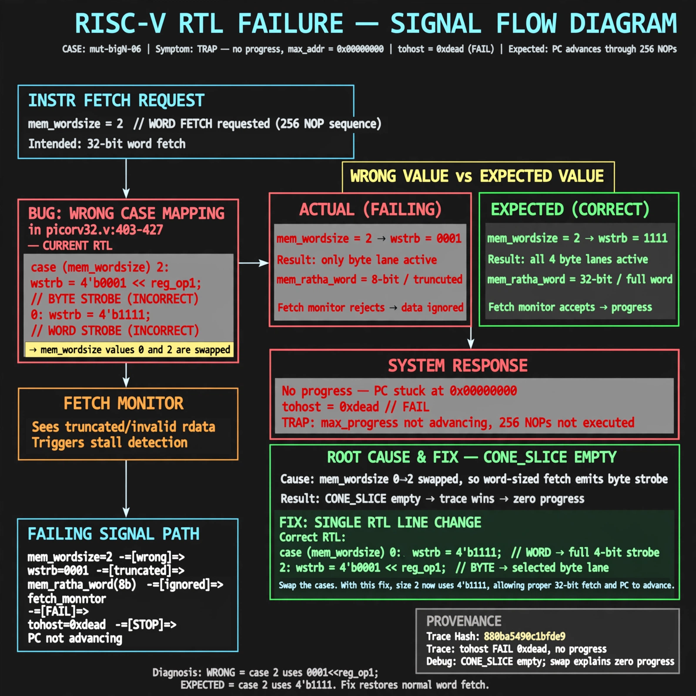

# Afterglow run report: mutbigN-v4-06

case `mut-bigN-06` | status **RED** | mode `live` | seed `42`

wall start `2026-10-27T14:38:06Z` | wall end `2026-10-27T14:54:59Z` | time-to-green `1012.5s`

retries `2` | human_touches `0` | diagnosed `True` | fixed_unaided `False` | patch_source `model-verbatim`

## Verdicts (from sim, not typed)

- BEFORE: tohost=FAIL 0xdead checksum=563b7c10626ff25de2b3c430956c7c113e448c4efaea068f9b83a198d4322b15 cycles=2009 seed=42 pass=False
- AFTER: tohost=FAIL 0xdead checksum=563b7c10626ff25de2b3c430956c7c113e448c4efaea068f9b83a198d4322b15 cycles=2009 seed=42 pass=False

## Diagnosis (verbatim from api/text_response.json)

```
Trace shows TRAP: no progress max_addr=0x00000000 with tohost FAIL 0xdead instead of advancing PC through 256 NOPs. Excerpt picorv32.v:403-427 has mem_wordsize 0=>word (wstrb 1111) and 2=>byte (wstrb 0001<<reg_op1) swapped, so word-sized fetches (size 2) emit byte strobes and truncated mem_rdata_word and are ignored by the fetch monitor. CONE_SLICE empty so trace wins; this swap explains zero progress.
```

expected re-sim signal: tohost PASS (was FAIL 0xdead), no TRAP: no progress, max_addr>0x00000000 with checksum != 563b7c10626ff25de2b3c430956c7c113e448c4efaea068f9b83a198d4322b15

## Patch (4 lines, guard-checked)

```diff
diff --git a/picorv32.v b/picorv32.v
--- a/picorv32.v
+++ b/picorv32.v
@@ -401,7 +401,7 @@
 	always @* begin
 		(* full_case *)
 		case (mem_wordsize)
-			0: begin
+			2: begin
 				mem_la_wdata = reg_op2;
 				mem_la_wstrb = 4'b1111;
 				mem_rdata_word = mem_rdata;
@@ -414,7 +414,7 @@
 				endcase
 			end
-			2: begin
+			0: begin
 				mem_la_wdata = {4{reg_op2[7:0]}};
 				mem_la_wstrb = 4'b0001 << reg_op1[1:0];
 				case (reg_op1[1:0])

```

## Provenance (judge checks)

- prompt file `v3` sha256 `ad529368accaf171e6121a54b2d27547230920a900c7c4e5094d3fff13ca4233`
- input_trace.txt sha256 `880ba5490c1bfde9c89034050f787a301c3e9311588bed01c6d2a087fb3f5cd5` (9 lines, 69 tokens)
- prompt tokens `837` (cap 2500)
- text model `muse-spark-1.3-contributor` latency `81934ms` request `chatcmpl-01a17dda-ea63-73bb-8706-c4a2cba6b293`
- image model `muse-image-1.0` latency `37469ms` request `412710b7-3787-4baf-85bb-25399807756e` status `ok`
- image prompt sha256 `bc5dc405295e9365528f3fbb5509380d162b4e68c60d8fb8a6ee0ae69cade5a7`, trace sha `880ba5490c1bfde9c89034050f787a301c3e9311588bed01c6d2a087fb3f5cd5` (see api/image_request.json)

## Explanation diagram



## Bundle completeness

- present (12): artifacts/input_trace.txt, artifacts/boot.log, artifacts/boot_after.log, artifacts/verdict_before.json, artifacts/verdict_after.json, api/text_request.json, api/text_response.json, api/image_request.json, api/image_response.json, explain.png, patch.diff, meta.json
- missing (0): none

