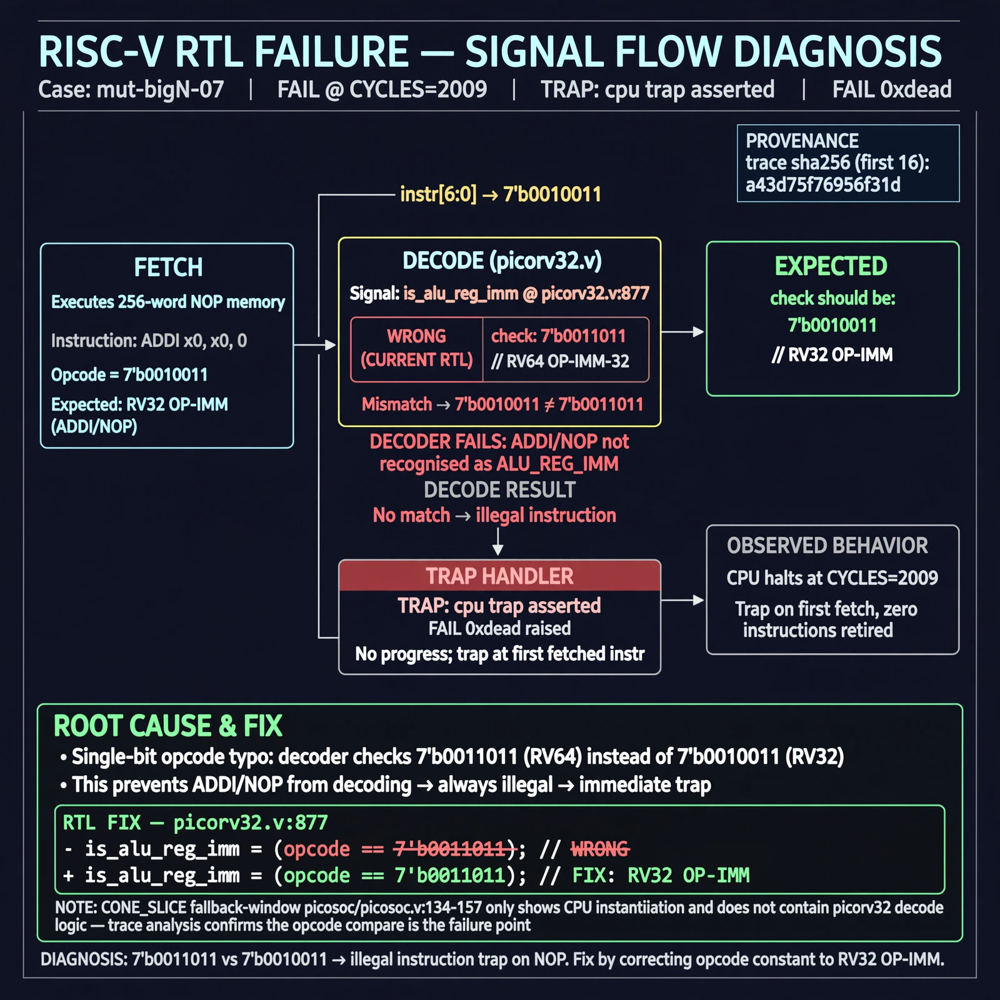

# Afterglow run report: mutbigN-v4-07

case `mut-bigN-07` | status **GREEN** | mode `live` | seed `42`

wall start `2026-10-27T14:54:59Z` | wall end `2026-10-27T14:56:27Z` | time-to-green `88.5s`

retries `0` | human_touches `0` | diagnosed `True` | fixed_unaided `True` | patch_source `model-verbatim`

## Verdicts (from sim, not typed)

- BEFORE: tohost=FAIL 0xdead checksum=c2a7a4d6295484feeb9ec1ea9381732b8e39a7ccd1997c7d70f6454da2fb4659 cycles=2009 seed=42 pass=False
- AFTER: tohost=PASS checksum=5c28238265cb94168311e9914f0df355642c557d04dba11845d557ac8a64aa4a cycles=2009 seed=42 pass=True

## Diagnosis (verbatim from api/text_response.json)

```
Fetch test executes 256-word NOP memory (ADDI x0,x0,0 with opcode 7'b0010011) but traps immediately with `TRAP: cpu trap asserted` and `FAIL 0xdead` at CYCLES=2009. `is_alu_reg_imm` at picorv32.v:877 checks `7'b0011011` (RV64 OP-IMM-32) instead of `7'b0010011` (RV32 OP-IMM), so ADDI/NOP never decodes and is treated as illegal. Single-bit opcode typo explains trap on first fetch and no progress; CONE_SLICE fallback-window picosoc/picosoc.v:134-157 only shows CPU instantiation and disagrees with no picorv32 decode, so trace wins.
```

expected re-sim signal: tohost PASS (not FAIL 0xdead), no TRAP: cpu trap asserted, fetch progress through NOPs

## Patch (2 lines, guard-checked)

```diff
diff --git a/picorv32.v b/picorv32.v
--- a/picorv32.v
+++ b/picorv32.v
@@ -874,5 +874,5 @@
 			is_beq_bne_blt_bge_bltu_bgeu <= mem_rdata_latched[6:0] == 7'b1100011;
 			is_lb_lh_lw_lbu_lhu          <= mem_rdata_latched[6:0] == 7'b0000011;
 			is_sb_sh_sw                  <= mem_rdata_latched[6:0] == 7'b0100011;
-			is_alu_reg_imm               <= mem_rdata_latched[6:0] == 7'b0011011;
+			is_alu_reg_imm               <= mem_rdata_latched[6:0] == 7'b0010011;
 			is_alu_reg_reg               <= mem_rdata_latched[6:0] == 7'b0110011;

```

## Provenance (judge checks)

- prompt file `v3` sha256 `ad529368accaf171e6121a54b2d27547230920a900c7c4e5094d3fff13ca4233`
- input_trace.txt sha256 `a43d75f76956f31d120ea863fec6b669284734d91ff6094c33cac6ed8030a443` (9 lines, 69 tokens)
- prompt tokens `1016` (cap 2500)
- text model `muse-spark-1.3-contributor` latency `35703ms` request `chatcmpl-01a17ddc-0ab3-749e-ae42-a656244ca384`
- image model `muse-image-1.0` latency `52172ms` request `4502f0eb-0963-41a5-b90b-bf697822db93` status `ok`
- image prompt sha256 `ddec6d521f34f3d5267ae72b0cfd25abecd46e8cf9f5841af72c6e3f4e11694b`, trace sha `a43d75f76956f31d120ea863fec6b669284734d91ff6094c33cac6ed8030a443` (see api/image_request.json)

## Explanation diagram



## Bundle completeness

- present (12): artifacts/input_trace.txt, artifacts/boot.log, artifacts/boot_after.log, artifacts/verdict_before.json, artifacts/verdict_after.json, api/text_request.json, api/text_response.json, api/image_request.json, api/image_response.json, explain.png, patch.diff, meta.json
- missing (0): none

