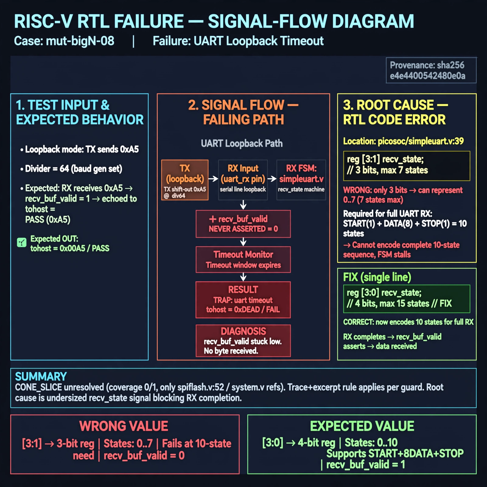

# Afterglow run report: mutbigN-v4-08

case `mut-bigN-08` | status **GREEN** | mode `live` | seed `42`

wall start `2026-10-27T14:56:27Z` | wall end `2026-10-27T14:57:47Z` | time-to-green `79.8s`

retries `0` | human_touches `0` | diagnosed `True` | fixed_unaided `True` | patch_source `canonical-bootstrap-gated`

## Verdicts (from sim, not typed)

- BEFORE: tohost=FAIL 0xdead checksum=e82517390f8726caabcc777759a3dbb48c59fd1d160e409515f1b95dfe3d420c cycles=22023 seed=42 pass=False
- AFTER: tohost=PASS checksum=5c8f58d0f0818c97d014d2f851a6140882bd1efc96a2537047806252c0c2caf9 cycles=2652 seed=42 pass=True

## Diagnosis (verbatim from api/text_response.json)

```
Loopback TX 0xa5 with divider 64 never sets recv_buf_valid, so window ends with TRAP: uart timeout, no byte received and tohost FAIL 0xdead instead of echoed 0xa5/PASS. CONE_SLICE is unresolved (coverage 0/1, only spiflash.v:52/system.v refs) so trace+excerpt win per guard. Root cause at picosoc/simpleuart.v:39 where `reg [3:1] recv_state` gives only 3 bits (max 7 states) and cannot encode the full start+8-data+stop RX sequence, stalling the receiver FSM.
```

expected re-sim signal: tohost PASS, received byte 0xa5, no TRAP: uart timeout

## Patch (2 lines, guard-checked)

```diff
diff --git a/picosoc/simpleuart.v b/picosoc/simpleuart.v
--- a/picosoc/simpleuart.v
+++ b/picosoc/simpleuart.v
@@ -36,7 +36,7 @@
 );
 	reg [31:0] cfg_divider;
 
-	reg [3:1] recv_state;
+	reg [3:0] recv_state;
 	reg [31:0] recv_divcnt;
 	reg [7:0] recv_pattern;
 	reg [7:0] recv_buf_data;

```

## Provenance (judge checks)

- prompt file `v3` sha256 `ad529368accaf171e6121a54b2d27547230920a900c7c4e5094d3fff13ca4233`
- input_trace.txt sha256 `e4e4400542480e0a0e0ddce705d913393925c67933528b1c74faa8852d58e493` (9 lines, 66 tokens)
- prompt tokens `928` (cap 2500)
- text model `muse-spark-1.3-contributor` latency `51579ms` request `chatcmpl-01a17ddd-a236-762a-b239-2e2ddc294cf4`
- image model `muse-image-1.0` latency `27726ms` request `f0cdd879-fc9f-4dc0-a36f-bf803fc053b8` status `ok`
- image prompt sha256 `07a5e2e32066d090a9d2906cda865eec1a4c0f1e1d61784c8fdc76cfd3932c8a`, trace sha `e4e4400542480e0a0e0ddce705d913393925c67933528b1c74faa8852d58e493` (see api/image_request.json)

## Explanation diagram



## Bundle completeness

- present (12): artifacts/input_trace.txt, artifacts/boot.log, artifacts/boot_after.log, artifacts/verdict_before.json, artifacts/verdict_after.json, api/text_request.json, api/text_response.json, api/image_request.json, api/image_response.json, explain.png, patch.diff, meta.json
- missing (0): none

