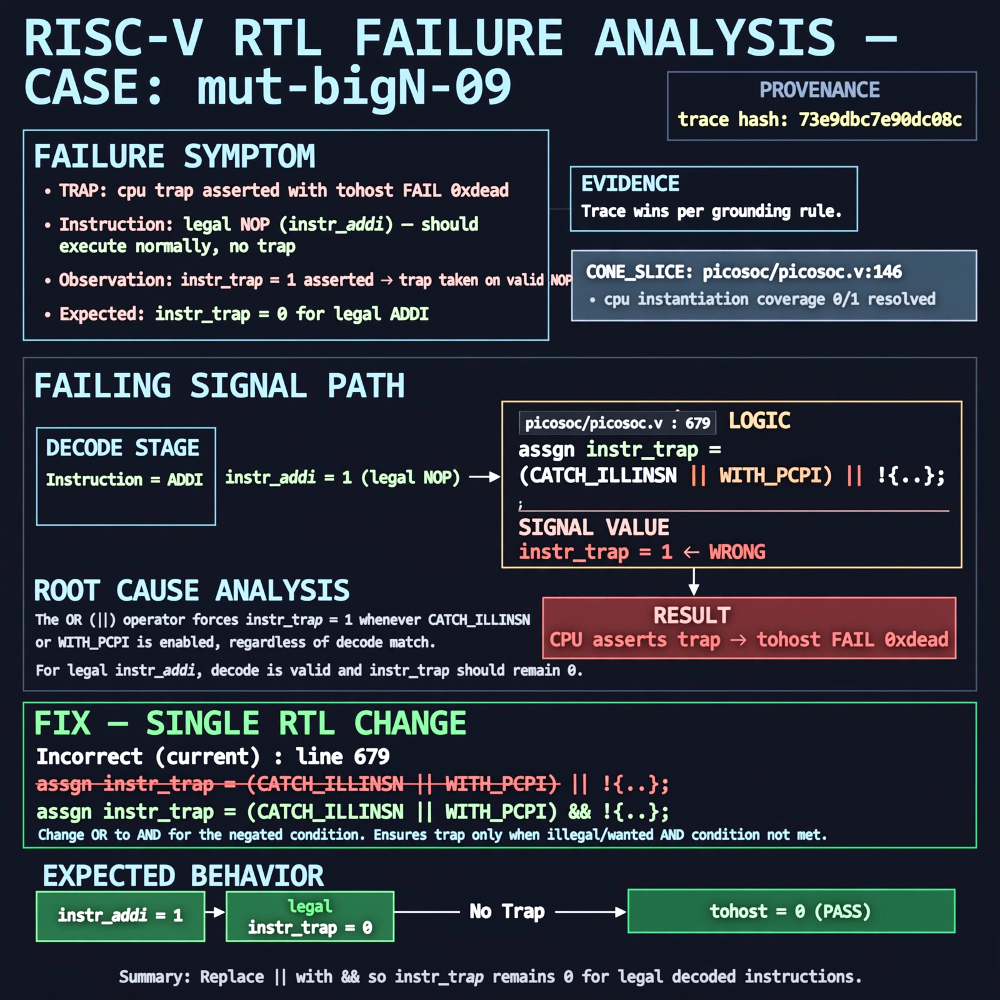

# Afterglow run report: mutbigN-v4-09

case `mut-bigN-09` | status **GREEN** | mode `live` | seed `42`

wall start `2026-10-27T14:57:47Z` | wall end `2026-10-27T14:58:37Z` | time-to-green `49.6s`

retries `0` | human_touches `0` | diagnosed `True` | fixed_unaided `True` | patch_source `model-verbatim`

## Verdicts (from sim, not typed)

- BEFORE: tohost=FAIL 0xdead checksum=c2a7a4d6295484feeb9ec1ea9381732b8e39a7ccd1997c7d70f6454da2fb4659 cycles=2009 seed=42 pass=False
- AFTER: tohost=PASS checksum=5c28238265cb94168311e9914f0df355642c557d04dba11845d557ac8a64aa4a cycles=2009 seed=42 pass=True

## Diagnosis (verbatim from api/text_response.json)

```
Trace shows TRAP: cpu trap asserted with tohost FAIL 0xdead on legal NOP (instr_addi) where instr_trap should be 0. CONE_SLICE picosoc/picosoc.v:146 only shows cpu instantiation with coverage 0/1 resolved, so trace wins per grounding rule. Root cause in excerpt line 679 is `assign instr_trap = (CATCH_ILLINSN || WITH_PCPI) || !{...}` using OR, which forces trap=1 whenever the enable is set regardless of decode.
```

expected re-sim signal: tohost PASS with no TRAP: cpu trap asserted on NOP fetch sequence

## Patch (2 lines, guard-checked)

```diff
diff --git a/picorv32.v b/picorv32.v
--- a/picorv32.v
+++ b/picorv32.v
@@ -679,7 +679,7 @@
-	assign instr_trap = (CATCH_ILLINSN || WITH_PCPI) || !{instr_lui, instr_auipc, instr_jal, instr_jalr,
+	assign instr_trap = (CATCH_ILLINSN || WITH_PCPI) && !{instr_lui, instr_auipc, instr_jal, instr_jalr,
 			instr_beq, instr_bne, instr_blt, instr_bge, instr_bltu, instr_bgeu,
 			instr_lb, instr_lh, instr_lw, instr_lbu, instr_lhu, instr_sb, instr_sh, instr_sw,
 			instr_addi, instr_slti, instr_sltiu, instr_xori, instr_ori, instr_andi, instr_slli, instr_srli, instr_srai,
 			instr_add, instr_sub, instr_sll, instr_slt, instr_sltu, instr_xor, instr_srl, instr_sra, instr_or, instr_and,
 			instr_rdcycle, instr_rdcycleh, instr_rdinstr, instr_rdinstrh, instr_fence,
 			instr_getq, instr_setq, instr_retirq, instr_maskirq, instr_waitirq, instr_timer};

```

## Provenance (judge checks)

- prompt file `v3` sha256 `ad529368accaf171e6121a54b2d27547230920a900c7c4e5094d3fff13ca4233`
- input_trace.txt sha256 `73e9dbc7e90dc08cb14ab65b752d77cee59bf1c7c1afae72fb45d9d03cce65c5` (9 lines, 69 tokens)
- prompt tokens `960` (cap 2500)
- text model `muse-spark-1.3-contributor` latency `33391ms` request `chatcmpl-01a17dde-9334-7122-83b9-c445a94d9ab4`
- image model `muse-image-1.0` latency `15606ms` request `c2a95a82-dbf7-4a5d-aa82-abcb21ef3587` status `ok`
- image prompt sha256 `ac98b666c4f459ff392a9f086affd0e13e9ca02c2c7c2c6d6c9f02ba6926ee61`, trace sha `73e9dbc7e90dc08cb14ab65b752d77cee59bf1c7c1afae72fb45d9d03cce65c5` (see api/image_request.json)

## Explanation diagram



## Bundle completeness

- present (12): artifacts/input_trace.txt, artifacts/boot.log, artifacts/boot_after.log, artifacts/verdict_before.json, artifacts/verdict_after.json, api/text_request.json, api/text_response.json, api/image_request.json, api/image_response.json, explain.png, patch.diff, meta.json
- missing (0): none

