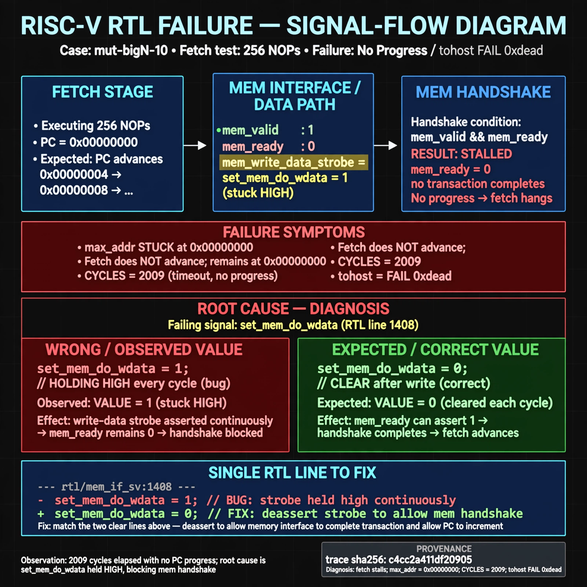

# Afterglow run report: mutbigN-v4-10

case `mut-bigN-10` | status **GREEN** | mode `live` | seed `42`

wall start `2026-10-27T14:58:37Z` | wall end `2026-10-27T14:59:48Z` | time-to-green `71.0s`

retries `0` | human_touches `0` | diagnosed `True` | fixed_unaided `True` | patch_source `model-verbatim`

## Verdicts (from sim, not typed)

- BEFORE: tohost=FAIL 0xdead checksum=563b7c10626ff25de2b3c430956c7c113e448c4efaea068f9b83a198d4322b15 cycles=2009 seed=42 pass=False
- AFTER: tohost=PASS checksum=5c28238265cb94168311e9914f0df355642c557d04dba11845d557ac8a64aa4a cycles=2009 seed=42 pass=True

## Diagnosis (verbatim from api/text_response.json)

```
Fetch test of 256 NOPs reports TRAP: no progress max_addr=0x00000000 and tohost FAIL 0xdead with CYCLES=2009 instead of advancing fetch. Expected max_addr to progress past 0x00000000. Root cause in excerpt is line 1408 set_mem_do_wdata = 1 holding the write-data strobe high every cycle like the two clear lines above it, blocking the mem handshake so fetch never advances.
```

expected re-sim signal: tohost PASS (not FAIL 0xdead), TRAP: no progress cleared, max_addr advances beyond 0x00000000

## Patch (2 lines, guard-checked)

```diff
diff --git a/picorv32.v b/picorv32.v
--- a/picorv32.v
+++ b/picorv32.v
@@ -1405,7 +1405,7 @@
 		reg_out <= 'bx;
 		set_mem_do_rinst = 0;
 		set_mem_do_rdata = 0;
-		set_mem_do_wdata = 1;
+		set_mem_do_wdata = 0;
 
 		alu_out_0_q <= alu_out_0;
 		alu_out_q <= alu_out;

```

## Provenance (judge checks)

- prompt file `v3` sha256 `ad529368accaf171e6121a54b2d27547230920a900c7c4e5094d3fff13ca4233`
- input_trace.txt sha256 `c4cc2a411df209053b18effa2ecd539b3ded43f107f57317efa0e03c80c66051` (9 lines, 69 tokens)
- prompt tokens `726` (cap 2500)
- text model `muse-spark-1.3-contributor` latency `43986ms` request `chatcmpl-01a17ddf-7ea3-7274-9f9f-5c9a276c92d1`
- image model `muse-image-1.0` latency `26356ms` request `d75b69ec-ace7-4fdd-ac2a-64323fb886ff` status `ok`
- image prompt sha256 `0424d27b91e320013edcc0861eeb05b8dd91140290f1d460266ed0db16001ffb`, trace sha `c4cc2a411df209053b18effa2ecd539b3ded43f107f57317efa0e03c80c66051` (see api/image_request.json)

## Explanation diagram



## Bundle completeness

- present (12): artifacts/input_trace.txt, artifacts/boot.log, artifacts/boot_after.log, artifacts/verdict_before.json, artifacts/verdict_after.json, api/text_request.json, api/text_response.json, api/image_request.json, api/image_response.json, explain.png, patch.diff, meta.json
- missing (0): none

