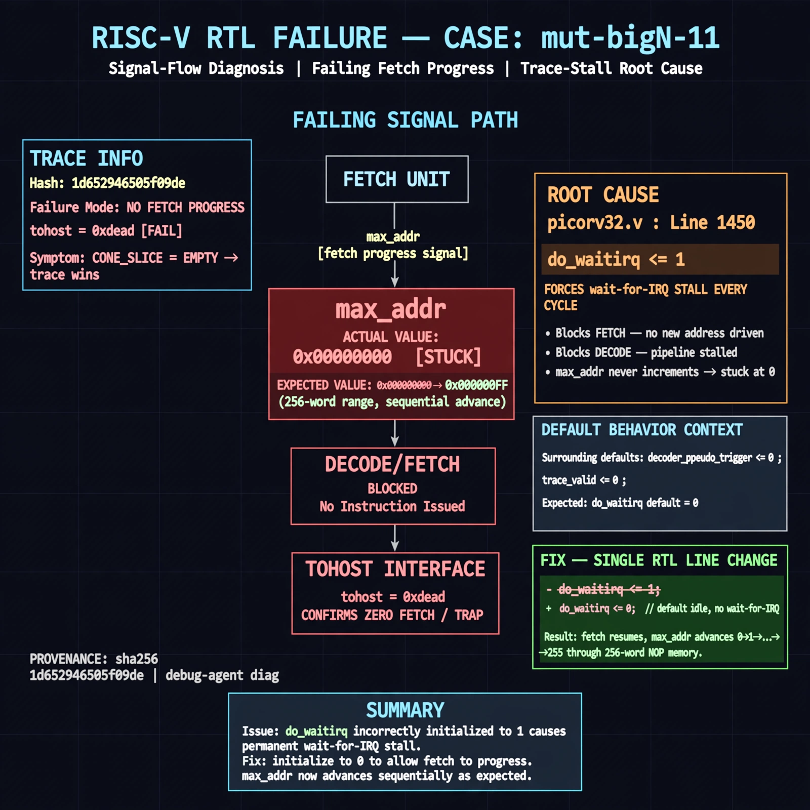

# Afterglow run report: mutbigN-v4-11

case `mut-bigN-11` | status **GREEN** | mode `live` | seed `42`

wall start `2026-10-27T14:59:48Z` | wall end `2026-10-27T15:00:53Z` | time-to-green `64.8s`

retries `0` | human_touches `0` | diagnosed `True` | fixed_unaided `True` | patch_source `model-verbatim`

## Verdicts (from sim, not typed)

- BEFORE: tohost=FAIL 0xdead checksum=563b7c10626ff25de2b3c430956c7c113e448c4efaea068f9b83a198d4322b15 cycles=2009 seed=42 pass=False
- AFTER: tohost=PASS checksum=5c28238265cb94168311e9914f0df355642c557d04dba11845d557ac8a64aa4a cycles=2009 seed=42 pass=True

## Diagnosis (verbatim from api/text_response.json)

```
Fetch progress signal max_addr stuck at 0x00000000 with TRAP: no progress vs expected sequential advance through 256-word NOP mem; tohost FAIL 0xdead confirms zero fetch. CONE_SLICE is empty so trace wins. Root cause in excerpt at picorv32.v:1450 `do_waitirq <= 1` forces wait-for-IRQ stall every cycle, blocking decode/fetch; default must be 0 like surrounding decoder_pseudo_trigger/trace_valid defaults.
```

expected re-sim signal: tohost PASS (was FAIL 0xdead), TRAP: no progress cleared, max_addr != 0x00000000 with fetch progress

## Patch (2 lines, guard-checked)

```diff
diff --git a/picorv32.v b/picorv32.v
--- a/picorv32.v
+++ b/picorv32.v
@@ -1446,7 +1446,7 @@
 		decoder_trigger <= mem_do_rinst && mem_done;
 		decoder_trigger_q <= decoder_trigger;
 		decoder_pseudo_trigger <= 0;
 		decoder_pseudo_trigger_q <= decoder_pseudo_trigger;
-		do_waitirq <= 1;
+		do_waitirq <= 0;
 
 		trace_valid <= 0;

```

## Provenance (judge checks)

- prompt file `v3` sha256 `ad529368accaf171e6121a54b2d27547230920a900c7c4e5094d3fff13ca4233`
- input_trace.txt sha256 `1d652946505f09decb193e81a71ced54464a260d0d4417bcda63ab9fec7fefb7` (9 lines, 69 tokens)
- prompt tokens `705` (cap 2500)
- text model `muse-spark-1.3-contributor` latency `49097ms` request `chatcmpl-01a17de0-a836-71e4-9303-79a68293da32`
- image model `muse-image-1.0` latency `15191ms` request `3c6b2cad-f15c-45a7-94d6-41347811a3e4` status `ok`
- image prompt sha256 `5ec74a4c7238b8007e84691ab72741a358b83f72053033fa0b311443d17989e1`, trace sha `1d652946505f09decb193e81a71ced54464a260d0d4417bcda63ab9fec7fefb7` (see api/image_request.json)

## Explanation diagram



## Bundle completeness

- present (12): artifacts/input_trace.txt, artifacts/boot.log, artifacts/boot_after.log, artifacts/verdict_before.json, artifacts/verdict_after.json, api/text_request.json, api/text_response.json, api/image_request.json, api/image_response.json, explain.png, patch.diff, meta.json
- missing (0): none

