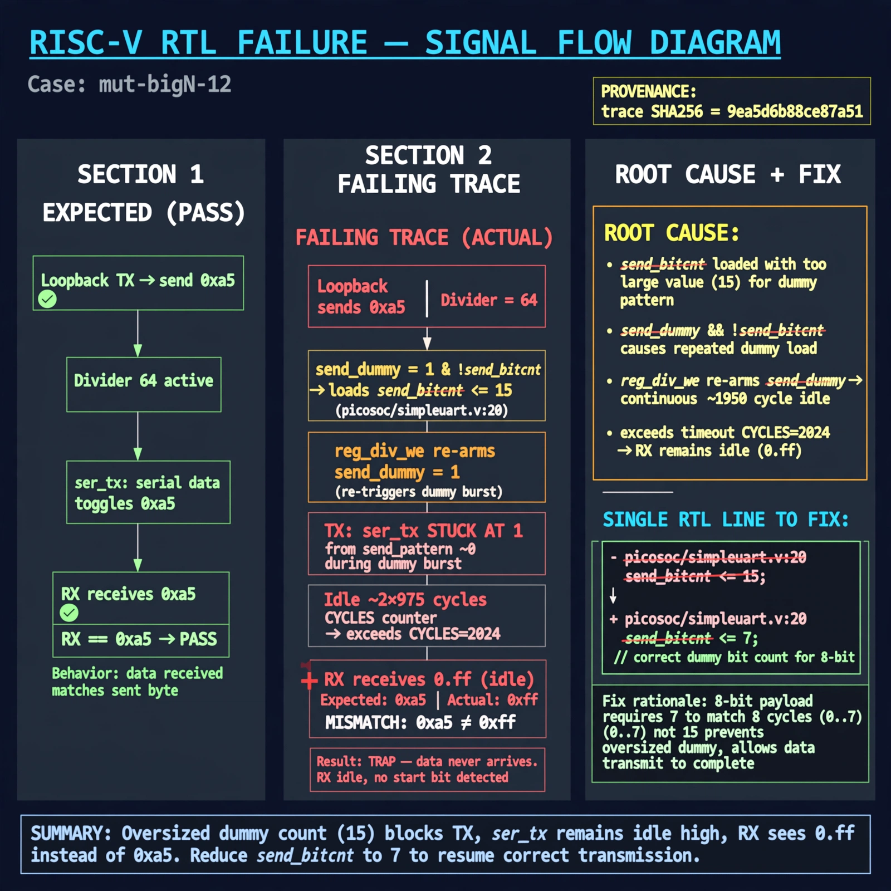

# Afterglow run report: mutbigN-v4-12

case `mut-bigN-12` | status **RED** | mode `live` | seed `42`

wall start `2026-10-27T15:00:53Z` | wall end `2026-10-27T15:23:18Z` | time-to-green `1345.0s`

retries `2` | human_touches `0` | diagnosed `True` | fixed_unaided `False` | patch_source `model-verbatim`

## Verdicts (from sim, not typed)

- BEFORE: tohost=FAIL 0xdead checksum=9e1b73c13d0a095f6b9512137fc937a720f9b8a80231ffc4b660d6d1459f6985 cycles=2024 seed=42 pass=False
- AFTER: tohost=FAIL 0xdead checksum=9e1b73c13d0a095f6b9512137fc937a720f9b8a80231ffc4b660d6d1459f6985 cycles=2024 seed=42 pass=False

## Diagnosis (verbatim from api/text_response.json)

```
Loopback sent 0xa5 with divider 64 but RX got 0xff (idle) want 0xa5 per TRAP. TX ser_tx stayed at 1 from send_pattern ~0 during dummy burst because send_dummy && !send_bitcnt loads send_bitcnt <=15, and reg_div_we re-arms send_dummy, causing ~2x975-cycle idle that exceeds CYCLES=2024 so data never arrives. Root cause is oversized dummy count in excerpt at send_bitcnt load (refs picosoc/simpleuart.v:20, picosoc/picosoc.v:190 instance).
```

expected re-sim signal: tohost PASS, TRAP gone, uart loopback got 0xa5 want 0

## Patch (2 lines, guard-checked)

```diff
diff --git a/picosoc/simpleuart.v b/picosoc/simpleuart.v
--- a/picosoc/simpleuart.v
+++ b/picosoc/simpleuart.v
@@ -119,7 +119,7 @@
 			if (send_dummy && !send_bitcnt) begin
 				send_pattern <= ~0;
-				send_bitcnt <= 15;
+				send_bitcnt <= 1;
 				send_divcnt <= 0;
 				send_dummy <= 0;
 			end else

```

## Provenance (judge checks)

- prompt file `v3` sha256 `ad529368accaf171e6121a54b2d27547230920a900c7c4e5094d3fff13ca4233`
- input_trace.txt sha256 `9ea5d6b88ce87a51983ef21919e2e722b472dc2aebc27c6f53bc40cb2a5ab0af` (9 lines, 68 tokens)
- prompt tokens `954` (cap 2500)
- text model `muse-spark-1.3-contributor` latency `88969ms` request `chatcmpl-01a17df0-5694-727b-aabd-5b2ed9a0bbb0`
- image model `muse-image-1.0` latency `18491ms` request `00540a96-42dc-4536-930e-074e9ae93917` status `ok`
- image prompt sha256 `a2bf5df192567ee37952d93c3abcc80ac3269e0999a5bdbdb10279e7761036f9`, trace sha `9ea5d6b88ce87a51983ef21919e2e722b472dc2aebc27c6f53bc40cb2a5ab0af` (see api/image_request.json)

## Explanation diagram



## Bundle completeness

- present (12): artifacts/input_trace.txt, artifacts/boot.log, artifacts/boot_after.log, artifacts/verdict_before.json, artifacts/verdict_after.json, api/text_request.json, api/text_response.json, api/image_request.json, api/image_response.json, explain.png, patch.diff, meta.json
- missing (0): none

