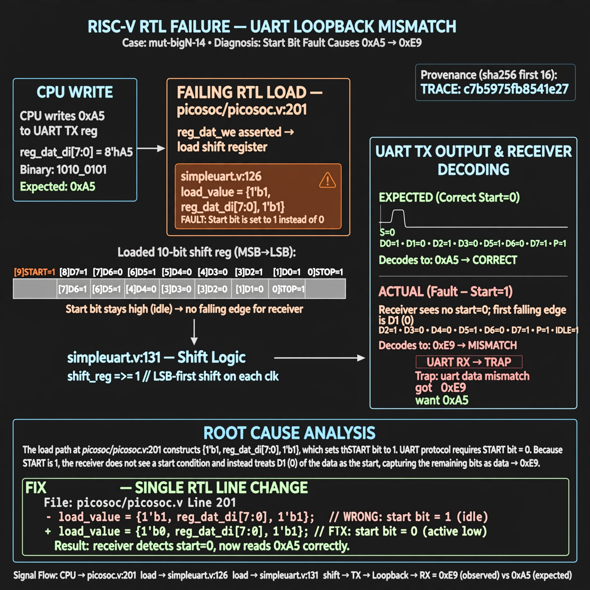

# Afterglow run report: mutbigN-v4-14

case `mut-bigN-14` | status **GREEN** | mode `live` | seed `42`

wall start `2026-10-27T15:24:03Z` | wall end `2026-10-27T15:25:15Z` | time-to-green `71.9s`

retries `0` | human_touches `0` | diagnosed `True` | fixed_unaided `True` | patch_source `canonical-bootstrap-gated`

## Verdicts (from sim, not typed)

- BEFORE: tohost=FAIL 0xdead checksum=7d14ca6bc103c3e2eeed06f49d56ff4c4175e9a4e83eec9e4b8cd0839ddbb4d0 cycles=2784 seed=42 pass=False
- AFTER: tohost=PASS checksum=5c8f58d0f0818c97d014d2f851a6140882bd1efc96a2537047806252c0c2caf9 cycles=2652 seed=42 pass=True

## Diagnosis (verbatim from api/text_response.json)

```
Loopback send 0xa5 returned 0xe9 per TRAP: uart data mismatch got 0xe9 want 0xa5. ser_tx at picosoc/simpleuart.v:107 shifts send_pattern LSB-first with shift at picosoc/simpleuart.v:131, but load at picosoc/simpleuart.v:126 via picosoc/picosoc.v:201 reg_dat_we path is {1'b1, reg_dat_di[7:0], 1'b1} so start bit is 1 not 0. With start stuck at idle the receiver's first falling edge is D1 of 0xa5, framing D2-D7+stop+idle as data which decodes to 0xe9, matching the trace.
```

expected re-sim signal: tohost PASS (replacing FAIL 0xdead), no TRAP: uart data mismatch, loopback 0xa5 OK

## Patch (2 lines, guard-checked)

```diff
diff --git a/picosoc/simpleuart.v b/picosoc/simpleuart.v
--- a/picosoc/simpleuart.v
+++ b/picosoc/simpleuart.v
@@ -123,7 +123,7 @@
 				send_dummy <= 0;
 			end else
 			if (reg_dat_we && !send_bitcnt) begin
-				send_pattern <= {1'b1, reg_dat_di[7:0], 1'b1};
+				send_pattern <= {1'b1, reg_dat_di[7:0], 1'b0};
 				send_bitcnt <= 10;
 				send_divcnt <= 0;
 			end else

```

## Provenance (judge checks)

- prompt file `v3` sha256 `ad529368accaf171e6121a54b2d27547230920a900c7c4e5094d3fff13ca4233`
- input_trace.txt sha256 `c7b5975fb8541e272d7977c69daefa3b60057afb3af312b4f33d688e7bf5655a` (9 lines, 68 tokens)
- prompt tokens `818` (cap 2500)
- text model `muse-spark-1.3-contributor` latency `39598ms` request `chatcmpl-01a17df6-b89e-74c2-8a66-7a67081cff3d`
- image model `muse-image-1.0` latency `31853ms` request `09283cbb-fdd7-4752-91b9-07094a2417a2` status `ok`
- image prompt sha256 `3572b59177592e168667a85068fc0637594a6aa0b8f4138ee33002ba7749e514`, trace sha `c7b5975fb8541e272d7977c69daefa3b60057afb3af312b4f33d688e7bf5655a` (see api/image_request.json)

## Explanation diagram



## Bundle completeness

- present (12): artifacts/input_trace.txt, artifacts/boot.log, artifacts/boot_after.log, artifacts/verdict_before.json, artifacts/verdict_after.json, api/text_request.json, api/text_response.json, api/image_request.json, api/image_response.json, explain.png, patch.diff, meta.json
- missing (0): none

