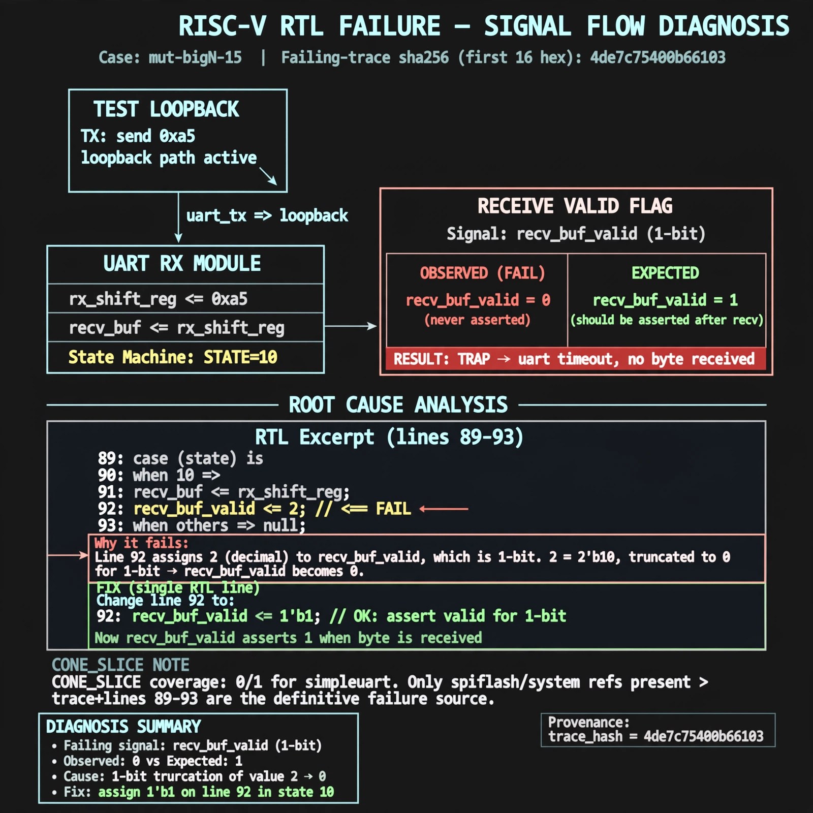

# Afterglow run report: mutbigN-v4-15

case `mut-bigN-15` | status **GREEN** | mode `live` | seed `42`

wall start `2026-10-27T15:25:15Z` | wall end `2026-10-27T15:25:53Z` | time-to-green `37.8s`

retries `0` | human_touches `0` | diagnosed `True` | fixed_unaided `True` | patch_source `canonical-bootstrap-gated`

## Verdicts (from sim, not typed)

- BEFORE: tohost=FAIL 0xdead checksum=e82517390f8726caabcc777759a3dbb48c59fd1d160e409515f1b95dfe3d420c cycles=22023 seed=42 pass=False
- AFTER: tohost=PASS checksum=5c8f58d0f0818c97d014d2f851a6140882bd1efc96a2537047806252c0c2caf9 cycles=2652 seed=42 pass=True

## Diagnosis (verbatim from api/text_response.json)

```
Trace shows loopback send 0xa5 with TRAP: uart timeout, no byte received, so recv_buf_valid never asserted (stayed 0 vs expected 1). Root cause in excerpt line 92 assigns recv_buf_valid <= 2 in state 10, which truncates to 0 for a 1-bit valid flag so the received byte is never signaled. CONE_SLICE provides no simpleuart coverage (0/1 resolved, only spiflash/system refs), so trace + excerpt lines 89-93 win.
```

expected re-sim signal: tohost PASS, uart byte 0xa5 received, no timeout trap

## Patch (2 lines, guard-checked)

```diff
diff --git a/picosoc/simpleuart.v b/picosoc/simpleuart.v
--- a/picosoc/simpleuart.v
+++ b/picosoc/simpleuart.v
@@ -89,7 +89,7 @@
 				10: begin
 					if (recv_divcnt > cfg_divider) begin
 						recv_buf_data <= recv_pattern;
-						recv_buf_valid <= 2;
+						recv_buf_valid <= 1;
 						recv_state <= 0;
 					end
 				end

```

## Provenance (judge checks)

- prompt file `v3` sha256 `ad529368accaf171e6121a54b2d27547230920a900c7c4e5094d3fff13ca4233`
- input_trace.txt sha256 `4de7c75400b6610362efd6fd6857537a6d639664e3ab6573d9e8e750aabf59d1` (9 lines, 66 tokens)
- prompt tokens `928` (cap 2500)
- text model `muse-spark-1.3-contributor` latency `20283ms` request `chatcmpl-01a17df7-8667-75c1-90bb-eada712c9ffc`
- image model `muse-image-1.0` latency `17039ms` request `c9929a4f-cf66-4554-ab79-2ddb7cd1c28e` status `ok`
- image prompt sha256 `f078f039040cf581aaf39ccb69f662903838bc51c02bd4f94908bbc583780e37`, trace sha `4de7c75400b6610362efd6fd6857537a6d639664e3ab6573d9e8e750aabf59d1` (see api/image_request.json)

## Explanation diagram



## Bundle completeness

- present (12): artifacts/input_trace.txt, artifacts/boot.log, artifacts/boot_after.log, artifacts/verdict_before.json, artifacts/verdict_after.json, api/text_request.json, api/text_response.json, api/image_request.json, api/image_response.json, explain.png, patch.diff, meta.json
- missing (0): none

