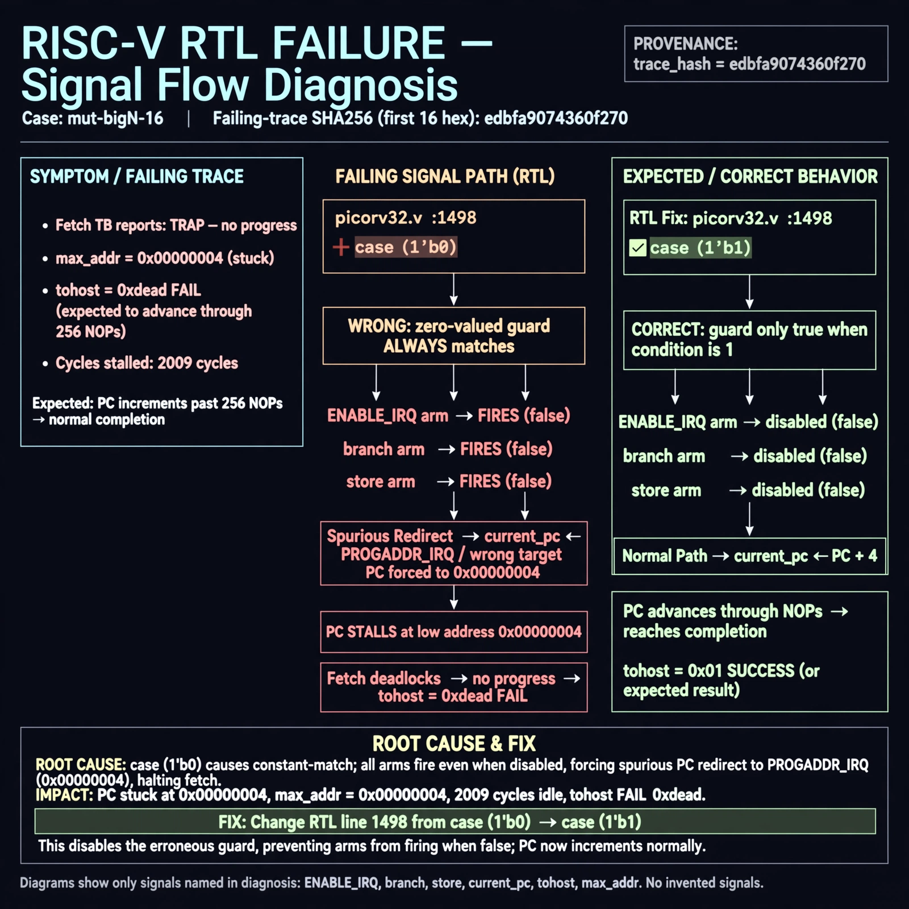

# Afterglow run report: mutbigN-v4-16

case `mut-bigN-16` | status **GREEN** | mode `live` | seed `42`

wall start `2026-10-27T15:25:53Z` | wall end `2026-10-27T15:26:56Z` | time-to-green `62.9s`

retries `0` | human_touches `0` | diagnosed `True` | fixed_unaided `True` | patch_source `model-verbatim`

## Verdicts (from sim, not typed)

- BEFORE: tohost=FAIL 0xdead checksum=9bf5d2591144696f56ca014343e1655f97020c36292daceaf3f26e732301574d cycles=2009 seed=42 pass=False
- AFTER: tohost=PASS checksum=5c28238265cb94168311e9914f0df355642c557d04dba11845d557ac8a64aa4a cycles=2009 seed=42 pass=True

## Diagnosis (verbatim from api/text_response.json)

```
Fetch TB reports TRAP: no progress max_addr=0x00000004 with tohost FAIL 0xdead instead of advancing through 256 NOPs. Excerpt picorv32.v:1498 uses case (1'b0) so zero-valued guards match, causing the ENABLE_IRQ and branch/store arms to fire when false and forcing current_pc to PROGADDR_IRQ/wrong target. That spurious redirect stalls PC at low addresses, explaining max_addr 0x4 and dead 2009 cycles; correct selector is case (1'b1).
```

expected re-sim signal: tohost PASS, no TRAP: no progress, max_addr advances through 256-word NOP region

## Patch (2 lines, guard-checked)

```diff
diff --git a/picorv32.v b/picorv32.v
--- a/picorv32.v
+++ b/picorv32.v
@@ -1497,3 +1497,3 @@
 				(* parallel_case *)
-				case (1'b0)
+				case (1'b1)
 					latched_branch: begin

```

## Provenance (judge checks)

- prompt file `v3` sha256 `ad529368accaf171e6121a54b2d27547230920a900c7c4e5094d3fff13ca4233`
- input_trace.txt sha256 `edbfa9074360f270673eec90585a025150b2df8547cfa02e61e5b1e5aa812e70` (9 lines, 69 tokens)
- prompt tokens `719` (cap 2500)
- text model `muse-spark-1.3-contributor` latency `50276ms` request `chatcmpl-01a17df8-8fb6-7067-b5ab-be38b5f9625f`
- image model `muse-image-1.0` latency `12079ms` request `696aa771-33cf-4db5-949f-c842ad27c882` status `ok`
- image prompt sha256 `907fba95b479792b958edb15a31ed10b4ae3881dbb256e4c7b9b31d81ffbe3b4`, trace sha `edbfa9074360f270673eec90585a025150b2df8547cfa02e61e5b1e5aa812e70` (see api/image_request.json)

## Explanation diagram



## Bundle completeness

- present (12): artifacts/input_trace.txt, artifacts/boot.log, artifacts/boot_after.log, artifacts/verdict_before.json, artifacts/verdict_after.json, api/text_request.json, api/text_response.json, api/image_request.json, api/image_response.json, explain.png, patch.diff, meta.json
- missing (0): none

