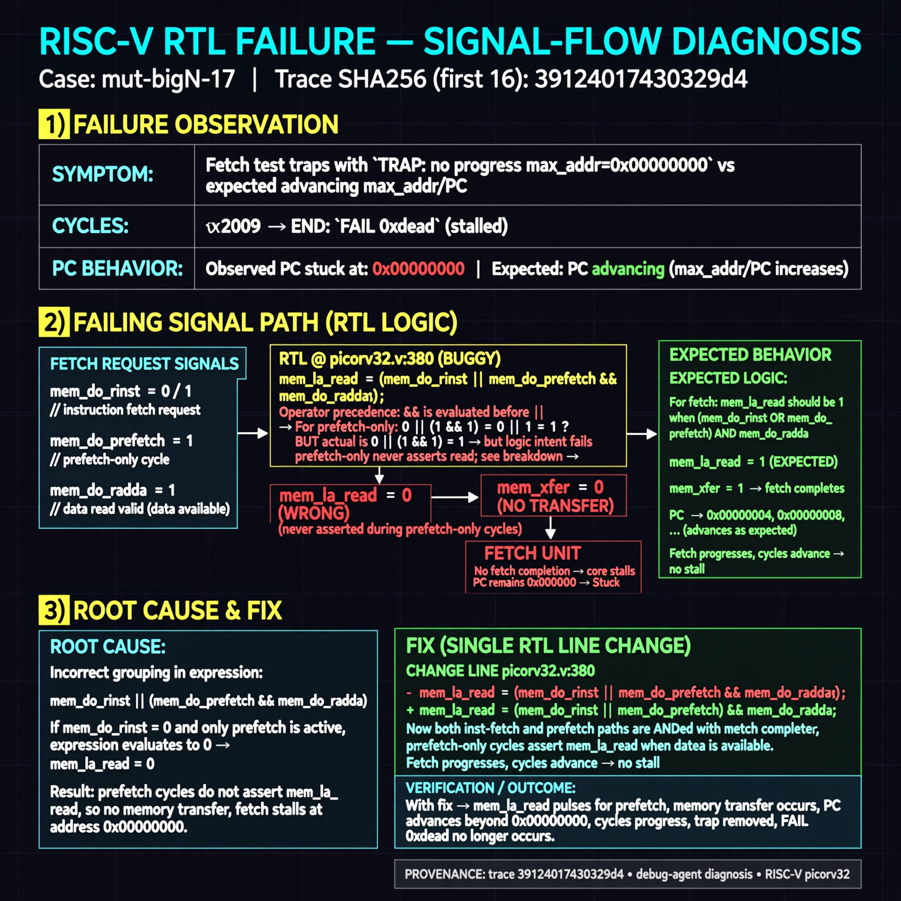

# Afterglow run report: mutbigN-v4-17

case `mut-bigN-17` | status **GREEN** | mode `live` | seed `42`

wall start `2026-10-27T15:26:56Z` | wall end `2026-10-27T15:28:08Z` | time-to-green `71.7s`

retries `0` | human_touches `0` | diagnosed `True` | fixed_unaided `True` | patch_source `model-verbatim`

## Verdicts (from sim, not typed)

- BEFORE: tohost=FAIL 0xdead checksum=563b7c10626ff25de2b3c430956c7c113e448c4efaea068f9b83a198d4322b15 cycles=2009 seed=42 pass=False
- AFTER: tohost=PASS checksum=5c28238265cb94168311e9914f0df355642c557d04dba11845d557ac8a64aa4a cycles=2009 seed=42 pass=True

## Diagnosis (verbatim from api/text_response.json)

```
Fetch test traps with `TRAP: no progress max_addr=0x00000000` vs expected advancing max_addr/PC and cycles <2009, ending `FAIL 0xdead`. `mem_la_read` at picorv32.v:380 uses `(mem_do_rinst || mem_do_prefetch && mem_do_rdata)` so prefetch-only cycles never assert read. Without `mem_la_read/mem_xfer` the core never completes fetch and stalls at 0x00000000.
```

expected re-sim signal: tohost PASS with progress max_addr>0x00000000 and no no-progress TRAP

## Patch (2 lines, guard-checked)

```diff
diff --git a/picorv32.v b/picorv32.v
--- a/picorv32.v
+++ b/picorv32.v
@@ -379,3 +379,3 @@
 	assign mem_la_write = resetn && !mem_state && mem_do_wdata;
-	assign mem_la_read = resetn && ((!mem_la_use_prefetched_high_word && !mem_state && (mem_do_rinst || mem_do_prefetch && mem_do_rdata)) ||
+	assign mem_la_read = resetn && ((!mem_la_use_prefetched_high_word && !mem_state && (mem_do_rinst || mem_do_prefetch || mem_do_rdata)) ||
 			(COMPRESSED_ISA && mem_xfer && (!last_mem_valid ? mem_la_firstword : mem_la_firstword_reg) && !mem_la_secondword && &mem_rdata_latched[1:0]));

```

## Provenance (judge checks)

- prompt file `v3` sha256 `ad529368accaf171e6121a54b2d27547230920a900c7c4e5094d3fff13ca4233`
- input_trace.txt sha256 `39124017430329d46dde403ec1a967a52f0df6e5d965c55e14804c1013902904` (9 lines, 69 tokens)
- prompt tokens `799` (cap 2500)
- text model `muse-spark-1.3-contributor` latency `32733ms` request `chatcmpl-01a17df9-4146-73a3-a086-e90255cc58cb`
- image model `muse-image-1.0` latency `38267ms` request `0f1bf29b-e03d-4270-b09b-62d7c38fc6bb` status `ok`
- image prompt sha256 `2a0365f0d3e544ad238faebfa2cea4c8fae6747e0b740aa1658ec16612f785cc`, trace sha `39124017430329d46dde403ec1a967a52f0df6e5d965c55e14804c1013902904` (see api/image_request.json)

## Explanation diagram



## Bundle completeness

- present (12): artifacts/input_trace.txt, artifacts/boot.log, artifacts/boot_after.log, artifacts/verdict_before.json, artifacts/verdict_after.json, api/text_request.json, api/text_response.json, api/image_request.json, api/image_response.json, explain.png, patch.diff, meta.json
- missing (0): none

