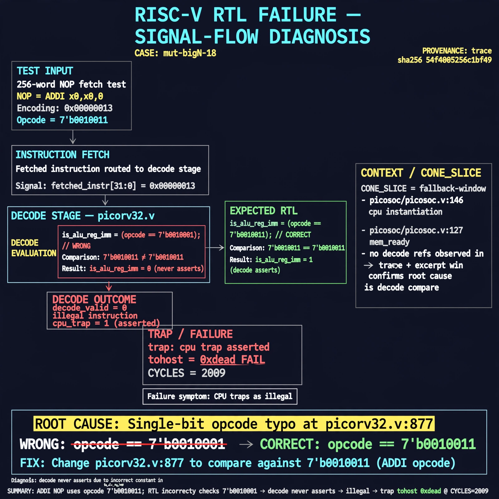

# Afterglow run report: mutbigN-v4-18

case `mut-bigN-18` | status **GREEN** | mode `live` | seed `42`

wall start `2026-10-27T15:28:08Z` | wall end `2026-10-27T15:29:00Z` | time-to-green `51.6s`

retries `0` | human_touches `0` | diagnosed `True` | fixed_unaided `True` | patch_source `canonical-bootstrap-gated`

## Verdicts (from sim, not typed)

- BEFORE: tohost=FAIL 0xdead checksum=c2a7a4d6295484feeb9ec1ea9381732b8e39a7ccd1997c7d70f6454da2fb4659 cycles=2009 seed=42 pass=False
- AFTER: tohost=PASS checksum=5c28238265cb94168311e9914f0df355642c557d04dba11845d557ac8a64aa4a cycles=2009 seed=42 pass=True

## Diagnosis (verbatim from api/text_response.json)

```
Trace shows 256-word NOP fetch test ending in TRAP: cpu trap asserted with tohost FAIL 0xdead at CYCLES=2009. NOP is ADDI x0,x0,0 with opcode 7'b0010011, but picorv32.v:877 compares is_alu_reg_imm to 7'b0010001 so decode never asserts and CPU traps as illegal. CONE_SLICE is fallback-window (picosoc/picosoc.v:146 cpu instantiation, picosoc/picosoc.v:127 mem_ready) with no decode refs, so trace+excerpt win and root cause is the single-bit opcode typo at picorv32.v:877.
```

expected re-sim signal: tohost PASS (vs FAIL 0xdead) with no TRAP: cpu trap asserted and fetch progress

## Patch (2 lines, guard-checked)

```diff
diff --git a/picorv32.v b/picorv32.v
--- a/picorv32.v
+++ b/picorv32.v
@@ -874,7 +874,7 @@
 			is_beq_bne_blt_bge_bltu_bgeu <= mem_rdata_latched[6:0] == 7'b1100011;
 			is_lb_lh_lw_lbu_lhu          <= mem_rdata_latched[6:0] == 7'b0000011;
 			is_sb_sh_sw                  <= mem_rdata_latched[6:0] == 7'b0100011;
-			is_alu_reg_imm               <= mem_rdata_latched[6:0] == 7'b0010001;
+			is_alu_reg_imm               <= mem_rdata_latched[6:0] == 7'b0010011;
 			is_alu_reg_reg               <= mem_rdata_latched[6:0] == 7'b0110011;
 
 			{ decoded_imm_j[31:20], decoded_imm_j[10:1], decoded_imm_j[11], decoded_imm_j[19:12], decoded_imm_j[0] } <= $signed({mem_rdata_latched[31:12], 1'b0});

```

## Provenance (judge checks)

- prompt file `v3` sha256 `ad529368accaf171e6121a54b2d27547230920a900c7c4e5094d3fff13ca4233`
- input_trace.txt sha256 `54f4005256c1bf491364b648979bd67e87f7cfcd4dcb001a734caf096e0aba6a` (9 lines, 69 tokens)
- prompt tokens `1016` (cap 2500)
- text model `muse-spark-1.3-contributor` latency `33434ms` request `chatcmpl-01a17dfa-5c33-73d2-989f-e7c36833f630`
- image model `muse-image-1.0` latency `17624ms` request `6e2dddd2-4864-4136-b39a-a594a3c86d95` status `ok`
- image prompt sha256 `7de96bcc19c80934aaf8cb5c5c57b9cf95bb177ee83debb18915f6c740d5db99`, trace sha `54f4005256c1bf491364b648979bd67e87f7cfcd4dcb001a734caf096e0aba6a` (see api/image_request.json)

## Explanation diagram



## Bundle completeness

- present (12): artifacts/input_trace.txt, artifacts/boot.log, artifacts/boot_after.log, artifacts/verdict_before.json, artifacts/verdict_after.json, api/text_request.json, api/text_response.json, api/image_request.json, api/image_response.json, explain.png, patch.diff, meta.json
- missing (0): none

