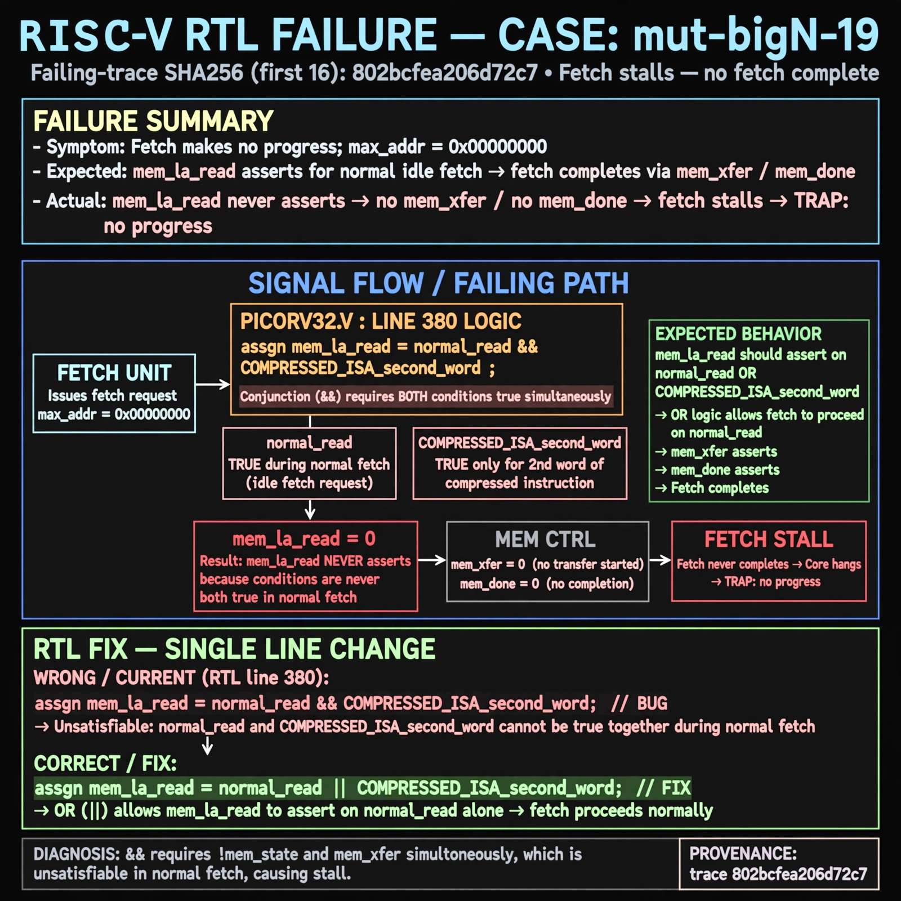

# Afterglow run report: mutbigN-v4-19

case `mut-bigN-19` | status **GREEN** | mode `live` | seed `42`

wall start `2026-10-27T15:29:00Z` | wall end `2026-10-27T15:29:42Z` | time-to-green `42.8s`

retries `0` | human_touches `0` | diagnosed `True` | fixed_unaided `True` | patch_source `model-verbatim`

## Verdicts (from sim, not typed)

- BEFORE: tohost=FAIL 0xdead checksum=563b7c10626ff25de2b3c430956c7c113e448c4efaea068f9b83a198d4322b15 cycles=2009 seed=42 pass=False
- AFTER: tohost=PASS checksum=5c28238265cb94168311e9914f0df355642c557d04dba11845d557ac8a64aa4a cycles=2009 seed=42 pass=True

## Diagnosis (verbatim from api/text_response.json)

```
Fetch makes no progress with max_addr=0x00000000 because mem_la_read never asserts so no mem_xfer/mem_done fetch completes. Expected mem_la_read to assert for a normal idle fetch, but picorv32.v:380 uses && between the normal-read term and the COMPRESSED_ISA second-word term instead of ||, requiring !mem_state and mem_xfer simultaneously. That conjunction is unsatisfiable in normal fetch, stalling the core and tripping TRAP: no progress.
```

expected re-sim signal: tohost PASS (not FAIL 0xdead), no TRAP: no progress, max_addr > 0x00000000, checksum != 563b7c10626ff25de2b3c430956c7c113e448c4efaea068f9b83a198d4322b15

## Patch (2 lines, guard-checked)

```diff
diff --git a/picorv32.v b/picorv32.v
--- a/picorv32.v
+++ b/picorv32.v
@@ -379,3 +379,3 @@
 	assign mem_la_write = resetn && !mem_state && mem_do_wdata;
-	assign mem_la_read = resetn && ((!mem_la_use_prefetched_high_word && !mem_state && (mem_do_rinst || mem_do_prefetch || mem_do_rdata)) &&
+	assign mem_la_read = resetn && ((!mem_la_use_prefetched_high_word && !mem_state && (mem_do_rinst || mem_do_prefetch || mem_do_rdata)) ||
 			(COMPRESSED_ISA && mem_xfer && (!last_mem_valid ? mem_la_firstword : mem_la_firstword_reg) && !mem_la_secondword && &mem_rdata_latched[1:0]));
 	assign mem_la_addr = (mem_do_prefetch || mem_do_rinst) ? {next_pc[31:2] + mem_la_firstword_xfer, 2'b00} : {reg_op1[31:2], 2'b00};

```

## Provenance (judge checks)

- prompt file `v3` sha256 `ad529368accaf171e6121a54b2d27547230920a900c7c4e5094d3fff13ca4233`
- input_trace.txt sha256 `802bcfea206d72c788e3d728e4a74cd37a0c5538192262f348818bf41891240d` (9 lines, 69 tokens)
- prompt tokens `799` (cap 2500)
- text model `muse-spark-1.3-contributor` latency `29133ms` request `chatcmpl-01a17dfb-155e-75f3-b502-545f7ad796c2`
- image model `muse-image-1.0` latency `13026ms` request `484f0c1a-f0f1-4878-8cb0-4b61e0e04540` status `ok`
- image prompt sha256 `3b4ce728804125f944e89f805b087f8bb9852af50032184f28fce0c423b5d148`, trace sha `802bcfea206d72c788e3d728e4a74cd37a0c5538192262f348818bf41891240d` (see api/image_request.json)

## Explanation diagram



## Bundle completeness

- present (12): artifacts/input_trace.txt, artifacts/boot.log, artifacts/boot_after.log, artifacts/verdict_before.json, artifacts/verdict_after.json, api/text_request.json, api/text_response.json, api/image_request.json, api/image_response.json, explain.png, patch.diff, meta.json
- missing (0): none

