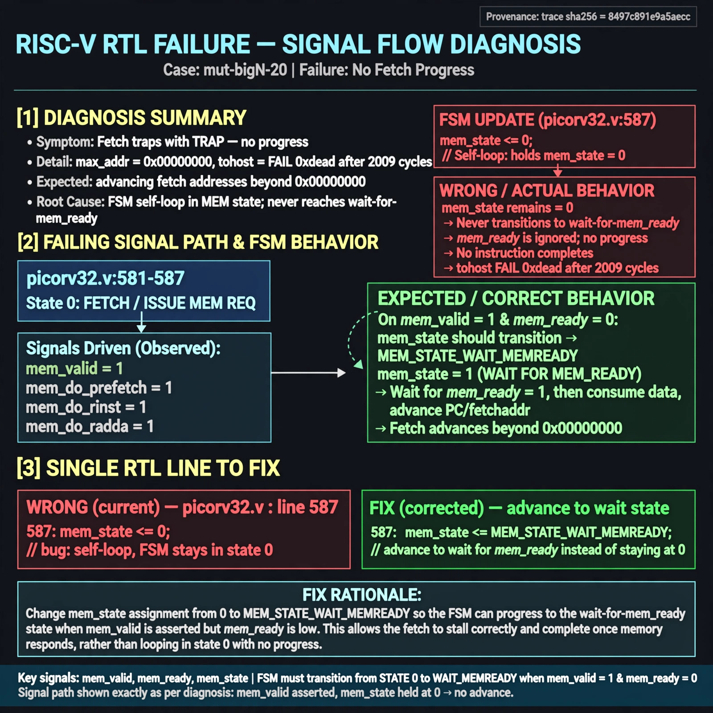

# Afterglow run report: mutbigN-v4-20

case `mut-bigN-20` | status **GREEN** | mode `live` | seed `42`

wall start `2026-10-27T15:29:43Z` | wall end `2026-10-27T15:31:16Z` | time-to-green `93.7s`

retries `0` | human_touches `0` | diagnosed `True` | fixed_unaided `True` | patch_source `canonical-bootstrap-gated`

## Verdicts (from sim, not typed)

- BEFORE: tohost=FAIL 0xdead checksum=563b7c10626ff25de2b3c430956c7c113e448c4efaea068f9b83a198d4322b15 cycles=2009 seed=42 pass=False
- AFTER: tohost=PASS checksum=5c28238265cb94168311e9914f0df355642c557d04dba11845d557ac8a64aa4a cycles=2009 seed=42 pass=True

## Diagnosis (verbatim from api/text_response.json)

```
Fetch test traps with TRAP: no progress max_addr=0x00000000 and tohost FAIL 0xdead after 2009 cycles, expected advancing fetch addresses beyond 0x0. In picorv32.v:581-587 state 0 asserts mem_valid for mem_do_prefetch/mem_do_rinst/mem_do_rdata but picorv32.v:587 holds mem_state <= 0 instead of advancing, so the FSM never enters the wait-for-mem_ready state and no instruction ever completes. This self-loop is the single root cause of zero progress.
```

expected re-sim signal: tohost PASS with progress max_addr > 0x00000000 and no TRAP: no progress

## Patch (2 lines, guard-checked)

```diff
diff --git a/picorv32.v b/picorv32.v
--- a/picorv32.v
+++ b/picorv32.v
@@ -584,7 +584,7 @@
 						mem_valid <= !mem_la_use_prefetched_high_word;
 						mem_instr <= mem_do_prefetch || mem_do_rinst;
 						mem_wstrb <= 0;
-						mem_state <= 0;
+						mem_state <= 1;
 					end
 					if (mem_do_wdata) begin
 						mem_valid <= 1;

```

## Provenance (judge checks)

- prompt file `v3` sha256 `ad529368accaf171e6121a54b2d27547230920a900c7c4e5094d3fff13ca4233`
- input_trace.txt sha256 `8497c891e9a5aecc086e014414c8c0dc8c4130d618ca9035f2a06f8bc000b4c8` (9 lines, 69 tokens)
- prompt tokens `705` (cap 2500)
- text model `muse-spark-1.3-contributor` latency `40579ms` request `chatcmpl-01a17dfb-e9a0-77f8-aba9-7b8c0a7407f9`
- image model `muse-image-1.0` latency `52497ms` request `7e751262-004b-4fe6-bf58-e28bd82b854c` status `ok`
- image prompt sha256 `8855b18e9b3c663db94dcdb774045457b1d3c64fbf493e24a355fd9aec99eb58`, trace sha `8497c891e9a5aecc086e014414c8c0dc8c4130d618ca9035f2a06f8bc000b4c8` (see api/image_request.json)

## Explanation diagram



## Bundle completeness

- present (12): artifacts/input_trace.txt, artifacts/boot.log, artifacts/boot_after.log, artifacts/verdict_before.json, artifacts/verdict_after.json, api/text_request.json, api/text_response.json, api/image_request.json, api/image_response.json, explain.png, patch.diff, meta.json
- missing (0): none

