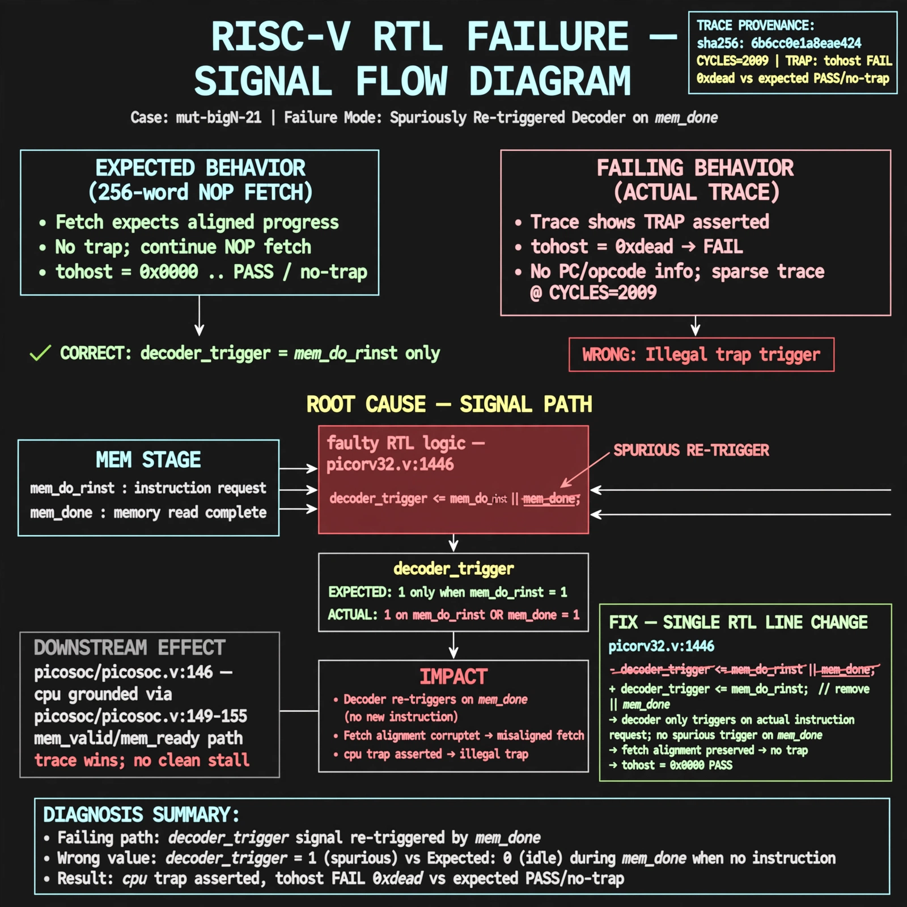

# Afterglow run report: mutbigN-v4-21

case `mut-bigN-21` | status **GREEN** | mode `live` | seed `42`

wall start `2026-10-27T15:31:16Z` | wall end `2026-10-27T15:41:35Z` | time-to-green `618.3s`

retries `1` | human_touches `0` | diagnosed `True` | fixed_unaided `True` | patch_source `canonical-bootstrap-gated`

## Verdicts (from sim, not typed)

- BEFORE: tohost=FAIL 0xdead checksum=c2a7a4d6295484feeb9ec1ea9381732b8e39a7ccd1997c7d70f6454da2fb4659 cycles=2009 seed=42 pass=False
- AFTER: tohost=PASS checksum=5c28238265cb94168311e9914f0df355642c557d04dba11845d557ac8a64aa4a cycles=2009 seed=42 pass=True

## Diagnosis (verbatim from api/text_response.json)

```
256-word NOP fetch expects aligned progress with no trap but trace shows TRAP: cpu trap asserted with tohost FAIL 0xdead vs expected PASS/no-trap. Trace window is sparse/unclear (only CYCLES=2009, no PC/opcode), so exact mis-decode cycle cannot be pinned. Root cause in excerpt picorv32.v:1446 `decoder_trigger <= mem_do_rinst || mem_done` spuriously re-triggers decoder on mem_done, corrupting fetch alignment and causing illegal trap; grounding picosoc/picosoc.v:146 cpu with picosoc/picosoc.v:149-155 mem_valid/mem_ready path, trace wins.
```

expected re-sim signal: tohost PASS with no TRAP: cpu trap asserted, checksum != c2a7a4d6295484feeb9ec1ea9381732b8e39a7ccd1997c7d70f6454da2fb4659

## Patch (2 lines, guard-checked)

```diff
diff --git a/picorv32.v b/picorv32.v
--- a/picorv32.v
+++ b/picorv32.v
@@ -1443,7 +1443,7 @@
 			timer <= timer - 1;
 		end
 
-		decoder_trigger <= mem_do_rinst || mem_done;
+		decoder_trigger <= mem_do_rinst && mem_done;
 		decoder_trigger_q <= decoder_trigger;
 		decoder_pseudo_trigger <= 0;
 		decoder_pseudo_trigger_q <= decoder_pseudo_trigger;

```

## Provenance (judge checks)

- prompt file `v3` sha256 `ad529368accaf171e6121a54b2d27547230920a900c7c4e5094d3fff13ca4233`
- input_trace.txt sha256 `6b6cc0e1a8eae424ceaa188794c3b258b4e3bbb93c25b6183873849e5ba089a1` (9 lines, 69 tokens)
- prompt tokens `1051` (cap 2500)
- text model `muse-spark-1.3-contributor` latency `92770ms` request `chatcmpl-01a17e05-b29c-701f-a8e2-e1b439c2f555`
- image model `muse-image-1.0` latency `29681ms` request `0061e13c-7e82-43c0-bd88-262e3cfcd19e` status `ok`
- image prompt sha256 `6b01aebb9c6d823ef12d788aba77e2b0ee33cb6d26dbee365e00bd0ef1e1a691`, trace sha `6b6cc0e1a8eae424ceaa188794c3b258b4e3bbb93c25b6183873849e5ba089a1` (see api/image_request.json)

## Explanation diagram



## Bundle completeness

- present (12): artifacts/input_trace.txt, artifacts/boot.log, artifacts/boot_after.log, artifacts/verdict_before.json, artifacts/verdict_after.json, api/text_request.json, api/text_response.json, api/image_request.json, api/image_response.json, explain.png, patch.diff, meta.json
- missing (0): none

