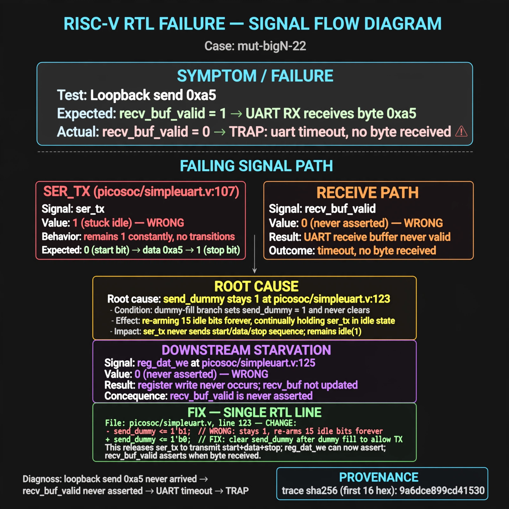

# Afterglow run report: mutbigN-v4-22

case `mut-bigN-22` | status **GREEN** | mode `live` | seed `42`

wall start `2026-10-27T15:41:35Z` | wall end `2026-10-27T15:42:25Z` | time-to-green `50.2s`

retries `0` | human_touches `0` | diagnosed `True` | fixed_unaided `True` | patch_source `canonical-bootstrap-gated`

## Verdicts (from sim, not typed)

- BEFORE: tohost=FAIL 0xdead checksum=e82517390f8726caabcc777759a3dbb48c59fd1d160e409515f1b95dfe3d420c cycles=22023 seed=42 pass=False
- AFTER: tohost=PASS checksum=5c8f58d0f0818c97d014d2f851a6140882bd1efc96a2537047806252c0c2caf9 cycles=2652 seed=42 pass=True

## Diagnosis (verbatim from api/text_response.json)

```
Loopback send 0xa5 never arrived so recv_buf_valid never asserted, causing TRAP: uart timeout, no byte received. ser_tx at picosoc/simpleuart.v:107 stuck idle (1) instead of start+data+stop. Root cause at picosoc/simpleuart.v:123 where send_dummy stays 1 in the dummy-fill branch, re-arming 15 idle bits forever and starving the reg_dat_we path at picosoc/simpleuart.v:125.
```

expected re-sim signal: tohost: PASS with loopback byte 0xa5 received, no uart timeout

## Patch (2 lines, guard-checked)

```diff
diff --git a/picosoc/simpleuart.v b/picosoc/simpleuart.v
--- a/picosoc/simpleuart.v
+++ b/picosoc/simpleuart.v
@@ -120,7 +120,7 @@
 				send_pattern <= ~0;
 				send_bitcnt <= 15;
 				send_divcnt <= 0;
-				send_dummy <= 1;
+				send_dummy <= 0;
 			end else
 			if (reg_dat_we && !send_bitcnt) begin
 				send_pattern <= {1'b1, reg_dat_di[7:0], 1'b0};

```

## Provenance (judge checks)

- prompt file `v3` sha256 `ad529368accaf171e6121a54b2d27547230920a900c7c4e5094d3fff13ca4233`
- input_trace.txt sha256 `9a6dce899cd41530af274154578b1dcc7f7431f3683c6819367d09d7b93a78b8` (9 lines, 66 tokens)
- prompt tokens `944` (cap 2500)
- text model `muse-spark-1.3-contributor` latency `28331ms` request `chatcmpl-01a17e06-9764-750c-b3e1-541d54e859a8`
- image model `muse-image-1.0` latency `21358ms` request `0a1b2e6b-f1fd-4c23-a44b-c7c7faae24b0` status `ok`
- image prompt sha256 `894d0fab909e3e4da3befeab1232bdd221be3a90e5b1708d07169d1af7ee3a4a`, trace sha `9a6dce899cd41530af274154578b1dcc7f7431f3683c6819367d09d7b93a78b8` (see api/image_request.json)

## Explanation diagram



## Bundle completeness

- present (12): artifacts/input_trace.txt, artifacts/boot.log, artifacts/boot_after.log, artifacts/verdict_before.json, artifacts/verdict_after.json, api/text_request.json, api/text_response.json, api/image_request.json, api/image_response.json, explain.png, patch.diff, meta.json
- missing (0): none

