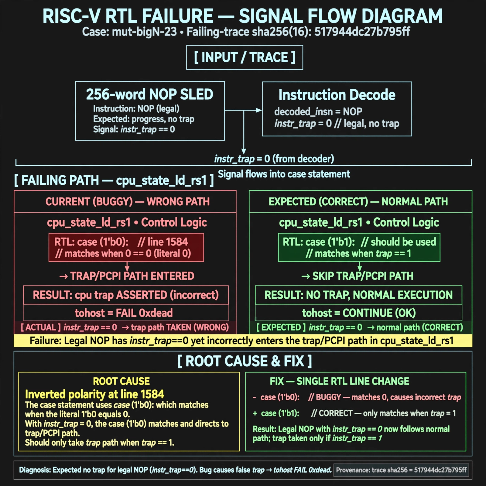

# Afterglow run report: mutbigN-v4-23

case `mut-bigN-23` | status **GREEN** | mode `live` | seed `42`

wall start `2026-10-27T15:42:25Z` | wall end `2026-10-27T15:44:03Z` | time-to-green `98.1s`

retries `0` | human_touches `0` | diagnosed `True` | fixed_unaided `True` | patch_source `model-verbatim`

## Verdicts (from sim, not typed)

- BEFORE: tohost=FAIL 0xdead checksum=c2a7a4d6295484feeb9ec1ea9381732b8e39a7ccd1997c7d70f6454da2fb4659 cycles=2009 seed=42 pass=False
- AFTER: tohost=PASS checksum=5c28238265cb94168311e9914f0df355642c557d04dba11845d557ac8a64aa4a cycles=2009 seed=42 pass=True

## Diagnosis (verbatim from api/text_response.json)

```
Trace shows 256-word NOP sled expecting progress with no trap, but reports TRAP: cpu trap asserted and tohost FAIL 0xdead. Legal NOP has instr_trap==0 yet incorrectly enters the trap/PCPI path in cpu_state_ld_rs1. Root cause in excerpt is inverted polarity at line 1584: case (1'b0) matches 0==0 for legal insns instead of case (1'b1) for trap==1.
```

expected re-sim signal: tohost PASS, no TRAP: cpu trap asserted, fetch progress through NOP mem completes

## Patch (2 lines, guard-checked)

```diff
diff --git a/picorv32.v b/picorv32.v
--- a/picorv32.v
+++ b/picorv32.v
@@ -1583,3 +1583,3 @@
 				(* parallel_case *)
-				case (1'b0)
+				case (1'b1)
 					(CATCH_ILLINSN || WITH_PCPI) && instr_trap: begin

```

## Provenance (judge checks)

- prompt file `v3` sha256 `ad529368accaf171e6121a54b2d27547230920a900c7c4e5094d3fff13ca4233`
- input_trace.txt sha256 `517944dc27b795ffa6ec69b5f4109b5c050bf4d4bb9935d25dcb99f6123fe2af` (9 lines, 69 tokens)
- prompt tokens `945` (cap 2500)
- text model `muse-spark-1.3-contributor` latency `67104ms` request `chatcmpl-01a17e07-f382-76e2-b5f5-f9ef60fee1ab`
- image model `muse-image-1.0` latency `30342ms` request `9d09ff58-b7c9-4e95-a057-58021b39e1b4` status `ok`
- image prompt sha256 `ef5f1becc11898acbd4b7c724f2a23b627a53ede54f19dc992a2cc14c97d205e`, trace sha `517944dc27b795ffa6ec69b5f4109b5c050bf4d4bb9935d25dcb99f6123fe2af` (see api/image_request.json)

## Explanation diagram



## Bundle completeness

- present (12): artifacts/input_trace.txt, artifacts/boot.log, artifacts/boot_after.log, artifacts/verdict_before.json, artifacts/verdict_after.json, api/text_request.json, api/text_response.json, api/image_request.json, api/image_response.json, explain.png, patch.diff, meta.json
- missing (0): none

