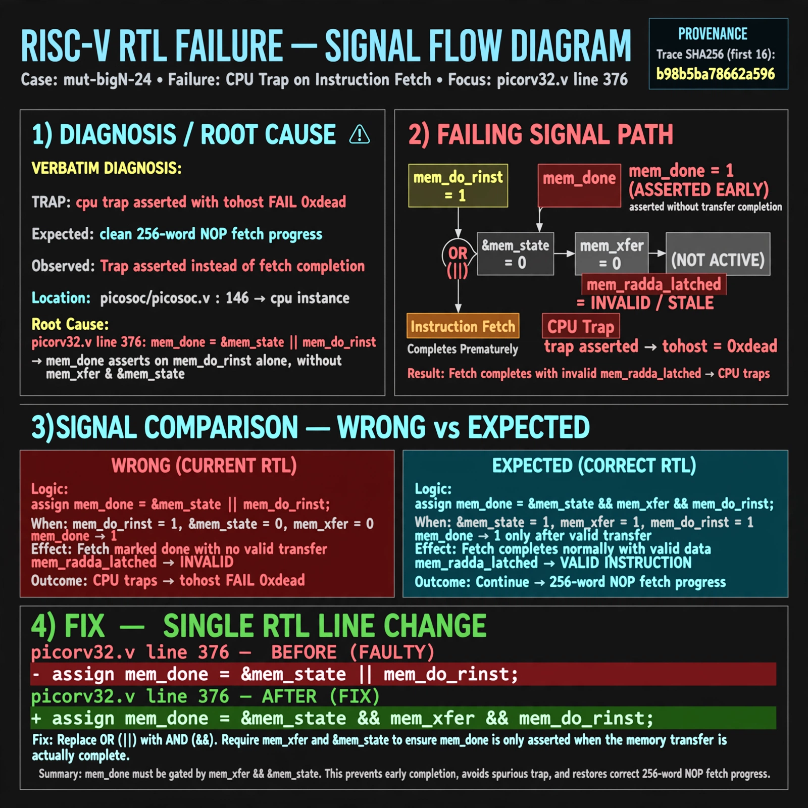

# Afterglow run report: mutbigN-v4-24

case `mut-bigN-24` | status **GREEN** | mode `live` | seed `42`

wall start `2026-10-27T15:44:03Z` | wall end `2026-10-27T15:47:12Z` | time-to-green `188.7s`

retries `0` | human_touches `0` | diagnosed `True` | fixed_unaided `True` | patch_source `model-verbatim`

## Verdicts (from sim, not typed)

- BEFORE: tohost=FAIL 0xdead checksum=c2a7a4d6295484feeb9ec1ea9381732b8e39a7ccd1997c7d70f6454da2fb4659 cycles=2009 seed=42 pass=False
- AFTER: tohost=PASS checksum=5c28238265cb94168311e9914f0df355642c557d04dba11845d557ac8a64aa4a cycles=2009 seed=42 pass=True

## Diagnosis (verbatim from api/text_response.json)

```
TRAP: cpu trap asserted with tohost FAIL 0xdead instead of clean 256-word NOP fetch progress (see picosoc/picosoc.v:146 cpu instance, VERDICT FAIL 0xdead). Root cause is picorv32.v line 376 mem_done term (&mem_state || mem_do_rinst) asserting mem_done on mem_do_rinst alone without mem_xfer and &mem_state, so instruction fetch completes with invalid mem_rdata_latched and traps.
```

expected re-sim signal: tohost PASS with no TRAP: cpu trap asserted, 256-word NOP sweep completes

## Patch (2 lines, guard-checked)

```diff
diff --git a/picorv32.v b/picorv32.v
--- a/picorv32.v
+++ b/picorv32.v
@@ -375,3 +375,3 @@
 	wire mem_busy = |{mem_do_prefetch, mem_do_rinst, mem_do_rdata, mem_do_wdata};
-	wire mem_done = resetn && ((mem_xfer && |mem_state && (mem_do_rinst || mem_do_rdata || mem_do_wdata)) || (&mem_state || mem_do_rinst)) &&
+	wire mem_done = resetn && ((mem_xfer && |mem_state && (mem_do_rinst || mem_do_rdata || mem_do_wdata)) || (&mem_state && mem_do_rinst)) &&
 			(!mem_la_firstword || (~&mem_rdata_latched[1:0] && mem_xfer));

```

## Provenance (judge checks)

- prompt file `v3` sha256 `ad529368accaf171e6121a54b2d27547230920a900c7c4e5094d3fff13ca4233`
- input_trace.txt sha256 `b98b5ba78662a596366022bb8066b68e4cd42bf4b5af2bdaa027f6498be07b11` (9 lines, 69 tokens)
- prompt tokens `1029` (cap 2500)
- text model `muse-spark-1.3-contributor` latency `56706ms` request `chatcmpl-01a17e0a-b3ee-707e-9743-8a225b6bcbe1`
- image model `muse-image-1.0` latency `38713ms` request `3081358e-7874-4faa-815a-01d79aaa5ad7` status `ok`
- image prompt sha256 `d5c7f573006787008d74bef90fd1561e09de0069d846fc456197babcd220a36f`, trace sha `b98b5ba78662a596366022bb8066b68e4cd42bf4b5af2bdaa027f6498be07b11` (see api/image_request.json)

## Explanation diagram



## Bundle completeness

- present (12): artifacts/input_trace.txt, artifacts/boot.log, artifacts/boot_after.log, artifacts/verdict_before.json, artifacts/verdict_after.json, api/text_request.json, api/text_response.json, api/image_request.json, api/image_response.json, explain.png, patch.diff, meta.json
- missing (0): none

