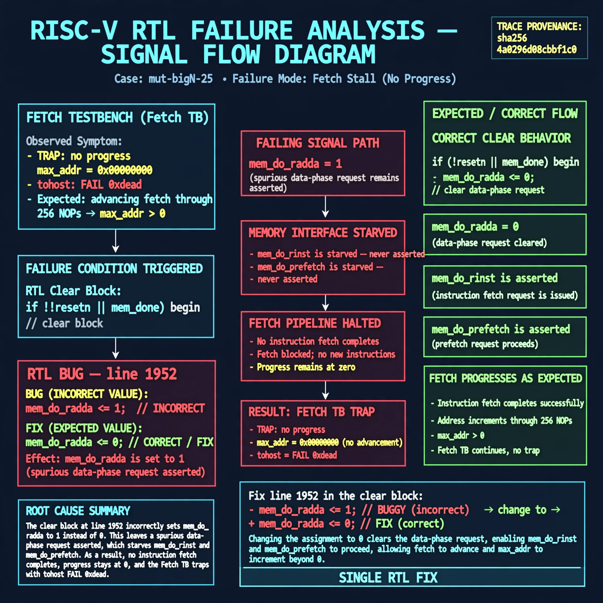

# Afterglow run report: mutbigN-v4-25

case `mut-bigN-25` | status **GREEN** | mode `live` | seed `42`

wall start `2026-10-27T15:47:12Z` | wall end `2026-10-27T15:48:41Z` | time-to-green `89.0s`

retries `0` | human_touches `0` | diagnosed `True` | fixed_unaided `True` | patch_source `model-verbatim`

## Verdicts (from sim, not typed)

- BEFORE: tohost=FAIL 0xdead checksum=563b7c10626ff25de2b3c430956c7c113e448c4efaea068f9b83a198d4322b15 cycles=2009 seed=42 pass=False
- AFTER: tohost=PASS checksum=5c28238265cb94168311e9914f0df355642c557d04dba11845d557ac8a64aa4a cycles=2009 seed=42 pass=True

## Diagnosis (verbatim from api/text_response.json)

```
Fetch TB traps `TRAP: no progress max_addr=0x00000000` with `tohost: FAIL 0xdead` vs expected advancing fetch through 256 NOPs (max_addr>0). Excerpt line 1952 in the `if (!resetn || mem_done)` clear block sets `mem_do_rdata <= 1` instead of 0, leaving a spurious data-phase request asserted. That starves `mem_do_rinst`/`mem_do_prefetch` so no instruction fetch completes and progress stays at zero.
```

expected re-sim signal: tohost PASS, no TRAP: no progress, max_addr != 0x00000000

## Patch (2 lines, guard-checked)

```diff
diff --git a/picorv32.v b/picorv32.v
--- a/picorv32.v
+++ b/picorv32.v
@@ -1949,7 +1949,7 @@
 		if (!resetn || mem_done) begin
 			mem_do_prefetch <= 0;
 			mem_do_rinst <= 0;
-			mem_do_rdata <= 1;
+			mem_do_rdata <= 0;
 			mem_do_wdata <= 0;
 		end

```

## Provenance (judge checks)

- prompt file `v3` sha256 `ad529368accaf171e6121a54b2d27547230920a900c7c4e5094d3fff13ca4233`
- input_trace.txt sha256 `4a0296d08cbbf1c0d754234f798af918c5ecbedacb3d292a289464cfc569a62b` (9 lines, 69 tokens)
- prompt tokens `714` (cap 2500)
- text model `muse-spark-1.3-contributor` latency `22454ms` request `chatcmpl-01a17e0b-a5d1-776f-a1bf-852750c492ab`
- image model `muse-image-1.0` latency `65912ms` request `3c877acc-0fd8-43ee-a094-27b689f1c999` status `ok`
- image prompt sha256 `326042e00066ce06701a3bc65daacdaab24374053f1f9e0b2933162fda4e2d9f`, trace sha `4a0296d08cbbf1c0d754234f798af918c5ecbedacb3d292a289464cfc569a62b` (see api/image_request.json)

## Explanation diagram



## Bundle completeness

- present (12): artifacts/input_trace.txt, artifacts/boot.log, artifacts/boot_after.log, artifacts/verdict_before.json, artifacts/verdict_after.json, api/text_request.json, api/text_response.json, api/image_request.json, api/image_response.json, explain.png, patch.diff, meta.json
- missing (0): none

