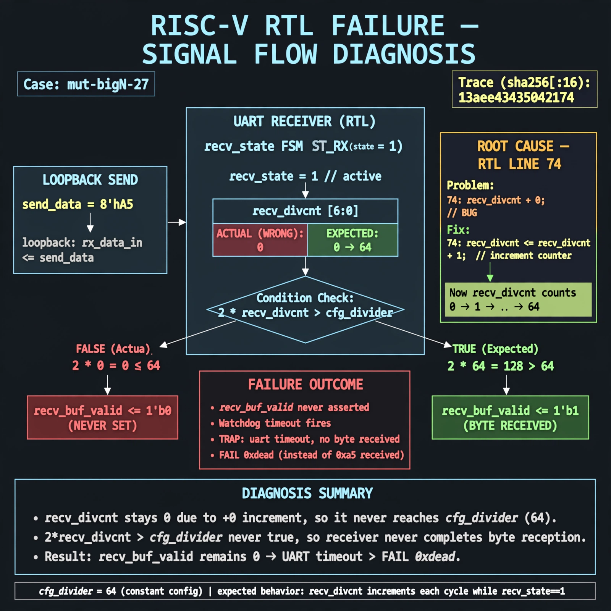

# Afterglow run report: mutbigN-v4-27

case `mut-bigN-27` | status **GREEN** | mode `live` | seed `42`

wall start `2026-10-27T15:50:18Z` | wall end `2026-10-27T15:50:55Z` | time-to-green `37.7s`

retries `0` | human_touches `0` | diagnosed `True` | fixed_unaided `True` | patch_source `model-verbatim`

## Verdicts (from sim, not typed)

- BEFORE: tohost=FAIL 0xdead checksum=e82517390f8726caabcc777759a3dbb48c59fd1d160e409515f1b95dfe3d420c cycles=22023 seed=42 pass=False
- AFTER: tohost=PASS checksum=5c8f58d0f0818c97d014d2f851a6140882bd1efc96a2537047806252c0c2caf9 cycles=2652 seed=42 pass=True

## Diagnosis (verbatim from api/text_response.json)

```
Loopback send 0xa5 never sets recv_buf_valid, causing `TRAP: uart timeout, no byte received` and `FAIL 0xdead` instead of a received byte. Expected recv_divcnt to count up to cfg_divider (64) to leave recv_state 1, but it stays 0. Root cause in excerpt line 74 `recv_divcnt <= recv_divcnt + 0` never increments, so `2*recv_divcnt > cfg_divider` never fires and receiver stalls.
```

expected re-sim signal: tohost PASS (no TRAP: uart timeout), loopback byte 0xa5 received with divider 64

## Patch (2 lines, guard-checked)

```diff
diff --git a/picosoc/simpleuart.v b/picosoc/simpleuart.v
--- a/picosoc/simpleuart.v
+++ b/picosoc/simpleuart.v
@@ -71,7 +71,7 @@
 			recv_buf_data <= 0;
 			recv_buf_valid <= 0;
 		end else begin
-			recv_divcnt <= recv_divcnt + 0;
+			recv_divcnt <= recv_divcnt + 1;
 			if (reg_dat_re)
 				recv_buf_valid <= 0;
 			case (recv_state)

```

## Provenance (judge checks)

- prompt file `v3` sha256 `ad529368accaf171e6121a54b2d27547230920a900c7c4e5094d3fff13ca4233`
- input_trace.txt sha256 `13aee43435042174d524cf9ed44de1cf2483d0f8556f3b3fe20610177ffee711` (9 lines, 66 tokens)
- prompt tokens `949` (cap 2500)
- text model `muse-spark-1.3-contributor` latency `22319ms` request `chatcmpl-01a17e0e-7b34-7005-9a14-2887ed60f663`
- image model `muse-image-1.0` latency `14886ms` request `13a886a4-e992-4aeb-9f5f-d012a40a3cbe` status `ok`
- image prompt sha256 `19cfe2ecb9cfdca8427ffb163a51f078d58043e03e94837998d0465b2fcb736e`, trace sha `13aee43435042174d524cf9ed44de1cf2483d0f8556f3b3fe20610177ffee711` (see api/image_request.json)

## Explanation diagram



## Bundle completeness

- present (12): artifacts/input_trace.txt, artifacts/boot.log, artifacts/boot_after.log, artifacts/verdict_before.json, artifacts/verdict_after.json, api/text_request.json, api/text_response.json, api/image_request.json, api/image_response.json, explain.png, patch.diff, meta.json
- missing (0): none

