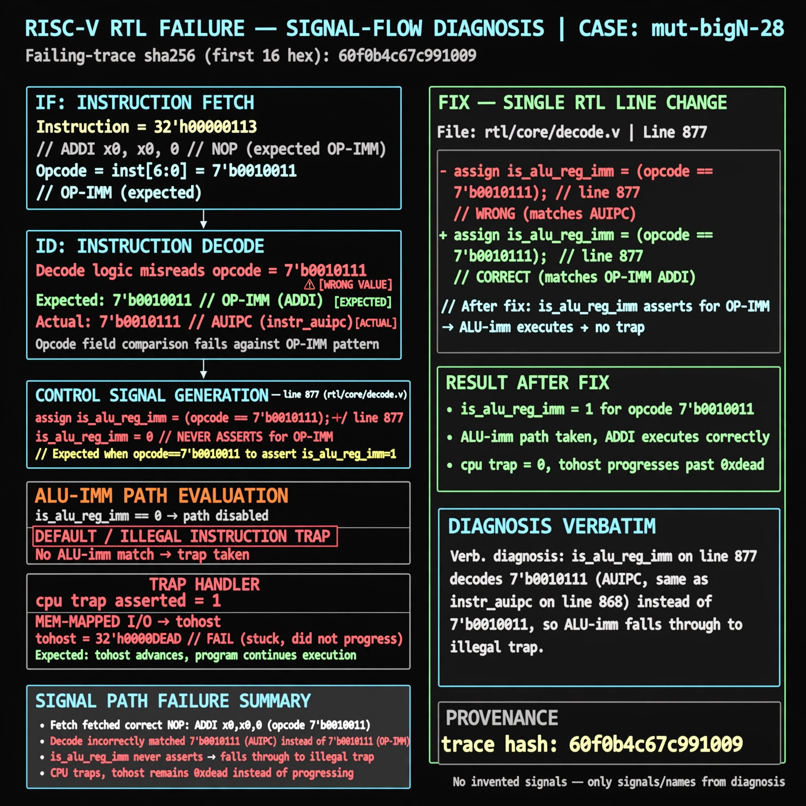

# Afterglow run report: mutbigN-v4-28

case `mut-bigN-28` | status **GREEN** | mode `live` | seed `42`

wall start `2026-10-27T15:50:56Z` | wall end `2026-10-27T15:51:53Z` | time-to-green `57.7s`

retries `0` | human_touches `0` | diagnosed `True` | fixed_unaided `True` | patch_source `model-verbatim`

## Verdicts (from sim, not typed)

- BEFORE: tohost=FAIL 0xdead checksum=c2a7a4d6295484feeb9ec1ea9381732b8e39a7ccd1997c7d70f6454da2fb4659 cycles=2009 seed=42 pass=False
- AFTER: tohost=PASS checksum=5c28238265cb94168311e9914f0df355642c557d04dba11845d557ac8a64aa4a cycles=2009 seed=42 pass=True

## Diagnosis (verbatim from api/text_response.json)

```
Fetch of NOP (ADDI x0,x0,0, opcode 0010011) asserted TRAP: cpu trap asserted and tohost stayed FAIL 0xdead instead of progressing. is_alu_reg_imm on line 877 never asserts for OP-IMM because it decodes 7'b0010111 (AUIPC, same as instr_auipc on line 868) instead of 7'b0010011, so ALU-imm falls through to illegal trap.
```

expected re-sim signal: tohost PASS with no TRAP: cpu trap asserted on NOP fetch sequence

## Patch (2 lines, guard-checked)

```diff
diff --git a/picorv32.v b/picorv32.v
--- a/picorv32.v
+++ b/picorv32.v
@@ -874,6 +874,6 @@
 			is_beq_bne_blt_bge_bltu_bgeu <= mem_rdata_latched[6:0] == 7'b1100011;
 			is_lb_lh_lw_lbu_lhu          <= mem_rdata_latched[6:0] == 7'b0000011;
 			is_sb_sh_sw                  <= mem_rdata_latched[6:0] == 7'b0100011;
-			is_alu_reg_imm               <= mem_rdata_latched[6:0] == 7'b0010111;
+			is_alu_reg_imm               <= mem_rdata_latched[6:0] == 7'b0010011;
 			is_alu_reg_reg               <= mem_rdata_latched[6:0] == 7'b0110011;

```

## Provenance (judge checks)

- prompt file `v3` sha256 `ad529368accaf171e6121a54b2d27547230920a900c7c4e5094d3fff13ca4233`
- input_trace.txt sha256 `60f0b4c67c991009098cc385c037945559b0912213bd411969b08d575ad43bec` (9 lines, 69 tokens)
- prompt tokens `1016` (cap 2500)
- text model `muse-spark-1.3-contributor` latency `26909ms` request `chatcmpl-01a17e0f-20df-7672-bae3-f2345a0f24a7`
- image model `muse-image-1.0` latency `30126ms` request `613826da-0a26-4033-8f6e-504d588cc89b` status `ok`
- image prompt sha256 `0b87e30a14feb2e7f8e0bdcc8227294ba97950e3cf0a181ae4bc7e6c4ffa29d6`, trace sha `60f0b4c67c991009098cc385c037945559b0912213bd411969b08d575ad43bec` (see api/image_request.json)

## Explanation diagram



## Bundle completeness

- present (12): artifacts/input_trace.txt, artifacts/boot.log, artifacts/boot_after.log, artifacts/verdict_before.json, artifacts/verdict_after.json, api/text_request.json, api/text_response.json, api/image_request.json, api/image_response.json, explain.png, patch.diff, meta.json
- missing (0): none

