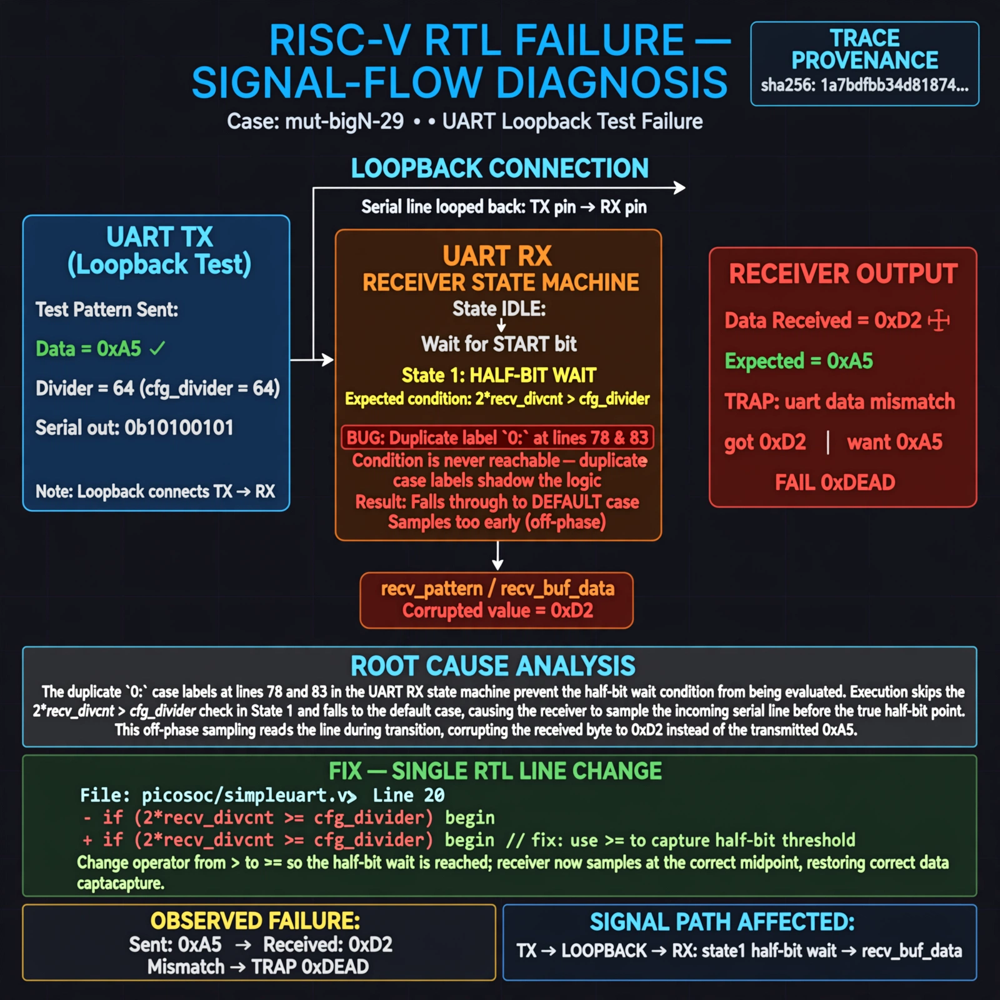

# Afterglow run report: mutbigN-v4-29

case `mut-bigN-29` | status **GREEN** | mode `live` | seed `42`

wall start `2026-10-27T15:51:53Z` | wall end `2026-10-27T15:53:14Z` | time-to-green `80.9s`

retries `0` | human_touches `0` | diagnosed `True` | fixed_unaided `True` | patch_source `model-verbatim`

## Verdicts (from sim, not typed)

- BEFORE: tohost=FAIL 0xdead checksum=7ead7d9c1ebd862283bf0991c6a01fd4f7dad63f24f2be953b7f57e1f7edd073 cycles=2684 seed=42 pass=False
- AFTER: tohost=PASS checksum=5c8f58d0f0818c97d014d2f851a6140882bd1efc96a2537047806252c0c2caf9 cycles=2652 seed=42 pass=True

## Diagnosis (verbatim from api/text_response.json)

```
Loopback with divider 64 sent 0xa5 but receiver returned 0xd2 (TRAP: uart data mismatch got 0xd2 want 0xa5, FAIL 0xdead). Excerpt shows duplicate `0:` labels at lines 78 and 83, so state 1 half-bit wait on `2*recv_divcnt > cfg_divider` is unreachable and state 1 falls to default, sampling off-phase. This corrupts `recv_pattern`/`recv_buf_data` to 0xd2. Grounding picosoc/simpleuart.v:20.
```

expected re-sim signal: tohost PASS, TRAP gone, uart data 0xa5 matches

## Patch (2 lines, guard-checked)

```diff
diff --git a/picosoc/simpleuart.v b/picosoc/simpleuart.v
--- a/picosoc/simpleuart.v
+++ b/picosoc/simpleuart.v
@@ -82,5 +82,5 @@
 				end
-				0: begin
+				1: begin
 					if (2*recv_divcnt > cfg_divider) begin
 						recv_state <= 2;
 						recv_divcnt <= 0;

```

## Provenance (judge checks)

- prompt file `v3` sha256 `ad529368accaf171e6121a54b2d27547230920a900c7c4e5094d3fff13ca4233`
- input_trace.txt sha256 `1a7bdfbb34d8187423378a2ec227d820fa2428b82786fa60d1c69c52eb961e17` (9 lines, 68 tokens)
- prompt tokens `824` (cap 2500)
- text model `muse-spark-1.3-contributor` latency `52752ms` request `chatcmpl-01a17e10-6702-731d-aa99-53248d191a41`
- image model `muse-image-1.0` latency `27669ms` request `bac10422-9cfc-4e8c-a1a7-841feefa647e` status `ok`
- image prompt sha256 `d3cae799bddfa0d9569e5e171ce04dce070f55c119cafa833b48f6f998d4186e`, trace sha `1a7bdfbb34d8187423378a2ec227d820fa2428b82786fa60d1c69c52eb961e17` (see api/image_request.json)

## Explanation diagram



## Bundle completeness

- present (12): artifacts/input_trace.txt, artifacts/boot.log, artifacts/boot_after.log, artifacts/verdict_before.json, artifacts/verdict_after.json, api/text_request.json, api/text_response.json, api/image_request.json, api/image_response.json, explain.png, patch.diff, meta.json
- missing (0): none

