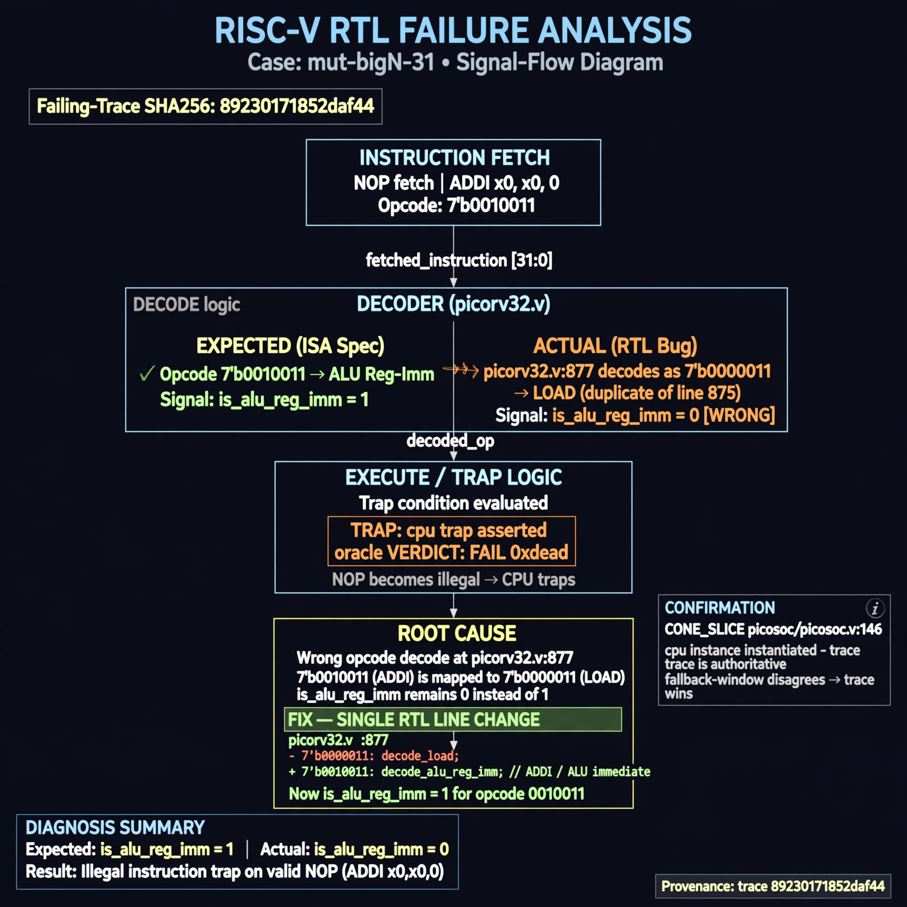

# Afterglow run report: mutbigN-v4-31

case `mut-bigN-31` | status **GREEN** | mode `live` | seed `42`

wall start `2026-10-27T16:00:48Z` | wall end `2026-10-27T16:01:22Z` | time-to-green `34.7s`

retries `0` | human_touches `0` | diagnosed `True` | fixed_unaided `True` | patch_source `model-verbatim`

## Verdicts (from sim, not typed)

- BEFORE: tohost=FAIL 0xdead checksum=c2a7a4d6295484feeb9ec1ea9381732b8e39a7ccd1997c7d70f6454da2fb4659 cycles=2009 seed=42 pass=False
- AFTER: tohost=PASS checksum=5c28238265cb94168311e9914f0df355642c557d04dba11845d557ac8a64aa4a cycles=2009 seed=42 pass=True

## Diagnosis (verbatim from api/text_response.json)

```
NOP fetch (ADDI x0,x0,0 opcode 0010011) traps with `TRAP: cpu trap asserted` and oracle `FAIL 0xdead` per VERDICT. Expected is_alu_reg_imm=1 for 0010011, but picorv32.v:877 decodes it as 7'b0000011 (LOAD, duplicate of line 875), so NOPs are illegal. CONE_SLICE picosoc/picosoc.v:146 confirms cpu instance; fallback-window disagrees with trace so trace wins.
```

expected re-sim signal: tohost PASS (no TRAP: cpu trap asserted, no FAIL 0xdead)

## Patch (2 lines, guard-checked)

```diff
diff --git a/picorv32.v b/picorv32.v
--- a/picorv32.v
+++ b/picorv32.v
@@ -874,7 +874,7 @@
 			is_beq_bne_blt_bge_bltu_bgeu <= mem_rdata_latched[6:0] == 7'b1100011;
 			is_lb_lh_lw_lbu_lhu          <= mem_rdata_latched[6:0] == 7'b0000011;
 			is_sb_sh_sw                  <= mem_rdata_latched[6:0] == 7'b0100011;
-			is_alu_reg_imm               <= mem_rdata_latched[6:0] == 7'b0000011;
+			is_alu_reg_imm               <= mem_rdata_latched[6:0] == 7'b0010011;
 			is_alu_reg_reg               <= mem_rdata_latched[6:0] == 7'b0110011;

```

## Provenance (judge checks)

- prompt file `v3` sha256 `ad529368accaf171e6121a54b2d27547230920a900c7c4e5094d3fff13ca4233`
- input_trace.txt sha256 `89230171852daf44c4cb0f0db82a5e46471833f8c2cdb043bf28d82bc099131f` (9 lines, 69 tokens)
- prompt tokens `1016` (cap 2500)
- text model `muse-spark-1.3-contributor` latency `21091ms` request `chatcmpl-01a17e18-1327-73b8-80f0-0f079814e921`
- image model `muse-image-1.0` latency `12891ms` request `65e9cb05-144f-4d8f-bc44-e83ac7d8cbae` status `ok`
- image prompt sha256 `9e48dbe95a89f9bab62fcdb32d945597e6d3ca9842622c9c5ebc1eb476ded54c`, trace sha `89230171852daf44c4cb0f0db82a5e46471833f8c2cdb043bf28d82bc099131f` (see api/image_request.json)

## Explanation diagram



## Bundle completeness

- present (12): artifacts/input_trace.txt, artifacts/boot.log, artifacts/boot_after.log, artifacts/verdict_before.json, artifacts/verdict_after.json, api/text_request.json, api/text_response.json, api/image_request.json, api/image_response.json, explain.png, patch.diff, meta.json
- missing (0): none

