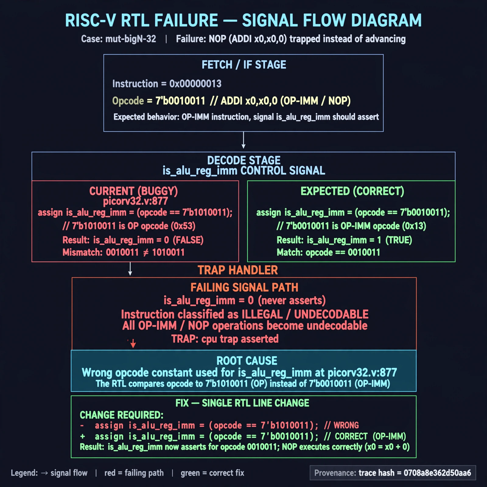

# Afterglow run report: mutbigN-v4-32

case `mut-bigN-32` | status **GREEN** | mode `live` | seed `42`

wall start `2026-10-27T16:01:22Z` | wall end `2026-10-27T16:02:15Z` | time-to-green `52.6s`

retries `0` | human_touches `0` | diagnosed `True` | fixed_unaided `True` | patch_source `model-verbatim`

## Verdicts (from sim, not typed)

- BEFORE: tohost=FAIL 0xdead checksum=c2a7a4d6295484feeb9ec1ea9381732b8e39a7ccd1997c7d70f6454da2fb4659 cycles=2009 seed=42 pass=False
- AFTER: tohost=PASS checksum=5c28238265cb94168311e9914f0df355642c557d04dba11845d557ac8a64aa4a cycles=2009 seed=42 pass=True

## Diagnosis (verbatim from api/text_response.json)

```
256-word NOP (ADDI x0,x0,0, opcode 0010011) fetch traps with `TRAP: cpu trap asserted` and `FAIL 0xdead` instead of advancing. Expected `is_alu_reg_imm` to assert for opcode 0010011, but picorv32.v:877 compares to 7'b1010011 so it never asserts. Root cause is wrong opcode constant for `is_alu_reg_imm`, leaving all OP-IMM/NOP undecodable and causing illegal-instruction trap.
```

expected re-sim signal: tohost PASS (FAIL 0xdead cleared) with no TRAP: cpu trap asserted

## Patch (2 lines, guard-checked)

```diff
diff --git a/picorv32.v b/picorv32.v
--- a/picorv32.v
+++ b/picorv32.v
@@ -874,6 +874,6 @@
 			is_beq_bne_blt_bge_bltu_bgeu <= mem_rdata_latched[6:0] == 7'b1100011;
 			is_lb_lh_lw_lbu_lhu          <= mem_rdata_latched[6:0] == 7'b0000011;
 			is_sb_sh_sw                  <= mem_rdata_latched[6:0] == 7'b0100011;
-			is_alu_reg_imm               <= mem_rdata_latched[6:0] == 7'b1010011;
+			is_alu_reg_imm               <= mem_rdata_latched[6:0] == 7'b0010011;
 			is_alu_reg_reg               <= mem_rdata_latched[6:0] == 7'b0110011;

```

## Provenance (judge checks)

- prompt file `v3` sha256 `ad529368accaf171e6121a54b2d27547230920a900c7c4e5094d3fff13ca4233`
- input_trace.txt sha256 `0708a8e362d50aa6dd1ebf9372172247c23a214a32d676e817ebe8742f39a304` (9 lines, 69 tokens)
- prompt tokens `1016` (cap 2500)
- text model `muse-spark-1.3-contributor` latency `30784ms` request `chatcmpl-01a17e18-c0fa-71ae-a77b-da40ceafbbfa`
- image model `muse-image-1.0` latency `21178ms` request `6f7cbcec-a1e6-42c5-b5fb-d5a2ce35df2a` status `ok`
- image prompt sha256 `a372f86ee120e460e156a9447161f74d0c26941c567c4c96fedaea0142a65552`, trace sha `0708a8e362d50aa6dd1ebf9372172247c23a214a32d676e817ebe8742f39a304` (see api/image_request.json)

## Explanation diagram



## Bundle completeness

- present (12): artifacts/input_trace.txt, artifacts/boot.log, artifacts/boot_after.log, artifacts/verdict_before.json, artifacts/verdict_after.json, api/text_request.json, api/text_response.json, api/image_request.json, api/image_response.json, explain.png, patch.diff, meta.json
- missing (0): none

