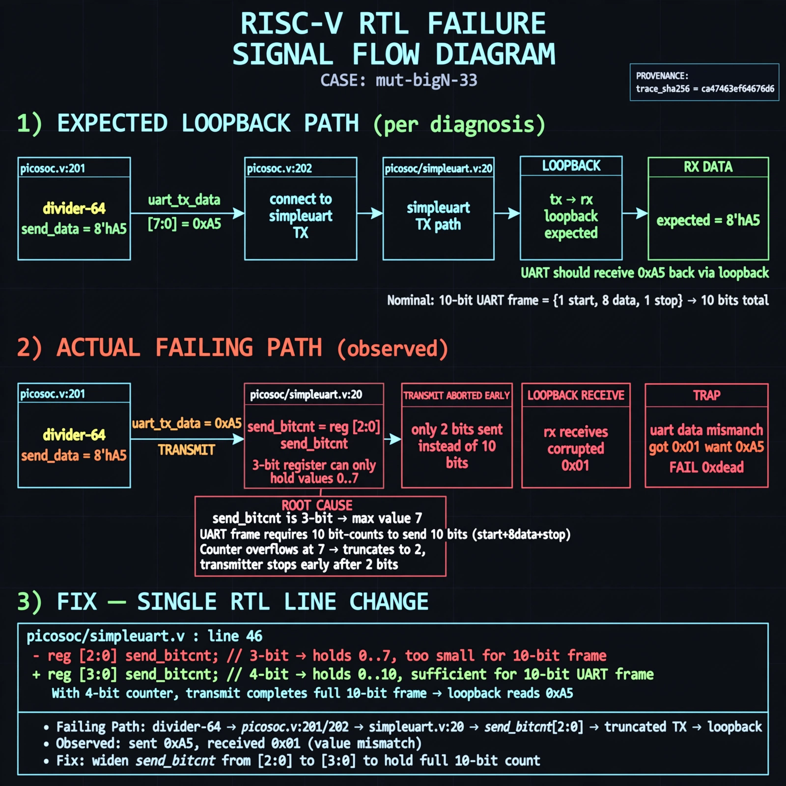

# Afterglow run report: mutbigN-v4-33

case `mut-bigN-33` | status **GREEN** | mode `live` | seed `42`

wall start `2026-10-27T16:02:15Z` | wall end `2026-10-27T16:03:14Z` | time-to-green `58.7s`

retries `0` | human_touches `0` | diagnosed `True` | fixed_unaided `True` | patch_source `model-verbatim`

## Verdicts (from sim, not typed)

- BEFORE: tohost=FAIL 0xdead checksum=b6e0169fb7c409f1a6e23cdf77f846d41e48405df0444f0d3c56f6ec28770cef cycles=2652 seed=42 pass=False
- AFTER: tohost=PASS checksum=5c8f58d0f0818c97d014d2f851a6140882bd1efc96a2537047806252c0c2caf9 cycles=2652 seed=42 pass=True

## Diagnosis (verbatim from api/text_response.json)

```
Loopback divider-64 send 0xa5 was read back as 0x01 per `TRAP: uart data mismatch got 0x01 want 0xa5`, yielding `FAIL 0xdead`. Wiring in picosoc/picosoc.v:201, picosoc/picosoc.v:202 and picosoc/simpleuart.v:20 shows divider/data path into simpleuart, so loopback should match. Root cause in excerpt line 46 is `reg [2:0] send_bitcnt` which cannot hold 10-bit UART frame count and truncates 10 to 2, cutting transmit short and corrupting loopback data to 0x01.
```

expected re-sim signal: tohost PASS (replacing FAIL 0xdead), TRAP gone, uart loopback got 0xa5 want 0xa5

## Patch (2 lines, guard-checked)

```diff
diff --git a/picosoc/simpleuart.v b/picosoc/simpleuart.v
--- a/picosoc/simpleuart.v
+++ b/picosoc/simpleuart.v
@@ -45,4 +45,4 @@
 	reg [9:0] send_pattern;
-	reg [2:0] send_bitcnt;
+	reg [3:0] send_bitcnt;
 	reg [31:0] send_divcnt;
 	reg send_dummy;

```

## Provenance (judge checks)

- prompt file `v3` sha256 `ad529368accaf171e6121a54b2d27547230920a900c7c4e5094d3fff13ca4233`
- input_trace.txt sha256 `ca47463ef64676d6facb0ace65e4dacc84bfe06d496739713f6992c9a20071bb` (9 lines, 68 tokens)
- prompt tokens `816` (cap 2500)
- text model `muse-spark-1.3-contributor` latency `37166ms` request `chatcmpl-01a17e19-a757-76d7-a8cb-2c93a69b4f94`
- image model `muse-image-1.0` latency `20982ms` request `664a52bb-8aad-4cda-8ea8-4fa67f99eaf2` status `ok`
- image prompt sha256 `de4e3fcbb55e94df1724df9f115bac39a392997b81e05137265e34ed0b162769`, trace sha `ca47463ef64676d6facb0ace65e4dacc84bfe06d496739713f6992c9a20071bb` (see api/image_request.json)

## Explanation diagram



## Bundle completeness

- present (12): artifacts/input_trace.txt, artifacts/boot.log, artifacts/boot_after.log, artifacts/verdict_before.json, artifacts/verdict_after.json, api/text_request.json, api/text_response.json, api/image_request.json, api/image_response.json, explain.png, patch.diff, meta.json
- missing (0): none

