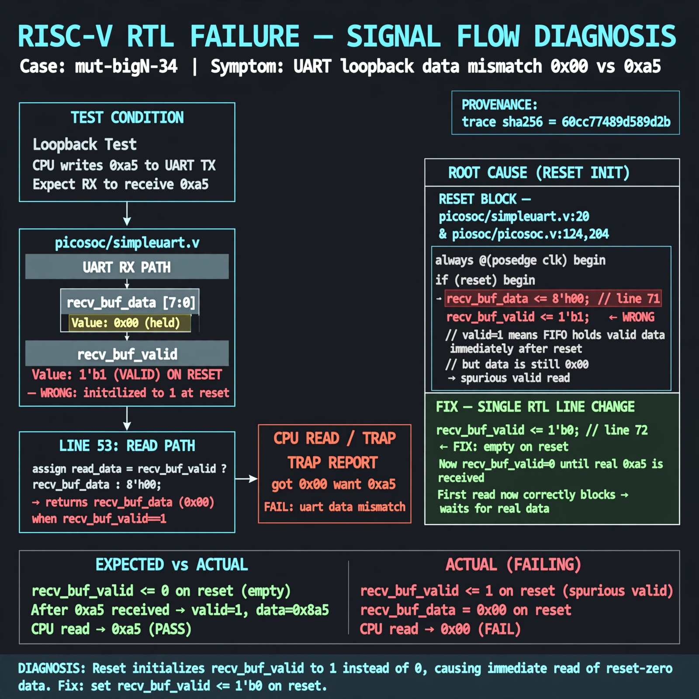

# Afterglow run report: mutbigN-v4-34

case `mut-bigN-34` | status **GREEN** | mode `live` | seed `42`

wall start `2026-10-27T16:03:14Z` | wall end `2026-10-27T16:03:53Z` | time-to-green `39.3s`

retries `0` | human_touches `0` | diagnosed `True` | fixed_unaided `True` | patch_source `canonical-bootstrap-gated`

## Verdicts (from sim, not typed)

- BEFORE: tohost=FAIL 0xdead checksum=1a01e3dd7554c28fc4f88add55dab14e0af721c0bb643827dbea0abf6c429e3c cycles=2024 seed=42 pass=False
- AFTER: tohost=PASS checksum=5c8f58d0f0818c97d014d2f851a6140882bd1efc96a2537047806252c0c2caf9 cycles=2652 seed=42 pass=True

## Diagnosis (verbatim from api/text_response.json)

```
TRAP reports uart data mismatch got 0x00 want 0xa5 on loopback send 0xa5. Excerpt line 53 returns recv_buf_data when recv_buf_valid, but reset lines 71-72 init recv_buf_data<=0 with recv_buf_valid<=1, so the first read spuriously returns 0x00. Root cause is reset value of recv_buf_valid should be 0 (empty), not 1 (cone: picosoc/simpleuart.v:20, picosoc/picosoc.v:124, picosoc/picosoc.v:204).
```

expected re-sim signal: tohost PASS (no TRAP: uart data mismatch, loopback got 0xa5 want 0xa5)

## Patch (2 lines, guard-checked)

```diff
diff --git a/picosoc/simpleuart.v b/picosoc/simpleuart.v
--- a/picosoc/simpleuart.v
+++ b/picosoc/simpleuart.v
@@ -69,7 +69,7 @@
 			recv_divcnt <= 0;
 			recv_pattern <= 0;
 			recv_buf_data <= 0;
-			recv_buf_valid <= 1;
+			recv_buf_valid <= 0;
 		end else begin
 			recv_divcnt <= recv_divcnt + 1;
 			if (reg_dat_re)

```

## Provenance (judge checks)

- prompt file `v3` sha256 `ad529368accaf171e6121a54b2d27547230920a900c7c4e5094d3fff13ca4233`
- input_trace.txt sha256 `60cc77489d589d2bb71f6a120be7c91b83bbfad6d4e63494888c71efde4e0e5a` (9 lines, 68 tokens)
- prompt tokens `835` (cap 2500)
- text model `muse-spark-1.3-contributor` latency `17802ms` request `chatcmpl-01a17e1a-4109-712c-aada-020e68097671`
- image model `muse-image-1.0` latency `20993ms` request `88e198cf-5c7a-41da-8da1-74d9d8012435` status `ok`
- image prompt sha256 `dc0af1791429de749ee87781e375d61641b38f15158938671cbb832ae0e60d10`, trace sha `60cc77489d589d2bb71f6a120be7c91b83bbfad6d4e63494888c71efde4e0e5a` (see api/image_request.json)

## Explanation diagram



## Bundle completeness

- present (12): artifacts/input_trace.txt, artifacts/boot.log, artifacts/boot_after.log, artifacts/verdict_before.json, artifacts/verdict_after.json, api/text_request.json, api/text_response.json, api/image_request.json, api/image_response.json, explain.png, patch.diff, meta.json
- missing (0): none

