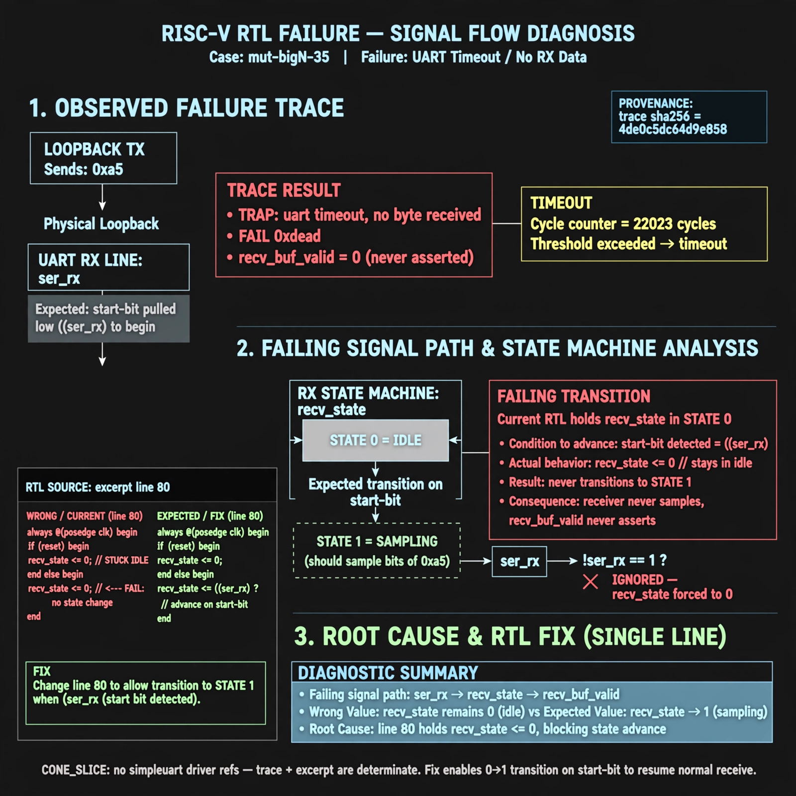

# Afterglow run report: mutbigN-v4-35

case `mut-bigN-35` | status **GREEN** | mode `live` | seed `42`

wall start `2026-10-27T16:03:53Z` | wall end `2026-10-27T16:04:39Z` | time-to-green `45.4s`

retries `0` | human_touches `0` | diagnosed `True` | fixed_unaided `True` | patch_source `model-verbatim`

## Verdicts (from sim, not typed)

- BEFORE: tohost=FAIL 0xdead checksum=e82517390f8726caabcc777759a3dbb48c59fd1d160e409515f1b95dfe3d420c cycles=22023 seed=42 pass=False
- AFTER: tohost=PASS checksum=5c8f58d0f0818c97d014d2f851a6140882bd1efc96a2537047806252c0c2caf9 cycles=2652 seed=42 pass=True

## Diagnosis (verbatim from api/text_response.json)

```
Loopback sends 0xa5 but trace ends with `TRAP: uart timeout, no byte received` and `FAIL 0xdead`, so recv_buf_valid never asserts. Expected state 0 to advance 0->1 on start-bit (!ser_rx) to sample the byte, but excerpt line 80 holds `recv_state <= 0` in state 0 so the receiver stays in idle forever. This stuck-idle transition alone explains the 22023-cycle timeout; CONE_SLICE has no simpleuart driver refs so trace plus excerpt decide.
```

expected re-sim signal: tohost PASS (byte 0xa5 received), no `TRAP: uart timeout, no byte received`

## Patch (2 lines, guard-checked)

```diff
diff --git a/picosoc/simpleuart.v b/picosoc/simpleuart.v
--- a/picosoc/simpleuart.v
+++ b/picosoc/simpleuart.v
@@ -77,7 +77,7 @@
 			case (recv_state)
 				0: begin
 					if (!ser_rx)
-						recv_state <= 0;
+						recv_state <= 1;
 					recv_divcnt <= 0;
 				end

```

## Provenance (judge checks)

- prompt file `v3` sha256 `ad529368accaf171e6121a54b2d27547230920a900c7c4e5094d3fff13ca4233`
- input_trace.txt sha256 `4de0c5dc64d9e858ffc4cb2f153b9b3de73eedbafb656dbe72ae3c1843d2ce81` (9 lines, 66 tokens)
- prompt tokens `954` (cap 2500)
- text model `muse-spark-1.3-contributor` latency `24362ms` request `chatcmpl-01a17e1a-f474-77ad-b93d-6d894ccfadfb`
- image model `muse-image-1.0` latency `20523ms` request `7b085345-18ac-4623-ae8b-3282400da760` status `ok`
- image prompt sha256 `dfb871939e92911933f40b15c673eb8568b4fdabfdfe143dbfed068cd60e3485`, trace sha `4de0c5dc64d9e858ffc4cb2f153b9b3de73eedbafb656dbe72ae3c1843d2ce81` (see api/image_request.json)

## Explanation diagram



## Bundle completeness

- present (12): artifacts/input_trace.txt, artifacts/boot.log, artifacts/boot_after.log, artifacts/verdict_before.json, artifacts/verdict_after.json, api/text_request.json, api/text_response.json, api/image_request.json, api/image_response.json, explain.png, patch.diff, meta.json
- missing (0): none

